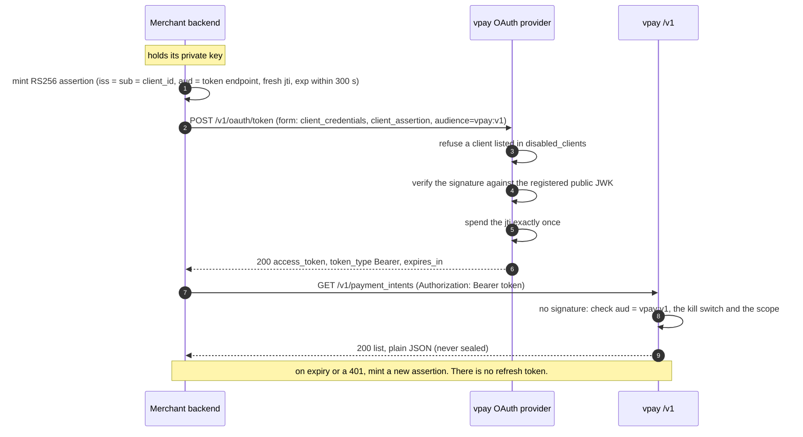

# Authentication

There is no API key of any shape on `/v1`. A merchant is a client registered in
vpay's YAML with **public** keys only, and since <Release /> it can reach `/v1`
two ways, one per request:

- **A signed message.** Each call is a COSE_Sign1 message under an Ed25519 key
  registered as `merchant_clients[].cose_keys`, and each answer is sealed under
  a vpay key the merchant pins. Both SDKs do this, and only this. It is the
  `keypair` method, and it has its own page: [Signed requests](/api/signed-requests).
- **A bearer token**, minted with OAuth2 `client_credentials` (RFC 6749 §4.4)
  and `private_key_jwt` client authentication (RFC 7523) against a JWK
  registered as `merchant_clients[].jwks`. It is the `machine_tokens` method,
  and the rest of this page is about it.

Which of the two a deployment accepts is its own configuration, `auth.methods`
([ADR-0037](vpay:docs/adr/0037-authentication-methods-are-deployment-configuration.md)).
This is the one place vpay deliberately stops looking like Stripe. Agents
working on it should load [vpay-merchant-api](skill:vpay-merchant-api).

## Which ways in a deployment has

`auth.methods` lists `keypair`, `machine_tokens`, `hmac_webhooks` and
`human_login`. **An absent key means all four**, which is what
`config/application.yml` ships with: `/v1` then takes a signed request or a
bearer token, and `/v1/oauth/token` is mounted. vaam runs with `[keypair]`
(plus `hmac_webhooks` until sealed webhooks exist), so on vaam's deployment no
token opens `/v1` and the token endpoint is an honest `404`.

| `keypair` | `machine_tokens` | What `/v1` accepts                                      | `/v1/oauth/token` |
| --------- | ---------------- | ------------------------------------------------------- | ----------------- |
| yes       | no               | signed messages only; anything else is the coarse `401` | `404`             |
| yes       | yes (default)    | a signed message, or a bearer token, one per request    | mounted           |
| no        | yes              | bearer tokens only; a signed body is a `415`            | mounted           |

`GET /.well-known/vpay-auth` answers `{"methods": [...]}` without a credential:
what this deployment permits and serves. Boot refuses a file in which nothing
could authenticate `/v1`, and refuses dormant configuration: a `jwks`,
`grant_types` or `allowed_audiences` while `machine_tokens` is off, `cose_keys`
while `keypair` is off. A `[keypair]` deployment therefore has to delete the
OAuth half of its merchant registrations. An `auth` key written anywhere but
the top level, such as under `deployment:` or a merchant entry, is refused too
(`MisplacedAuthKey`), and so are near misses like `auth_methods:`.

**Every merchant needs a credential.** A registration with neither `cose_keys`
nor `jwks` is refused. `jwks`, `grant_types` and `allowed_audiences` are
required together, and only for a merchant that has a `jwks` while
`machine_tokens` is permitted: a merchant with `cose_keys` alone boots under the
default and simply cannot use a token.

## Why no `sk_live_` keys

vpay originally planned Stripe-shaped `sk_live_`/`sk_test_` bearer keys, and
[ADR-0010](vpay:docs/adr/0010-merchant-auth-private-key-jwt.md) reversed that in
favour of the token handshake below. ADR-0035 then made `/v1` a signed message
and ADR-0010 is superseded for `/v1` itself, but the token door it designed is
kept for any deployment that permits `machine_tokens`. Both ways share what
mattered about the reversal:

- **No shared secret exists anywhere.** Not in a table, not in an environment
  variable, not on the wire. vpay holds only public keys, so a stolen vpay
  database does not let anyone impersonate a merchant.
- **No refresh token.** A token client re-authenticates with a fresh assertion
  instead, as RFC 6749 §4.4.3 recommends for this grant.
- **One grant only.** `authorization_code`, `refresh_token` and the device grant
  are refused with `unauthorized_client` before any store is touched.

The costs are stated just as plainly. Onboarding is a pull request, not a
self-serve flow: the merchant generates their own keys, sends the public
halves, and they land in YAML and are deployed. Configuration loads once at
boot, so a rolling deploy has a window where one pod knows a new merchant and
another does not. And an official Stripe SDK needs a seam to reach vpay, which
vpay ships; see [Stripe SDK compatibility](/api/stripe-compat).

Revocation without a deploy is the `disabled_clients` table: an operator flips a
client to disabled and it takes effect on the next request, for a signed caller
and a token caller alike. The table only ever subtracts access; YAML stays
authoritative for who exists and what their keys are.

## The token handshake

Everything from here on applies only where `machine_tokens` is permitted, and
only to a merchant registered with a `jwks`. **Neither vpay SDK speaks it**:
their assertion minting, token cache and re-authentication were deleted when
`/v1` became signed, and a token mode for them is planned (VPA-6), not built. A
token caller today is a plain HTTP client of your own.



### 1. The client assertion

| Claim / header | Value                                                                                         |
| -------------- | --------------------------------------------------------------------------------------------- |
| `alg`          | `RS256` — the permitted algorithm comes from the registered key, never from the header        |
| `kid`          | optional with one registered key; **required** and exact when the merchant registered several |
| `iss`, `sub`   | both the `client_id`                                                                          |
| `aud`          | the OP's token endpoint URL or its issuer, as a single string                                 |
| `jti`          | a fresh UUIDv4 per assertion, spent exactly once server-side                                  |
| `exp`          | `now + lifetime`, lifetime 1–300 s                                                            |

The OP allows 60 seconds of clock leeway, which vpay cannot configure: it is a
constant inside `authkestra-op`, and it did not move when v0.14.2 upgraded that
crate from 0.7.1 to 0.13.1. Spent `jti`s do not pile up: the worker's hourly
`sweep_expired` job deletes the expired ones. Since vpay 0.6.0 it keeps each
spent `jti` for **five minutes past its `exp`**, measured on the database's
clock ([ADR-0028](vpay:docs/adr/0028-a-spent-jti-outlives-the-validators-leeway.md)).
Before that, a sweep landing inside the leeway could delete a spent `jti` while
its assertion still verified, and a captured assertion could then be replayed
once for a second access token. A test now runs the real sweep between the first
use and a replay, and another fails CI if a dependency bump widens the leeway
past the five minutes. What nothing checks is a database clock running more than
about four minutes ahead of an API replica's.

::: warning `aud` is what vpay calls itself, not the URL you POST to
The OP compares `aud` against exactly two strings, both derived from
`deployment.public_base_url`: `{public_base_url}/v1/oauth/token` and the issuer
`{public_base_url}/v1/oauth`. If your server reaches vpay by an internal name —
a compose service, a private DNS name, a mesh address — the assertion's `aud`
must still be the public name. Left wrong, every token request is
`invalid_client` while the signature, key and lifetime are all correct, and
nothing on the wire says audience.
:::

### 2. The token request

`POST /v1/oauth/token`, form-encoded:

| Field                   | Value                                                    |
| ----------------------- | -------------------------------------------------------- |
| `grant_type`            | `client_credentials`                                     |
| `client_id`             | your `client_id` (always sent, so a log line names you)  |
| `client_assertion_type` | `urn:ietf:params:oauth:client-assertion-type:jwt-bearer` |
| `client_assertion`      | the JWT from step 1                                      |
| `audience`              | `vpay:v1`                                                |
| `scope`                 | only if you want less than your registration grants      |

`audience=vpay:v1` is load-bearing. Without it the OP mints a token addressed to
your `client_id`, and every `/v1` route refuses it with a `401`. The same
endpoint mints a token for the [MCP endpoint](/api/mcp) when the audience is
that endpoint's URL and the registration lists it.

The raw two-step looks like this. The first step is pseudocode:
`build_signed_jwt` is not a real tool, and since the SDKs stopped minting
assertions, nothing in vpay builds one for you. `examples/merchant-curl` no
longer shows this; it now walks the signed transport with the Node SDK's
`vpay-call` script.

```bash
# 1. Build a client assertion (RFC 7523).
ASSERTION=$(build_signed_jwt \
  --iss merchant_a --sub merchant_a --aud https://api.vpay.example/v1/oauth/token \
  --exp "+300s" --jti "$(uuidgen)" \
  --key merchant-a-private-key.pem --alg RS256)

# 2. Exchange the assertion for an access token.
curl -X POST https://api.vpay.example/v1/oauth/token \
  -d grant_type=client_credentials \
  -d client_id=merchant_a \
  -d client_assertion_type=urn:ietf:params:oauth:client-assertion-type:jwt-bearer \
  -d client_assertion="$ASSERTION" \
  -d audience=vpay:v1
# → { "access_token": "…", "token_type": "Bearer", "expires_in": 900 }
```

Errors follow RFC 6749's JSON
(`{ "error": "invalid_client", "error_description": "…" }`): `invalid_client` is
`401`, every other token error `400`.

### 3. Using the token

The call carries `Authorization: Bearer <access_token>` and **no signature**:
a request that is signed and also carries `Authorization` is a `400`. Access
tokens live **900 seconds** (`vpay_api::op::ACCESS_TOKEN_TTL_SECS`, not
configurable); on expiry, mint a new assertion. The answer is plain JSON, never
sealed, and a token caller gets none of the signed transport's binding to a
contract. A token caller's refusals are the Stripe-shaped ones:
`missing_bearer_token` or `invalid_token` (`401`), a `503` when the JWKS cannot
be read, and a `403` for a genuine token naming no registered client or lacking
the scope. Idempotency keys are the merchant's, shared with its signed calls.

### Scopes

Two strings: `payments:write` for any method that is not a read, and
`payments:read` or `payments:write` for `GET`/`HEAD` (write implies read; an
unknown verb requires write). A token request that names no `scope` is granted
exactly the client's registered `scopes:`. A narrower request keeps its
narrower scope; anything outside the registration is `invalid_scope`. A token
carrying neither scope is `403 forbidden` on every call. A token is also held to
the registration's **current** YAML `scopes`, as a signer is: a scope removed
from the YAML and applied by a restart stops working for tokens minted before
it. A signed call's scopes are its registration's.

## Discovery and JWKS

The issuer is `{deployment.public_base_url}/v1/oauth`, derived in one place, so
the `iss` a token is stamped with, the `iss` the validator pins and the
discovery document's `issuer` cannot drift apart. The path is not configurable.

- `GET /v1/oauth/.well-known/openid-configuration` is hand-built and advertises
  only what vpay serves: no `/authorize`, no `/userinfo`, no device or refresh
  grant, and `private_key_jwt` as the only client-auth method.
- `GET /v1/oauth/jwks.json` lists every publishable signing key — the active one
  plus any retired key still inside the 24-hour rotation window — with
  `Cache-Control: public, max-age=300`.

Both are mounted where something reads them: beside the token endpoint, where
the MCP endpoint is served, and on a management pod that serves the staff
sign-in, whose sessions are tokens from the same key.

vpay's own signing key is one RSA PEM loaded at boot. Rotating it is a restart
with a new Secret; the retired key stays publishable for 24 hours so tokens it
already signed keep verifying, and rolling back to a retired key is refused with
exit `78`. Nobody has rotated one on a deployment — see
[the rotation runbook](vpay:docs/runbooks/rotate-signing-key.md).

## What can go wrong

| Failure                                          | What you see                                                         |
| ------------------------------------------------ | -------------------------------------------------------------------- |
| Wrong private key, unregistered `kid`, typo'd id | `invalid_client` from the token endpoint                             |
| Client disabled in `disabled_clients`            | the token endpoint refuses, or `/v1` answers `401` `invalid_token`   |
| `machine_tokens` not permitted                   | `404` from the token endpoint; a bearer on `/v1` is the coarse `401` |
| Signed and `Authorization` on one request        | `400`: one caller, one credential                                    |
| Clock skew beyond 60 s                           | `invalid_client`, deliberately not saying which check failed         |
| Wrong `aud` (internal hostname)                  | `invalid_client`; set the assertion audience                         |
| Token minted without `audience=vpay:v1`          | `200` from the token endpoint, then `401` on every `/v1` call        |
| New merchant, pod not yet restarted              | `invalid_client` from one replica, success from another              |

## Known limitations

::: danger Read these before trusting this with money

- **The `jti` replay namespace is global, not per merchant.** A merchant whose
  library used a counter or timestamp as `jti` could collide with — or pre-spend
  — another merchant's values. Until that changes, `jti` **must** be a UUIDv4.
- **No rate limit on `/v1/oauth/token` or `/v1`.** It is left to the ingress,
  and nothing in the repository verifies the ingress does it.
- **The signing-key PEM is not zeroized** in memory.
  :::

## Status in this release

| Part                                                        | Status                   | Evidence                                                                                                                                                      |
| ----------------------------------------------------------- | ------------------------ | ------------------------------------------------------------------------------------------------------------------------------------------------------------- |
| Signed requests (`keypair`)                                 | <Status s="built" />     | See [Signed requests](/api/signed-requests#status-in-this-release)                                                                                            |
| `auth.methods`, its boot refusals, `/.well-known/vpay-auth` | <Status s="built" />     | One `ConfigError` variant and fixture per rule in `vpay-config`; 17 router cases in `vpay-api`, a sealed call and a token call on one router among them       |
| Token endpoint, discovery, JWKS                             | <Status s="built" />     | `merchant_token_flow.rs` boots a real router against a real Postgres; runs in CI                                                                              |
| A token accepted on `/v1` beside the signature              | <Status s="partial" />   | Router cases without a database; the round trip against the real tables is `merchant_token_flow.rs`, run by CI and only compiled where the change was written |
| Replay protection (`jti` spent once)                        | <Status s="built" />     | `the_same_client_assertion_cannot_be_spent_twice`; past a sweep, `a_spent_assertion_past_its_exp_but_inside_the_leeway_cannot_be_replayed_after_a_sweep`      |
| Kill switch (`disabled_clients`)                            | <Status s="built" />     | `a_disabled_client_is_refused_with_invalid_client_and_401`, no restart in between; a token on `/v1` and on the MCP endpoint asks the same switch              |
| A token mode in either SDK                                  | <Status s="not-built" /> | Deleted with the signed transport; VPA-6 would restore it                                                                                                     |
| Per-merchant `jti` namespace, rate limiting                 | <Status s="not-built" /> | recorded limitations from the 2026-09-02 security review                                                                                                      |
| A real merchant completing either way in                    | <Status s="not-built" /> | no vpay outside a test process has ever done it                                                                                                               |

The full record is
[docs/flows/merchant-auth.md § Status](vpay:docs/flows/merchant-auth.md#status)
and [ADR-0037](vpay:docs/adr/0037-authentication-methods-are-deployment-configuration.md).

## Go deeper

- [Signed requests](/api/signed-requests), the way both SDKs authenticate
- [ADR-0037: authentication methods are deployment configuration](vpay:docs/adr/0037-authentication-methods-are-deployment-configuration.md)
- [Merchant authentication: the token door](vpay:docs/flows/merchant-auth.md)
- [Webhook verification, failure table and known limitations](vpay:docs/flows/merchant-auth/verification-and-limits.md)
- [ADR-0010: private_key_jwt, not API keys](vpay:docs/adr/0010-merchant-auth-private-key-jwt.md)
- [Raw HTTP, now over a sealing CLI](vpay:examples/merchant-curl/README.md)
- [Rotating the OAuth signing key](vpay:docs/runbooks/rotate-signing-key.md)
- The SDKs, which seal: [Node.js](/sdks/nodejs), [Rust](/sdks/rust)
- Skill: [vpay-merchant-api](skill:vpay-merchant-api)
