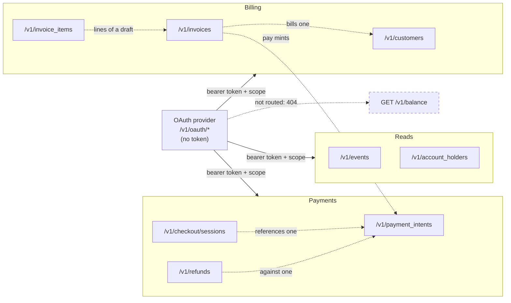
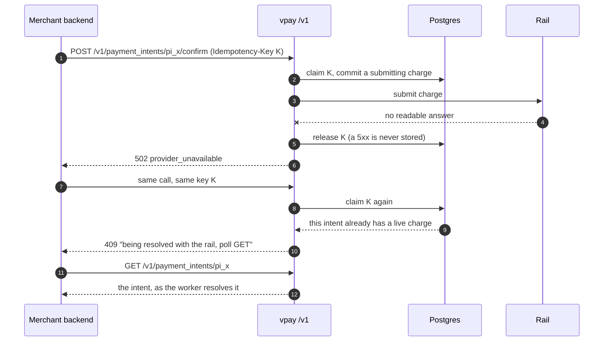

# Merchant API

`/v1` is the API a merchant's own backend calls. Its object model, form
encoding, error envelope and idempotency semantics are Stripe's, so an existing
Stripe integration reads naturally against it. Its **authentication is not**
Stripe's: there is no API key, only a short-lived bearer token obtained with
OAuth2 `client_credentials` + `private_key_jwt` (see
[Authentication](/api/authentication)).

Every route below is real — it answers with real rows from a real Postgres — but
the rails behind the money-moving ones have only ever been WireMock stubs, apart
from over seven successful MTN **sandbox** payments on 2026-09-15 and six
test-mode payments through Notch Pay's **sandbox** on 2026-10-21 and -22. Read
[Status](/guide/status) before you build on anything here.

Agents working on this surface should load
[vpay-merchant-api](skill:vpay-merchant-api).

## Four surfaces, four credential models

vpay exposes three authenticated HTTP surfaces and one public callback path.
They are kept apart on purpose — the API reference calls conflating any of them
a security bug.

| Surface                     | Caller                   | Credential                                                               | Page                                        |
| --------------------------- | ------------------------ | ------------------------------------------------------------------------ | ------------------------------------------- |
| `/v1`                       | the merchant's backend   | bearer token from `private_key_jwt`                                      | this section                                |
| `/v1/browser`               | the payer's browser      | publishable key + the intent's (or session's) `client_secret`            | [Browser checkout](/checkout/browser)       |
| `/dash/v1`                  | a signed-in staff member | OIDC session (authorization code + PKCE)                                 | [Dashboard auth](/dashboard/authentication) |
| `/provider/{code}/callback` | a rail                   | none — a callback only pulls a status query forward, never changes state | [Reconciler](/payments/reconciler)          |

`/v1/browser` is **not** a second way into `/v1`: it has its own route table,
its own 404 fallback and CORS, and exactly one route that is not a `GET`.
`/dash/v1` is mounted only on a deployment configured for the staff surface, and
no deployment running it is on record. The provider callback route is
proven against WireMock and has never been called by MTN, Orange or Notch Pay.

{.diagram}

## What is served on `/v1`

Unauthenticated, by necessity: `GET /healthz` and the merchant OAuth provider —
`POST /v1/oauth/token`, `GET /v1/oauth/.well-known/openid-configuration` and
`GET /v1/oauth/jwks.json`. Everything else sits behind a merchant bearer token
and a scope check:

| Resource                               | Methods                                                            |
| -------------------------------------- | ------------------------------------------------------------------ |
| `/v1/payment_intents`                  | `POST`, `GET`, `GET {id}`, `POST {id}/confirm`, `POST {id}/cancel` |
| `/v1/checkout/sessions`                | `POST`, `GET`, `GET {id}`, `POST {id}/expire`                      |
| `/v1/customers`                        | `POST`, `GET`, `GET {id}`, `POST {id}`, `DELETE {id}`              |
| `/v1/invoices`                         | `POST`, `GET`                                                      |
| `/v1/invoices/{id}`                    | `GET`, `POST`, `PATCH`, `DELETE`                                   |
| `/v1/invoices/{id}/finalize`           | `POST`                                                             |
| `/v1/invoices/{id}/void`               | `POST`                                                             |
| `/v1/invoices/{id}/mark_uncollectible` | `POST`                                                             |
| `/v1/invoices/{id}/pay`                | `POST`                                                             |
| `/v1/invoice_items`                    | `POST`                                                             |
| `/v1/invoice_items/{id}`               | `GET`, `POST`, `PATCH`, `DELETE`                                   |
| `/v1/events`                           | `GET`, `GET {id}`                                                  |
| `/v1/refunds`                          | `POST`, `GET`                                                      |
| `/v1/refunds/{id}`                     | `GET`, `POST`                                                      |
| `/v1/refunds/{id}/cancel`              | `POST`                                                             |
| `/v1/account_holders`                  | `GET`                                                              |

The table is the constant `vpay_api::V1_ROUTES`, and a boundary test walks that
constant rather than a list of its own, asserting every entry answers `401`
without a token — so a route cannot be mounted without being covered.

`POST` and `PATCH` are one handler on `/v1/invoices/{id}` and
`/v1/invoice_items/{id}`. Stripe's API has no `PATCH`, so an existing client
sends `POST`; `PATCH` sits beside it because a partial update is what the verb
means. There is no collection `GET` on `/v1/invoice_items` — an invoice's lines
are read from the invoice.

### Filtering a list by customer

`GET /v1/payment_intents`, `GET /v1/checkout/sessions` and `GET /v1/refunds`
accept `customer=cus_…` since vpay 0.6.0
([ADR-0024](vpay:docs/adr/0024-customer-filters-and-manual-payments.md)). The
value is checked for shape only: another merchant's customer, an unknown one and
one of yours with no rows all answer the same `200` with an empty page, never a
`404`, and a malformed value is a `400` naming `customer`. The cursors page
inside the filtered set. What each list compares:

- **payment intents:** their own `customer`;
- **checkout sessions:** their **own** `customer`, the one the page renders;
- **refunds:** their intent's `customer`, because a refund has none.

A session that names a customer on an intent with none now writes that customer
onto the intent in the same transaction
([ADR-0025](vpay:docs/adr/0025-session-customer-onto-intent.md)), so for
sessions created from vpay 0.6.0 on the three lists agree. Older intents were
not backfilled: a payment collected through such a session is listed by the
sessions filter and not by the other two. A server older than 0.6.0 ignores
`customer` and returns the whole list.



### Scopes

Two scopes exist: `payments:write` for any method that is not a read, and either
`payments:read` or `payments:write` for `GET`/`HEAD`. A valid token with neither
is a `403 forbidden`, not a `401` — the credential is fine, it just authorises
nothing. An authenticated request to a path with no route is
`404 unknown_route`.

## Bodies and errors

Request bodies are `application/x-www-form-urlencoded`, bracket-nested the way
Stripe's SDKs send them (`metadata[order_id]=1234`,
`payment_method_types[0]=mtn_momo`; the unindexed `[]` spelling is accepted
too). A JSON body is refused with a `400` telling you to send a form, and a body
over **64 KiB** is refused. Since v0.12.0 a confirm's `payment_method_options` must be a
map: a plain string there is refused, where it used to be accepted. Amounts are integer minor units — see
[Money](/payments/money).

Every non-2xx response the API renders is Stripe's envelope:

```json
{
  "error": {
    "type": "invalid_request_error",
    "code": "…",
    "message": "…",
    "param": "…"
  }
}
```

The status, `type` and `code` are derived from one classification of the failing
error, never chosen per handler, so the same failure always gets the same
answer. `message` never carries hosts, table names or credentials. Two responses
are produced above that renderer and carry an empty or plain-text body instead:
a `405` (right path, wrong method) and a `413` (body too large). The full
category table is on [Errors](/payments/errors).

## Payment-method types and routing

Since v0.12.0, `payment_method_types[]` takes two kinds of value, and one
intent may mix them
([ADR-0029](vpay:docs/adr/0029-card-and-bank-adapters-and-payment-method-routing.md)
D6):

- **A rail code** — `mtn_momo`, `orange_money` or `notchpay` — means that rail,
  pinned, exactly as before.
- **A payment-method type** — `mtn_wallet` or `orange_wallet` — means the
  payer's wallet network and leaves the rail to vpay. A create accepts one only
  when an enabled rail serves it in the intent's currency, else a `400` naming
  `payment_method_types`. `card` and `bank_transfer` are reserved and refused.

A confirm whose `payment_method_data[type]` is a type is **routed**: vpay ranks
every enabled rail that serves the type and settles the currency, and charges
the first. The payer's fields sit under the type, as in
`payment_method_data[mtn_wallet][msisdn]`.
`payment_method_options[<type>][rail]` pins one rail; a pin that cannot take
the payment is a `400` naming that parameter, never a fallback to another rail.
A decline is not retried on the next rail: one charge per intent still holds.

What a merchant should know before relying on it:

- **The ranking is provisional.** Its one component is a weight per rail that
  the operator configures (`routing.weights`, equal by default), and ties go to
  the lower rail code. With equal weights that sends `mtn_wallet` to
  `mtn_momo` and `orange_wallet` to `notchpay`: a tie-break, not a preference.
  The maintainer decided on 2026-10-23 that the fee is the
  next component, which is not built, and that no measured quantity, such as a
  completion rate, moves traffic on its own
  ([RFC-0008](vpay:docs/rfc/0008-payment-method-routing.md)).
- **`orange_wallet` needs different fields depending on the rail.**
  `orange_money` is a redirect rail and needs `return_url`; `notchpay` is a
  push rail and needs `msisdn`. A server-side confirm has to pin to know which
  to send. A confirm that sends `msisdn` works only while `notchpay` ranks
  first.
- **vpay does not check a payer's number against the network they chose.**
  On Notch Pay a number from the other network is refused by the rail, and
  the charge fails as `invalid_payer`, an answer seen in Notch Pay's sandbox
  and proven in vpay against a stub of it.
- **The decision is not on the API.** The chosen rail, the type and the
  ranking are recorded in vpay's database, on no `/v1` object.
- **Neither SDK can send a confirm by type or a pin** yet
  ([SDK parity](vpay:docs/sdks/parity.md)). The checkout session's browser
  answer offers a type as one entry, flowing as its first-ranked rail; the
  checkout page's rendering of it has no frontend test.

Routing is proven against WireMock and a real Postgres; no confirm by type has
reached a real rail.

## `Idempotency-Key` is required on every `POST`

This is stricter than Stripe, where the header is optional. A `POST` without one
is a `400` naming `idempotency_key`, before anything is created. Keys are 1–255
printable-ASCII bytes, scoped to your merchant, and kept for 24 hours; the
worker's hourly `sweep_expired` job deletes expired ones. Both vpay
SDKs, and stripe-node, send one on every `POST` automatically, so in practice
this only bites a hand-rolled client.

| What you did                             | What you get                                            |
| ---------------------------------------- | ------------------------------------------------------- |
| Same key, same body, first call finished | the stored response, byte for byte                      |
| Same key, different body                 | `400` `idempotency_error` / `idempotency_key_in_use`    |
| Same key, first call still running       | `400` `idempotency_error` / `idempotency_key_in_flight` |
| First call answered `5xx`                | the key is released; the retry re-executes              |
| Deployment changed under a replay        | the replay still answers what the original did          |

Stripe answers `409` for a key still in flight; vpay answers `400`, because the
status comes from the error's category. Branch on `code`, which is distinct
either way.

The case that matters most is a confirm that timed out at the rail. The `502`
releases the key, and the retry re-executes — which is safe, because it is not
the key that prevents a second charge but the database rule "one charge per
intent, forever":



::: warning Do not open a second intent after a 502
On a push rail a second PaymentIntent prompts the payer's handset a second time
for the same money. Retry under the same key, and if the answer is the `409`
saying the charge is being resolved, poll the `GET`. Only a `409` saying the
charge is terminal means "create a new intent".
:::

Since v0.11.0 a `502` can also carry the code
`charge_needs_reconciliation`: the rail answered, and only a person can settle
what it said. Handle it as the `502` above. The charge stays live, the worker
escalates it to `unresolved` for an operator, and the intent stays where it is
until a terminal answer arrives ([reconciler](/payments/reconciler)). Only the
Notch Pay and Orange adapters raise it, and no test drives it through a
confirm end to end.

A rail that answers and declines is a different case from one that does not
answer. `confirm` then returns `409` `charge_declined`: the charge is `failed`,
the intent stays in `requires_payment_method` carrying the reason, and one
`payment_intent.payment_failed` event is emitted. At <Release /> a confirm
settles the decline first and records the attempt second, so once the decline is
settled, a failure to record the attempt is logged and you still get the `409`.
When the worker resubmits a charge the rail has no record of and the rail
declines it, the worker fails the charge the same way. A retry after a decline
is a new PaymentIntent.

## Refunds: a `201` is not money back

A `201` from `POST /v1/refunds` means vpay wrote the refund as `pending`,
reserved its amount against the intent, emitted `charge.refunded` in the same
transaction, and instructed the rail. It does **not** mean money moved:

- **nothing settles a `pending` refund** — the provider port has no refund
  status read and there is no refund poll ladder (RFC-0003 open question 8);
- `mtn_momo::refund` makes MTN's Disbursements `transfer` call, but no real
  Disbursements credential exists in the project and that product has never been
  called — it is WireMock-proven only;
- `orange_money::refund` is a declared `NotImplemented` token, which fails the
  refund, releases its reservation and answers `501` `not_implemented` — the
  only route on `/v1` where a caller can receive that code;
- `notchpay::refund` is a declared `NotImplemented` token too, so a refund on a
  Notch Pay charge also answers `501`.

`destination[<rail code>][msisdn]` is required on MTN and Orange (a refund
there is an outbound transfer and needs a payee). The key is the charge's
**rail** code, such as `destination[mtn_momo][msisdn]`, never a payment-method
type such as `mtn_wallet`. Notch Pay refunds to
the instrument that paid, so a `destination` sent for it is a `400` naming
`destination`, before the token is reached. And
`POST /v1/refunds/{id}/cancel` in practice refuses every refund the create route
produces, because the rail has already been handed the transfer by the time you
hold the `re_…`.

## `GET /v1/balance` is not routed

It answers the honest `404` from the nest's fallback, to an authenticated
caller, because there is no ledger read path — a `200` would mean somebody
invented a resource. Both SDKs can call it and get that `404`.

## Status in this release

| Part                                        | Status                   | Evidence                                                                                                                            |
| ------------------------------------------- | ------------------------ | ----------------------------------------------------------------------------------------------------------------------------------- |
| OAuth provider and the `/v1` 401 boundary   | <Status s="built" />     | integration suites over a real router and Postgres, run in CI                                                                       |
| Payment intents, checkout sessions          | <Status s="partial" />   | real routes and rows; over seven MTN sandbox payments succeeded and Notch Pay's sandbox took six; other rail evidence is stub-based |
| Payment-method types and routing            | <Status s="partial" />   | WireMock and a real Postgres; one provisional score component; no SDK support; the decision is not on `/v1`                         |
| Customers, invoices, events                 | <Status s="built" />     | container-backed integration suites through the shipping router                                                                     |
| Idempotency                                 | <Status s="built" />     | every row of the table above is a named integration test against a real Postgres                                                    |
| Refunds                                     | <Status s="unproven" />  | routes and rows are real; no rail has ever refunded and nothing settles `pending`                                                   |
| `GET /v1/balance`                           | <Status s="not-built" /> | honest `404`                                                                                                                        |
| Rate limiting on `/v1` or `/v1/oauth/token` | <Status s="not-built" /> | left to an ingress nothing in the repository verifies                                                                               |

The full record is [docs/api/README.md](vpay:docs/api/README.md) and
[docs/status/backend.md](vpay:docs/status/backend.md).

## Go deeper

- [API reference, every route and its answers](vpay:docs/api/README.md)
- [README — what is served on `/v1` today](vpay:README.md)
- [The resource contract the SDKs implement](vpay:docs/flows/merchant-auth/resource-contract.md)
- [RFC-0003: refunds and their destinations](vpay:docs/rfc/0003-refunds-destinations-and-the-first-ledger-postings.md)
- [Raw HTTP walkthrough with curl](vpay:examples/merchant-curl/README.md)
- Skill: [vpay-merchant-api](skill:vpay-merchant-api)
