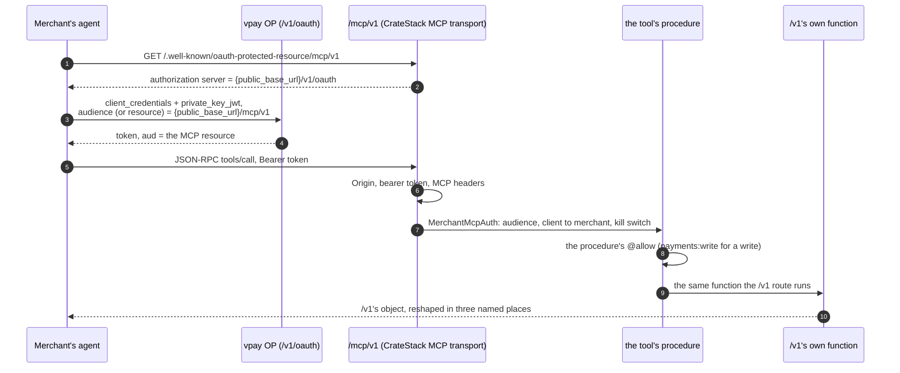

# MCP for agents

<Release /> carries the **first slice** of a merchant endpoint for the Model
Context Protocol: `POST /mcp/v1`, MCP revision `2026-07-28` over Streamable
HTTP, so a merchant's AI agent can create, read, confirm and cancel payments
and refunds as tools rather than as REST calls. Nine tools exist. The other 28
`/v1` routes have none yet, there are no MCP resources, there is no staff
endpoint, nothing in the Helm chart or compose turns it on, and no pod has run
it.

The decision behind it,
[ADR-0033](vpay:docs/adr/0033-mcp-is-the-primary-agent-surface.md), is still
**Proposed**: the maintainer gave its direction (one image, both merchants and
staff, reads and money-moving writes) and it is being built step by step.
Agents working on it should load [vpay-merchant-api](skill:vpay-merchant-api).

## Turning it on

The endpoint is opt-in twice, and off unless both happen:

1. **The deployment.** `deployment.surfaces` must name `mcp`. An absent
   `surfaces` key never mounts it. The endpoint is then
   `{public_base_url}/mcp/v1`, and that URL is also the token audience. Boot
   refuses `mcp` unless `auth.methods` permits `machine_tokens`
   (`McpNeedsMachineTokens`), because the endpoint takes bearer tokens only.
2. **The merchant.** Its `merchant_clients[]` entry lists that URL in
   `allowed_audiences`. The OP mints an MCP token only for a client that did.

There is no `mcp:` configuration block: the resource identifier, the one
allowed browser origin and the authorization server are all derived from what
the deployment already says about itself.

## One tool call

The token is the [bearer-token handshake](/api/authentication) with a
different audience. RFC 8707's `resource=` parameter is honoured as the
audience it names. The token endpoint runs on a pod serving the `business`
surface; a pod serving only `mcp` serves the discovery document and the JWKS
but mints nothing.

## What every call obeys

- **The tenant comes from the token, never from the arguments.** No tool takes
  a merchant id, and another merchant's object is the same "not found" as one
  that does not exist.
- **A write needs `payments:write`.** A `payments:read` token is refused by the
  procedure's own policy before any body runs.
- **Every write takes a required `idempotency_key`.** It is claimed in vpay's
  per-merchant store against the tool name and a hash of the arguments. A
  replay returns the first answer; the same key with different arguments is
  `/v1`'s `idempotency_key_in_use`.
- **No new rule.** Validation, rails, events and the ledger are `/v1`'s. A
  tool can do nothing its route cannot.
- **A refusal** is an `isError` result whose text is `{code, message}`, where
  `message` begins with `/v1`'s own `error.code`. A token for the wrong
  audience is a `401` with a challenge naming the metadata document. A
  `vpay:v1` token is refused here, and an MCP token is refused on `/v1`.
- **The output** is `/v1`'s object with `metadata` as a list of
  `{key, value}`, `next_action.type` renamed `kind` and
  `payment_method_details.type` renamed `method_type`.
- **A disabled client** is refused on its next call, as it is on `/v1`.

The dashboard's procedure transport serves none of this: `/dash/v1/$procs`
allows only its five searches and answers the merchant procedures with a `404`.

## The nine tools

| Tool                                                                                                  | `/v1` route it runs                                                             |
| ----------------------------------------------------------------------------------------------------- | ------------------------------------------------------------------------------- |
| `create_payment_intent`, `retrieve_payment_intent`, `confirm_payment_intent`, `cancel_payment_intent` | `POST /v1/payment_intents`, `GET {id}`, `POST {id}/confirm`, `POST {id}/cancel` |
| `search_payment_intents`                                                                              | `GET /v1/payment_intents`                                                       |
| `create_refund`, `retrieve_refund`, `cancel_refund`                                                   | `POST /v1/refunds`, `GET /v1/refunds/{id}`, `POST {id}/cancel`                  |
| `search_refunds`                                                                                      | `GET /v1/refunds`                                                               |

Every other `/v1` route is a **dated gap** in vpay's
[MCP parity table](vpay:docs/api/mcp-parity.md). `verify-mcp-parity`, the
seventeenth gate of `just verify`, fails the build if a `/v1` route has no row
there or a tool is named by none. It does not check that a tool behaves like its
route; the integration suite below does that for the nine.

## What can go wrong

- **A prompt-injected agent asks to move money.** vpay cannot see the prompt.
  The controls are scope (give an agent a read-only client), the idempotency
  key and the events every write emits. An amount ceiling is undecided.
- **The OP is retired while MCP still needs it.** The merchant OP is the only
  authorization server this endpoint has. A plan to remove it would leave
  `/mcp/v1` unable to get a token; ADR-0033 leaves that to the maintainer.
- **A confirm through MCP has never settled.** It runs `/v1`'s confirm, which
  is proven against WireMock over `/v1`, but no MCP case drives one to
  `succeeded`.

The threat model, written before any of the code, is
[security/threat-models/mcp.md](vpay:docs/security/threat-models/mcp.md).

## Status in this release

| Part                                       | Status                   | Evidence                                                                                                                                                                                                                                                           |
| ------------------------------------------ | ------------------------ | ------------------------------------------------------------------------------------------------------------------------------------------------------------------------------------------------------------------------------------------------------------------ |
| The merchant endpoint and its nine tools   | <Status s="partial" />   | `mcp_merchant.rs` against a real Postgres, the real router and the real OP: tenancy, scope, both audience directions, the `401` challenge, a foreign `Origin`, idempotency, outputs equal to the reshaped `/v1` objects, an absent `surfaces` key mounting nothing |
| A confirm that a rail settles, through MCP | <Status s="unproven" />  | `/v1`'s confirm is proven against WireMock over `/v1`; no MCP case reaches `succeeded`                                                                                                                                                                             |
| A real MCP client                          | <Status s="unproven" />  | The suite speaks JSON-RPC over HTTP directly; no agent host has called it                                                                                                                                                                                          |
| Tools for the other 28 `/v1` routes        | <Status s="not-built" /> | Dated gaps in the parity table                                                                                                                                                                                                                                     |
| MCP resources                              | <Status s="not-built" /> | ADR-0033 D5's measurement has not been made                                                                                                                                                                                                                        |
| A staff endpoint (`mcp_staff`)             | <Status s="not-built" /> | Waits for an upstream CrateStack audience feature                                                                                                                                                                                                                  |
| A chart workload, or any pod running it    | <Status s="not-built" /> | ADR-0033 step 6                                                                                                                                                                                                                                                    |

The full record is [mcp.md § Status](vpay:docs/flows/mcp.md#status).

## Go deeper

- [MCP: the merchant agent surface](vpay:docs/flows/mcp.md)
- [ADR-0033: MCP is the primary agent surface](vpay:docs/adr/0033-mcp-is-the-primary-agent-surface.md)
- [Which `/v1` routes have a tool](vpay:docs/api/mcp-parity.md)
- [The MCP threat model](vpay:docs/security/threat-models/mcp.md)
- [Step 3, measured](vpay:docs/status/verification/2026-10-26-mcp-step-3.md)
- [The bearer-token handshake](/api/authentication)
- Skill: [vpay-merchant-api](skill:vpay-merchant-api)
