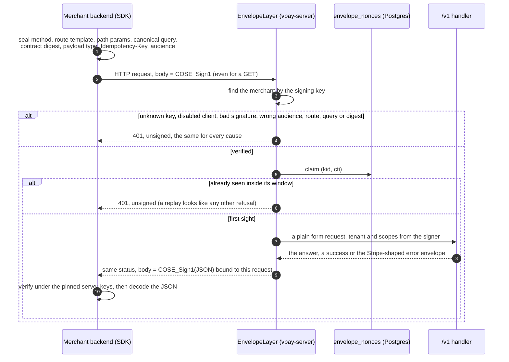
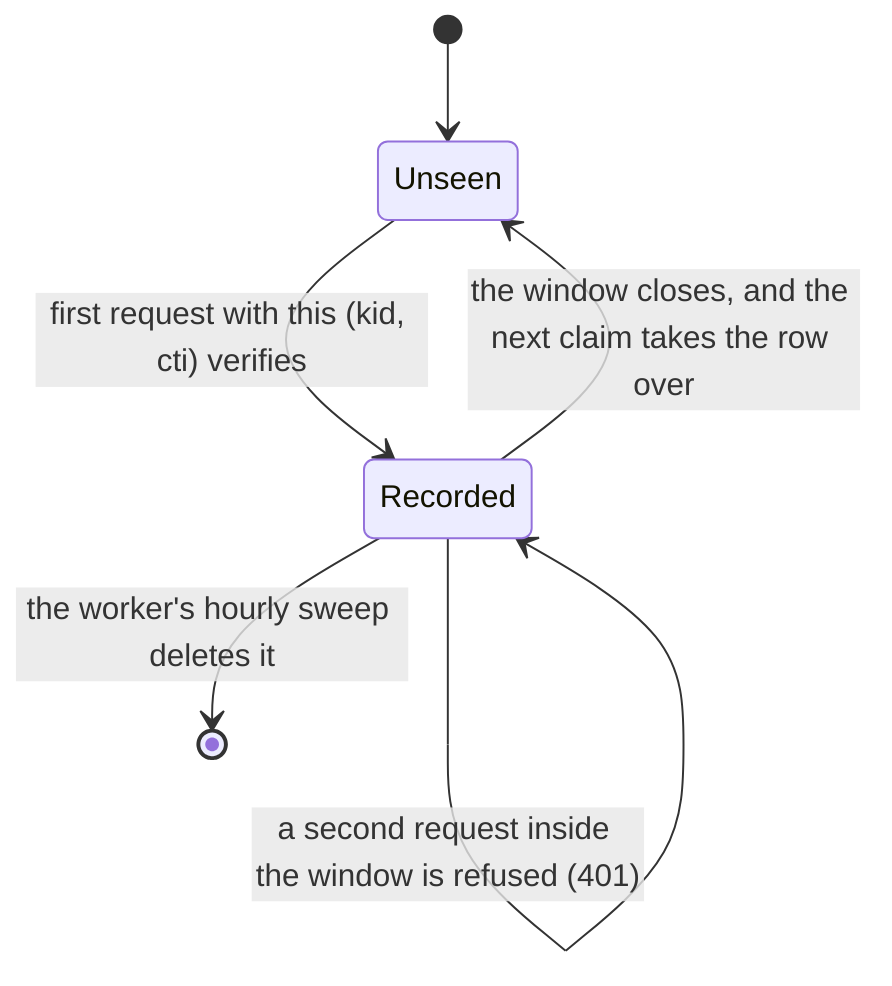

# Signed requests

Since <Release />, a `/v1` call is a **signed message**, not a request with a
credential attached. The merchant's backend seals each call as a COSE_Sign1
message under an Ed25519 key it registered with vpay, and vpay seals each answer
under one of its own two Ed25519 response keys, which the merchant pins. There
is no API key and, on a deployment that permits only this method, no token of
any kind. Both SDKs do all of it for you.

This is cratestack's signed transport (`cratestack-axum`'s `EnvelopeLayer`,
`cratestack-cose` and cratestack's Rust client). vpay chooses what a signature
binds, which keys are trusted and where the replay cache lives. The decision is
[ADR-0035](vpay:docs/adr/0035-v1-is-a-signed-message-not-a-token.md); the
mechanism is vpay's
[signed transport flow](vpay:docs/flows/signed-transport.md). Agents working on
it should load [vpay-merchant-api](skill:vpay-merchant-api).

> **No `/v1` request is handled unless it is a COSE_Sign1 message signed by a
> key the operator registered for a merchant, addressed to this deployment, and
> seen for the first time. Every answer to such a request is a COSE_Sign1
> message signed by this deployment, and a client that does not recognise the
> signing key does not read it.**

That is the whole rule on a deployment whose `auth.methods` permits `keypair`
alone, which is how vaam runs vpay. A deployment that leaves `auth.methods`
out permits a bearer token too; see
[A token beside the signature](#a-token-beside-the-signature).

## One call

The body is a COSE message in both directions, even for a `GET`. What is inside
the seal is still Stripe-shaped: form-encoded fields in, JSON out. A sealed
`GET` carries a body, which `fetch` forbids, so the Node SDK sends on
`node:http(s)`. A browser cannot host the merchant SDK, which was never a goal,
and `curl` cannot make a call at all: `sdks/nodejs/scripts/vpay-call.mjs` makes
one signed call from a shell, and
[`examples/merchant-curl`](vpay:examples/merchant-curl/README.md) uses it.

## What a signature binds

A request signature covers, byte for byte:

- the **audience**: the deployment's `deployment.public_base_url`;
- the **method** and the **route template**, such as
  `/payment_intents/{id}/confirm`, and the **path parameters** as matched;
- the **canonical query**, with pairs sorted, so `?b=1&a=2` and `?a=2&b=1` are
  one request;
- the operation's **contract digest**, `SHA-256(domain || "rest" 0x00 ||
METHOD 0x00 || template)`, from `vpay-wire`'s table of 37 operations;
- the **payload type** and the **`Idempotency-Key`** as sent;
- the payload.

So a request cannot be re-addressed to another deployment, route, resource,
query or idempotency key without the signature failing. Both SDKs carry a
vendored copy of the operation table, and a workspace test fails if either copy,
the digest derivation, or the way a concrete path finds its row drifts from
`vpay-wire`'s.

An answer's signature covers the **request it answers** (a digest of the
request's COSE bytes), the **status**, the payload type and the
`Idempotency-Key`. A sealed `404` cannot be replayed as the answer to another
request, and a sealed `200` cannot be delivered with a `500` status.

`Authorization`, `Stripe-Version`, `User-Agent` and every other header are
neither bound nor read by the layer.

## The keys

| Key                            | Where it is configured                                                               | Who holds the private half | Who pins the public half |
| ------------------------------ | ------------------------------------------------------------------------------------ | -------------------------- | ------------------------ |
| A merchant's signing key       | `merchant_clients[].cose_keys` in the YAML: one or more, optionally labelled         | the merchant only          | vpay                     |
| vpay's response key, `current` | `--envelope-signing-key-file` / `VPAY_ENVELOPE_SIGNING_KEY_FILE`, a file with a seed | vpay                       | every client             |
| vpay's response key, `next`    | `--envelope-signing-key-next-file` / `VPAY_ENVELOPE_SIGNING_KEY_NEXT_FILE`           | vpay                       | every client             |

A public key is 43 characters of unpadded base64url; a seed file is 32 bytes in
the same encoding. `cargo xtask gen-envelope-key --out <dir> --name <stem>`
writes `<stem>.seed` and `<stem>.pub`, and `just gen-envelope-keys` makes
throwaway ones for the compose stacks. The Helm chart takes the server seeds
from a Secret (`envelopeKeys.existingSecret`) and generates none.

`vpay-server` logs both public response keys at boot, which are what an
operator hands a merchant to pin. It refuses to start, with exit `78`, if
either file is missing or malformed, if the two are the same seed, or if the
merchant key registry cannot be built. Boot also refuses a malformed
`cose_keys` entry and a key registered twice anywhere in the file.

### Rotation

- **vpay's response key.** Publish `next`'s public half first, so merchants
  pin both. Once they have it, swap the two seeds and generate a new `next`. An
  answer sealed by either pinned key verifies, so the swap is not a flag day. A
  client that never learned `next` refuses the first answer after the swap,
  which is the failure the order avoids.
- **A merchant's key.** Register the new public key beside the old one, move
  the merchant's backends over, then remove the old one in a config change. A
  removed key stops authenticating on the next deploy. An urgent revocation is a
  `disabled_clients` row for the whole client, which takes effect on the next
  request with no restart.

## What a refusal looks like

Every refusal before the handler is the layer's one coarse `401`: **unsigned,
identical bytes, nothing about why**. A refusal that varied with its cause would
be an oracle for the cause, so diagnosis is harder by design:

| Cause                                  | What to check                                                                                       |
| -------------------------------------- | --------------------------------------------------------------------------------------------------- |
| The key is not registered              | `cose_keys` holds the public half of the seed the merchant signs with                               |
| The client is disabled                 | a row in `disabled_clients`                                                                         |
| The audience differs                   | the client's audience (the SDK default is its base URL) equals `deployment.public_base_url` exactly |
| The message was replayed               | a retrying proxy re-sending the same bytes; the SDKs seal a fresh message per attempt               |
| The clock is more than 300 s off       | the merchant host's clock against vpay's                                                            |
| The path or method is not an operation | `vpay-wire`'s table; an unknown `/v1` path is a `404`, not a `401`                                  |

**This `401` is not the Stripe error envelope.** It is
`{"code": "UNAUTHORIZED", …}` as JSON, or the same document in CBOR when the
caller asked for a sealed answer. Errors raised **after** the layer (validation,
`404`, `409`, a `403` for a missing scope) are still the Stripe-shaped
envelope, sealed. A foreign tenant's id is the same sealed `404` as one that
never existed.

The SDKs turn an unsigned answer into `VpayUnsignedResponseError` (Rust:
`Error::Unsigned`) and an answer that does not verify under the pinned keys
into `VpayUnverifiedResponseError` (Rust: `Error::Unverified`). Neither SDK
follows a redirect, and both bound the body they read to 8 MiB.

Outside the layer altogether: `/healthz` and `/readyz` on the traffic port,
`/livez` and `/metrics` on the observability port, the payer's
`/v1/browser/*`, the staff surface `/dash/v1/*` (which has its own layer), rail
callbacks under `/provider/*`, and the merchant OAuth provider under
`/v1/oauth/*`.

## The replay cache

Each accepted `(kid, cti)` becomes a row in `envelope_nonces` (migration
`0055`), claimed in one `INSERT … ON CONFLICT … WHERE expired … RETURNING`
statement. Two replicas opening the same captured request at the same instant
are serialised by the row lock: one gets the row and the other gets the `401`.
The comparison reads the database's clock. A database that cannot answer
refuses the request.

The cache is Postgres, not Redis or process memory, because every replica and
both server Deployments must share it, and vpay runs no Redis. The worker
deletes rows expired for more than five minutes.

## A token beside the signature

[ADR-0037](vpay:docs/adr/0037-authentication-methods-are-deployment-configuration.md)
made the ways into a deployment its own configuration, because vpay serves more
than vaam. `auth.methods` lists `keypair`, `machine_tokens`, `hmac_webhooks` and
`human_login`, and **an absent key means all four**. The `/v1` envelope's mode
follows the first two:

| `keypair` | `machine_tokens` | Envelope mode | An unsigned request                                 |
| --------- | ---------------- | ------------- | --------------------------------------------------- |
| yes       | no               | `Required`    | the coarse `401`                                    |
| yes       | yes              | `Optional`    | validated as a bearer token                         |
| no        | yes              | `Off`         | validated as a bearer token; a COSE body is a `415` |

At least one way in must remain: with `keypair` off, `machine_tokens` must be
on, or boot refuses the file. The token itself is the `client_credentials`
handshake on [Authentication](/api/authentication). What changes for a caller:

- **One caller, one credential.** A request that is signed and also carries an
  `Authorization` header is a `400`, sealed, on every deployment, `[keypair]`
  included. Before this release a signed request's header was ignored; strip
  it before upgrading. The vpay SDKs never set one.
- **A signed request that fails to verify is the `401`**, never downgraded to
  the token path, whatever else it carries.
- **A token caller is not protected the way a sealed one is.** Its answers are
  plain JSON, never sealed, even when it asks for a sealed one, and its
  requests are bound to no contract. It shares the merchant's idempotency keys
  with signed calls, so a retry that switches credential deduplicates.
- `disable_client` reaches both: a signer's key resolves to nothing, and a
  token's `client_id` is checked against `disabled_clients` on its next request.
- `GET /.well-known/vpay-auth` answers `{"methods": [...]}` without a
  credential: the methods this deployment permits and serves.

**The SDKs only seal.** Neither has a token mode; that is VPA-6 in vpay's
plans. A token caller today is a plain HTTP client.

## Status in this release

| Part                                                       | Status                   | Evidence                                                                                                                                                                                                                                                                 |
| ---------------------------------------------------------- | ------------------------ | ------------------------------------------------------------------------------------------------------------------------------------------------------------------------------------------------------------------------------------------------------------------------ |
| The layer on `/v1`, the coarse `401`, the replay cache     | <Status s="built" />     | `signed_transport.rs`, 7 cases against a real Postgres and the shipping router: every route refuses unsigned, a replay runs the handler once, a disabled client is refused, a wrong pinned key refuses the answer; five `vpay-db` nonce cases, a ten-way race among them |
| Both SDKs seal and open                                    | <Status s="built" />     | `sdks/rust/tests/signing.rs` against the real layer (11 cases); the Node SDK's 218 cases in nine files, `sealer.test.ts` against a verifier built from cratestack's own server envelope                                                                                  |
| `auth.methods` and a token beside the signature            | <Status s="partial" />   | Unit, fixture and router tests (17 router cases, 20 refusal fixtures); the round trips against real tables are CI's `signed_transport.rs` and `merchant_token_flow.rs`, edited in that change and only compiled where it was written                                     |
| The compose stack, the SDKs' live suites, the Helm render  | <Status s="unproven" />  | Not run where the change was written; vpay names CI's `e2e` and `helm` jobs as the evidence and records no measured run of them                                                                                                                                          |
| A token mode in either SDK                                 | <Status s="not-built" /> | VPA-6                                                                                                                                                                                                                                                                    |
| A refund destination's second, Authorization-key signature | <Status s="not-built" /> | Designed for money intents; not part of this transport                                                                                                                                                                                                                   |
| A real merchant, or a deployment, sealing calls            | <Status s="not-built" /> | No run outside a test process is on record                                                                                                                                                                                                                               |

The full record is
[signed-transport.md § Status](vpay:docs/flows/signed-transport.md#status) and
[status/backend.md](vpay:docs/status/backend.md).

## Go deeper

- [The signed `/v1` transport](vpay:docs/flows/signed-transport.md)
- [ADR-0035: `/v1` is a signed message, not a token](vpay:docs/adr/0035-v1-is-a-signed-message-not-a-token.md)
- [ADR-0037: authentication methods are deployment configuration](vpay:docs/adr/0037-authentication-methods-are-deployment-configuration.md)
- [The envelope module, for contributors](vpay:docs/reference/vpay-api/envelope.md)
- [The bearer-token handshake](/api/authentication),
  [the Node SDK](/sdks/nodejs), [the Rust SDK](/sdks/rust)
- Skills: [vpay-merchant-api](skill:vpay-merchant-api), [vpay-sdks](skill:vpay-sdks)
