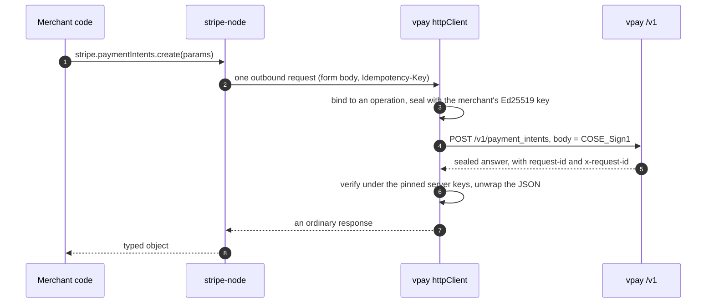

# Stripe SDK compatibility

vpay's `/v1` object model, form encoding, error envelope and idempotency are
Stripe's; its authentication is not. Since <Release /> every `/v1` call is a
[signed message](/api/signed-requests) and every answer is one, so **the
signature is the request body**. The official `stripe` package (stripe-node)
cannot do that by itself, but it accepts an arbitrary `config.httpClient`, the
object that turns one outbound request into one response, and
`@vaam-apps/vpay-sdk/stripe` supplies one that seals each request and opens each
answer. The `authenticator` this page described in earlier releases could only
add a header, so it was deleted with the bearer token it carried.

`sdks/stripe-compat` drives the real `stripe` package against a live compose
stack, and CI runs it in the `e2e (compose)` job. What it proves, and where the
two APIs differ, is below. Agents working on the SDKs should load
[vpay-sdks](skill:vpay-sdks).

## The client

```js
import { readFileSync } from "node:fs";
import Stripe from "stripe";
import { createStripeHttpClient } from "@vaam-apps/vpay-sdk/stripe";

const httpClient = createStripeHttpClient({
  baseUrl: "https://api.vpay.example",
  clientId: "acme-cameroon",
  privateKey: readFileSync("./merchant.seed", "utf8"), // an Ed25519 seed
  serverKeys: {
    current: process.env.VPAY_SERVER_KEY_CURRENT, // vpay's response keys, pinned
    next: process.env.VPAY_SERVER_KEY_NEXT,
  },
});

const stripe = new Stripe("unused", {
  httpClient,
  host: "api.vpay.example",
  port: "443",
  protocol: "https",
  maxNetworkRetries: 0,
  timeout: 30_000,
  telemetry: false,
});
```

The key string is **never sent**: stripe-node requires a non-empty one when an
`httpClient` is given, and the client ignores the `Authorization` header
stripe-node builds from it. `host`, `port` and `protocol` move every request off
`api.stripe.com`, and they matter: the client seals only for the origin in
`baseUrl` and refuses, signing nothing, a request addressed anywhere else. The
generated resources use absolute paths (`/v1/payment_intents`,
`/v1/payment_intents/{id}/confirm`) that are exactly vpay's, and a path or verb
`/v1` does not serve is refused by the operation table before anything is
signed. Transport is `node:http(s)`, because a sealed `GET` carries a body and
`fetch` forbids one, and the sealing is the Rust SDK's code compiled to
WebAssembly.

**A refusal reaches you as a Stripe error, once.** vpay's coarse unsigned `401`
is not the Stripe envelope, and an answer sealed under a key you did not pin is
not an answer at all. If the client rejected the promise, stripe-node would call
it a connection error and retry it. So the client returns a Stripe-shaped
response with `stripe-should-retry: false` instead:
`StripeAuthenticationError` with `code: "unsigned_response"` for the `401`, and
`StripeAPIError` with `code: "unverified_response"` for an answer that does not
verify (or `"response_too_large"` past 8 MiB). A real transport failure still
rejects and is retried up to `maxNetworkRetries`, each retry a freshly sealed
message. A `POST` keeps stripe-node's `Idempotency-Key`, so its retry is the
same operation; a `DELETE` has none from stripe-node, so a repeat of one that
had landed answers `404`. Set `maxNetworkRetries: 0` if that matters to you.

`examples/merchant-stripe-node` is a runnable version: create, confirm on the
MTN push rail, and poll `paymentIntents.retrieve` until `succeeded`, against a
WireMock rail.



## What carries over unchanged

| Behaviour                 | Why it works                                                                                               |
| ------------------------- | ---------------------------------------------------------------------------------------------------------- |
| Resource paths            | stripe-node hardcodes the same `/v1/payment_intents` paths vpay serves                                     |
| Form encoding             | stripe-node's indexed arrays (`payment_method_types[0]=…`) and `%2B` for `+` are what vpay's decoder takes |
| `Idempotency-Key`         | stripe-node sends one on every v1 `POST`, which vpay requires                                              |
| Lists and auto-pagination | `autoPagingToArray` needs only `data[].id` and `has_more`                                                  |
| Error envelope            | `{ error: { type, code, message, param? } }` from the same closed vocabulary                               |
| `webhooks.constructEvent` | vpay's signature construction is byte-identical; see [Webhooks](/api/webhooks)                             |
| `err.requestId`           | vpay sends `request-id` (the only name stripe-node reads) as well as `x-request-id`, one value             |

## Which error class you catch

stripe-node picks the class from the **status first**, and vpay derives status,
`type` and `code` from one classification — so this mapping is a property of the
two designs meeting.

| vpay answer                | What you catch                                                                                   |
| -------------------------- | ------------------------------------------------------------------------------------------------ |
| `404` `resource_missing`   | `StripeInvalidRequestError`, `err.code === "resource_missing"`                                   |
| `400` `invalid_request`    | `StripeInvalidRequestError`, `err.param` naming the field                                        |
| `400` `idempotency_error`  | `StripeIdempotencyError`                                                                         |
| the coarse unsigned `401`  | `StripeAuthenticationError`, `code: "unsigned_response"`, once; vpay does not say why it refused |
| `403` (missing scope)      | `StripePermissionError`, because stripe-node branches on the status                              |
| `409` (lifecycle conflict) | `StripeAPIError`                                                                                 |
| `502` (rail transport)     | `StripeAPIError` — and stripe-node retries it                                                    |
| `429`                      | never emitted                                                                                    |

vpay sets `stripe-should-retry` on every error it renders: `false` on a `409`
(which stripe-node would otherwise retry unconditionally) and `true` on an
in-flight idempotency key (which it would otherwise never retry). A replayed
response carries the advisory the original did.

## Every divergence

| Area                                                                                           | vpay's behaviour                                                                                                                                                                                                                                                                                                                                                                                                                                |
| ---------------------------------------------------------------------------------------------- | ----------------------------------------------------------------------------------------------------------------------------------------------------------------------------------------------------------------------------------------------------------------------------------------------------------------------------------------------------------------------------------------------------------------------------------------------- |
| API keys, `stripeAccount`, Connect                                                             | none exist; `Stripe-Account`, `Stripe-Version`, `Stripe-Context` and `X-Stripe-Client-*` are neither signed nor read                                                                                                                                                                                                                                                                                                                            |
| API version                                                                                    | none advertised or echoed; `lastResponse.apiVersion` is `undefined` and pinning `apiVersion` does nothing                                                                                                                                                                                                                                                                                                                                       |
| `payment_method_types`                                                                         | required, non-empty, each a rail this deployment enabled; `automatic_payment_methods` is dropped and the create is refused for the missing field                                                                                                                                                                                                                                                                                                |
| `confirm: true` on create                                                                      | refused with `param: "confirm"`; `confirm=false` is accepted                                                                                                                                                                                                                                                                                                                                                                                    |
| `payment_method_data.type`                                                                     | a rail code such as `mtn_momo`, with the instrument under the same key (`payment_method_data[mtn_momo][msisdn]`); TypeScript needs a cast                                                                                                                                                                                                                                                                                                       |
| `capture_method` (not `automatic`), `application_fee_amount`, `transfer_data`, `on_behalf_of`  | **refused** with a `400` naming the field, on create and confirm — ignoring them would move money at a time or to an account nobody asked for                                                                                                                                                                                                                                                                                                   |
| `setup_future_usage`, `confirmation_method`, `receipt_email`, `statement_descriptor`, `expand` | accepted and ignored; nothing is expandable                                                                                                                                                                                                                                                                                                                                                                                                     |
| `metadata`, `customer`                                                                         | stored and rendered on every read; a `cus_…` that is not yours is a `400` naming `customer`                                                                                                                                                                                                                                                                                                                                                     |
| `client_secret`                                                                                | on `create` and `retrieve` only; absent from `confirm`, `cancel`, `list` and every webhook body                                                                                                                                                                                                                                                                                                                                                 |
| `amount_received`, `capture_method`, `confirmation_method` on the object                       | absent, though stripe-node's types declare them                                                                                                                                                                                                                                                                                                                                                                                                 |
| `next_action`                                                                                  | only ever `redirect_to_url`, only on a redirect rail; `null` on a push rail                                                                                                                                                                                                                                                                                                                                                                     |
| `payment_method_details` on the object                                                         | vpay's own key, since v0.14.0: `null` until the intent has a charge, then `{ type, rail }`. Stripe has the name on its `Charge`, not on a PaymentIntent, so stripe-node's types do not declare it; it passes the key through untouched and a merchant reads it through `unknown`. `lifecycle.compat.test.ts` asserts `null` after a cancel and `{ type: "mtn_wallet", rail: "mtn_momo" }` after a confirm                                       |
| Currencies                                                                                     | XAF and EUR in integer minor units; a confirm whose currency is not the rail's settlement currency is a `400`                                                                                                                                                                                                                                                                                                                                   |
| Status vocabulary                                                                              | no `failed`; a refused charge returns the intent to `requires_payment_method` with `last_payment_error`                                                                                                                                                                                                                                                                                                                                         |
| In-flight idempotency key                                                                      | `400`, where Stripe answers `409`                                                                                                                                                                                                                                                                                                                                                                                                               |
| `search`, `/v1/balance`                                                                        | not routed; `404 unknown_route`                                                                                                                                                                                                                                                                                                                                                                                                                 |
| `refunds.create`                                                                               | on an MTN or Orange charge, needs `destination[<rail>][msisdn]` or, since v0.13.0, `destination[<the charge's method type>][msisdn]`, which Stripe has no parameter for; on a Notch Pay charge a `destination` is refused. A `201` is a `pending` refund no rail has ever settled                                                                                                                                                               |
| `refunds.update`                                                                               | metadata only, as Stripe — but an unaccepted parameter is a `400` naming it, not `parameter_unknown`                                                                                                                                                                                                                                                                                                                                            |
| `405` and `413`                                                                                | neither reaches you as Stripe's envelope. A method `/v1` has no operation for is refused by the client before anything is signed or sent: a `404` `StripeInvalidRequestError`, `code: "unknown_operation"`, with no `requestId`. A body past 64 KiB is the server's sealed `413` in cratestack's own shape, which the client re-presents as a `StripeAPIError` with `statusCode: 413`, `code: "request_too_large"` and the server's `requestId` |
| Checkout                                                                                       | vpay's `checkout.session` is its own (no `line_items`, `mode` or `amount_total`); the compat suite makes no claim about it                                                                                                                                                                                                                                                                                                                      |
| Rust                                                                                           | no `async-stripe` twin; Rust merchants use `vpay-sdk`                                                                                                                                                                                                                                                                                                                                                                                           |

::: warning A 502 from the rail is re-POSTed
stripe-node retries a `502` unconditionally, under the same `Idempotency-Key`.
The retry meets vpay's one-charge-per-intent rule and comes back as a `409`.
That is the predicted consequence of the headers — **no test observes it**,
because the compose stack's WireMock rails cannot be steered into a transport
failure from outside.
:::

## What the suite proves

`sdks/stripe-compat` runs the real `stripe@22.6.1` package, out of process over
TCP, against a real `vpay-server`, Postgres, worker, WireMock rails and a
WireMock webhook receiver. Its setup **fails** the run if no stack answers or
the merchant's first call does not complete, so it cannot skip. It covers create, retrieve,
cursor paging including `autoPagingToArray`, cancel, confirm to `processing` and
a poll to `succeeded`; a delivered webhook verified with
`stripe.webhooks.constructEvent` and refused for a tampered body and a wrong
secret; the request-id mirror; ignored `Stripe-Version`/`Stripe-Account`;
`expand` through stripe-node's own encoding; the error classes above with
`err.requestId`; each refused money-moving field naming itself; the `409`'s
`stripe-should-retry: false`; idempotent replay and a changed body under the
same key; a refused signature; and the unknown-operation and over-limit
refusals above, each answered once.

**Not proven:**

- the `stripe-should-retry: true` direction (provoking an in-flight key
  deterministically would need a test double in a shipping process);
- the `502` re-POST above;
- `stripe.refunds.*` and `stripe.events.list()` through stripe-node — the routes
  exist, but no case drives them;
- anything about a real rail: the `succeeded` the suite polls to is a WireMock
  mapping answering `SUCCESSFUL`, driven through the real worker and settlement;
- delivery to a real endpoint: the receiver is WireMock too;
- any `stripe` release other than `22.6.1`.

## Status in this release

| Part                                               | Status                   | Evidence                                                                                                                                                                                                                       |
| -------------------------------------------------- | ------------------------ | ------------------------------------------------------------------------------------------------------------------------------------------------------------------------------------------------------------------------------ |
| The sealing `createStripeHttpClient`               | <Status s="built" />     | its own suite, `stripe-http-client.test.ts` (19 cases), against a verifier built from cratestack's own server envelope, and stripe-node's types against it                                                                     |
| stripe-node through it, against a live stack       | <Status s="partial" />   | `sdks/stripe-compat` runs in CI's `e2e (compose)` job. vpay's measured count, 25 cases and 0 skipped, is from 2026-09-03 through the deleted authenticator; the change to the `httpClient` did not run it where it was written |
| Webhook verification with `constructEvent`         | <Status s="built" />     | `webhooks.compat.test.ts`, over bytes read from the receiver's journal                                                                                                                                                         |
| Refunds and events through stripe-node's resources | <Status s="unproven" />  | the routes are served; no compat case calls them                                                                                                                                                                               |
| A server-rendered Stripe-shaped `413`              | <Status s="not-built" /> | the client translates the sealed `413`; the server renders no envelope for it                                                                                                                                                  |
| Rust (`async-stripe`) glue                         | <Status s="not-built" /> | scoped as a follow-up                                                                                                                                                                                                          |
| Against a real rail                                | <Status s="not-built" /> | every rail in the suite is WireMock                                                                                                                                                                                            |

The full record is
[docs/flows/stripe-sdk-compat.md § Status](vpay:docs/flows/stripe-sdk-compat.md#status).

## Go deeper

- [Using the official Stripe SDKs against vpay](vpay:docs/flows/stripe-sdk-compat.md)
- [The compat suite](vpay:sdks/stripe-compat/README.md)
- [The `httpClient`'s source](vpay:sdks/nodejs/src/stripe-http-client.ts)
- [A runnable stripe-node example](vpay:examples/merchant-stripe-node/README.md)
- [Signed requests](/api/signed-requests), and
  [ADR-0035](vpay:docs/adr/0035-v1-is-a-signed-message-not-a-token.md), whose
  decision 5 moved this adapter onto `httpClient`
- The Node SDK itself: [Node.js](/sdks/nodejs); all SDKs: [SDKs](/sdks/)
- Skill: [vpay-sdks](skill:vpay-sdks)
