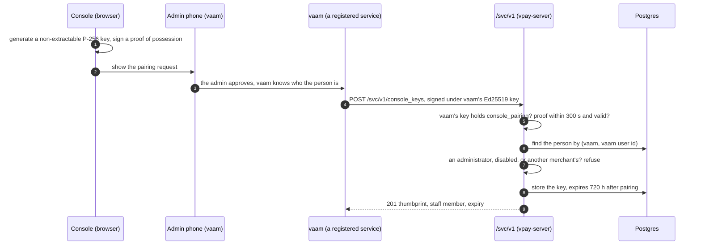
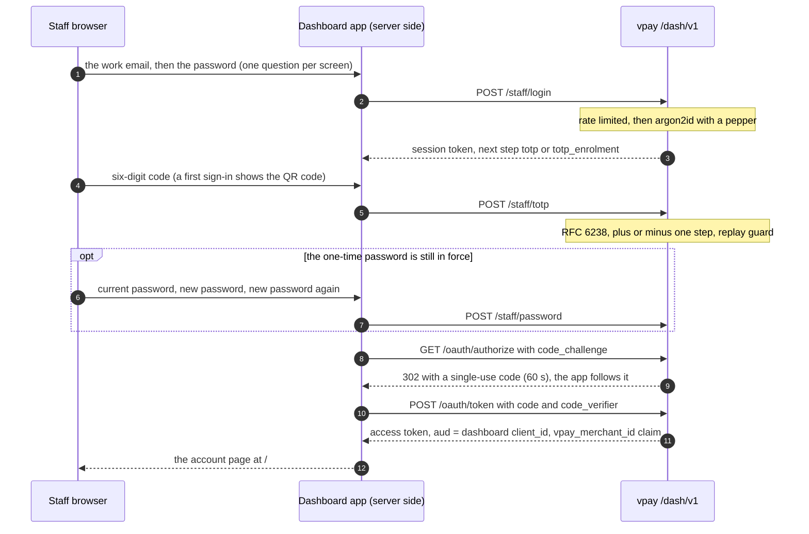
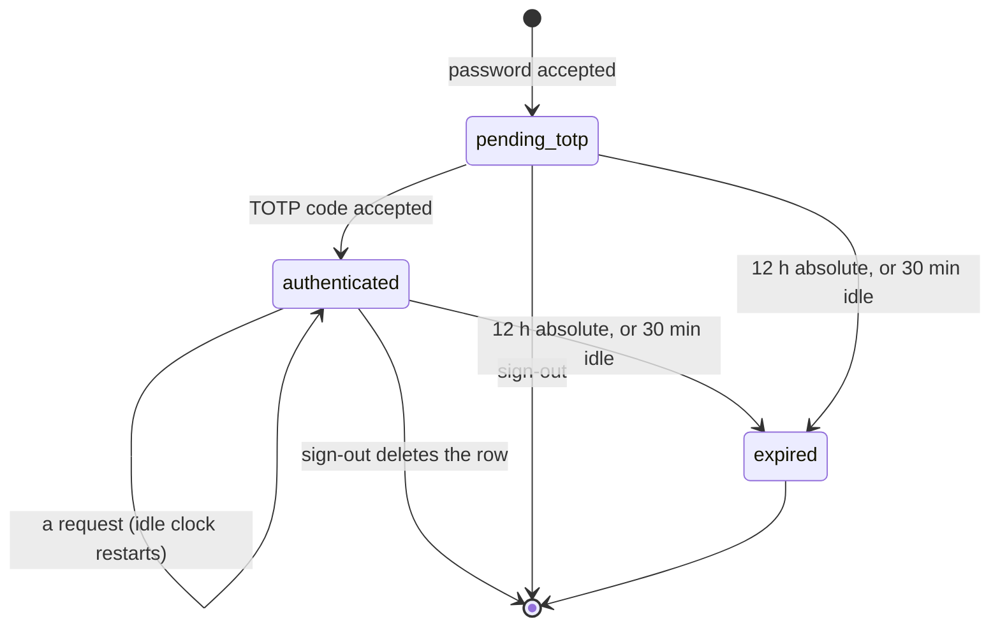

# Dashboard authentication

<Release /> rebuilt how a person reaches `/dash/v1`, twice in one release. It
now has two doors, one credential per request:

- **A console key.** Every request is a COSE_Sign1 message signed by a P-256
  key a person's browser generated, registered in `console_keys` for one staff
  member and good for 30 days. This is the `keypair` method, and on a
  deployment that permits nothing else (vaam's) it is the only door
  ([ADR-0036](vpay:docs/adr/0036-the-console-is-a-signed-message-under-a-paired-key.md)).
- **A staff sign-in**, served only where `auth.methods` serves `human_login`: a
  password and a mandatory TOTP code, or single sign-on through an OpenID Connect
  provider, then vpay's own authorization-code grant, ending in a short-lived
  access token. It was deleted with the console key's arrival and restored
  behind the method in the same release
  ([ADR-0037](vpay:docs/adr/0037-authentication-methods-are-deployment-configuration.md),
  decision 8).

**What the dashboard application can do with them is narrower.** It signs a
person in with a password and an authenticator code, or with single sign-on,
and lands them on an account page that says who they are, which merchant they
read, and lets them sign out. **It reads nothing from `/dash/v1`**: the
payments, refunds, deliveries and customers pages were deleted and come back
with VP-6b, which is also when the application learns to hold and sign with a
console key. Until then the way in with a key is a client that signs requests,
not the application. See [the dashboard](/dashboard/).

Agents working on this should load [vpay-dashboard](skill:vpay-dashboard).

## Which door a deployment has

| What the deployment writes                                             | `/dash/v1` takes                                           | `/login` in the dashboard application               |
| ---------------------------------------------------------------------- | ---------------------------------------------------------- | --------------------------------------------------- |
| neither `dashboard:` nor the `human_login` blocks                      | nothing: `/dash/v1` and `/svc/v1` are the honest `404`     | —                                                   |
| `dashboard:` (and `service_clients:` to let a service pair keys)       | console keys only; an unsigned request is the coarse `401` | "This console signs in with a paired key", no field |
| `human_login` served: `staff_auth` and `dashboard_client` both written | a console key **or** a staff access token, never both      | the sign-in                                         |

`human_login` is permitted by default (an absent `auth.methods` permits all four
methods) but **served** only where both its blocks are written. Half a sign-in is
refused at boot (`AuthMethodNotConfigured`), and so is either block on a
deployment whose explicit `auth.methods` leaves the method out
(`AuthMethodDisabled`). When `dashboard.merchant_id` and
`dashboard_client.merchant_id` are both written they must name the same tenant:
`/dash/v1` reads exactly one. A request that is signed **and** carries an
`Authorization` header is a `400`.

The dashboard application asks vpay which methods it serves,
`GET /.well-known/vpay-auth`, on every render of `/login`. If vpay cannot be
asked it says sign-in is not reachable, with the request id, and never falls
through to "paired key".

## The console key

> **No `/dash/v1` request is handled unless it is a COSE_Sign1 message signed
> by a console key that is registered to an active member of the dashboard's
> merchant, was paired less than 30 days ago, has not been revoked, is addressed
> to this deployment, and has not been seen before. Every answer to such a
> request is a COSE_Sign1 message signed by this deployment.**

That is the whole rule where `human_login` is not served. The private key is
generated in the browser with WebCrypto as non-extractable, so it cannot be read
back. The transport is the one `/v1` uses ([Signed requests](/api/signed-requests)):
the same binding, the same Postgres replay cache, the same coarse `401`.

### Pairing a key

A key reaches `console_keys` by exactly two doors, and both run the same
function:

- **From a service.** `POST /svc/v1/console_keys` is called by a service listed
  in `service_clients` whose entry carries the `console_pairing` capability. A
  capability is a field of the YAML and nothing else: no route, row or
  environment variable can grant one. A first pairing provisions the person as a
  **plain member** of `dashboard.merchant_id`, `is_admin = false`, with the
  member, the link to vaam and the key in one transaction.
- **The break-glass.** An operator with database access runs
  `vpay-server staff pair-key --staff <email|stf_…> --public-key <key>` for an
  existing, active member. It creates no member and changes no flag.

**Pairing never creates or upgrades an administrator.** The request has no role
field, and an already-linked administrator is refused with a `403`. An
administrator is made only by `vpay-server staff add --admin` and keyed only by
`staff pair-key`.

**A key lives exactly 30 days** from pairing, enforced by a `CHECK` as well as
by the code, and is never extended: the console pairs again with a new key. A
revoked or expired key is never registered again, because its row is never
deleted. **Revocation takes effect on the next request**:
`DELETE /svc/v1/console_keys/{thumbprint}` or `vpay-server staff revoke-key`,
either of which may revoke an administrator's key. A lost browser profile is a
revocation, not a reset.

`/svc/v1` is served on the business surface, the in-cluster origin vaam already
dials, not on the management tier. **Not built:** vaam's half (its service key,
the call, the admin phone's pairing screen), and the dashboard application's
key generation, pairing request and request signing (VP-6b).

### One signed request

The resolver reads `console_keys` on every request and caches nothing. After
the signature verifies, it re-reads the key and the member: a disabled member,
or one who belongs to another merchant than the dashboard's, is a sealed `403`.
A database that cannot answer is a `500`, never a miss.

| Cause                                                                                           | Answer                                      |
| ----------------------------------------------------------------------------------------------- | ------------------------------------------- |
| no signature, an unknown, revoked or expired key, a bad signature, the wrong audience, a replay | the coarse `401`, unsigned, identical bytes |
| a write method on a read-only route                                                             | `405` with `Allow: GET`, before the router  |
| a verified key whose member is disabled, gone, or of another merchant                           | sealed `403`, one answer for the three      |
| an administrator naming a merchant this deployment does not serve                               | sealed `400` naming `merchant_id`           |

## The staff sign-in (`human_login`)

Where `human_login` is served, a person signs in against a staff table vpay
owns, and the dashboard application's own server runs an OAuth
authorization-code grant with PKCE against vpay's **in-process** OpenID
Provider. The resulting `/dash/v1` access token never reaches the browser.

**There is no sign-up.** `vpay-server staff add --merchant … --email … --name …`
creates a member. Where `human_login` is served it also prints a one-time
password on stdout and marks the account `password_change_required`; where it
is not, it prints the member's `stf_…` id and writes no credential. An optional
`--admin` grants cross-tenant **reads** ([below](#admins)). The other way a
member appears is a first [single sign-on](#single-sign-on).

**The password** is hashed with argon2id at OWASP's first parameter set (19 MiB,
two passes, one lane), with a deployment pepper as argon2's secret input. The
`argon2` crate is 0.6 since v0.15.0; a hash 0.5.3 wrote still verifies
([verification](vpay:docs/status/verification/2026-10-26-argon2-0-6.md)).
Credentials live in one `credentials` table: three of its eight declared kinds
are implemented (`password`, `totp` and `oidc`, the last keyed on
`(issuer, subject)` and never on email).

**The application follows the `302` itself**, so a browser never sees a code, a
verifier or a token, and there is no page at `redirect_uri`: it is a string both
legs must spell identically. **There is no refresh token, and there never was
one on this surface**; a `refresh_token` request is a `400` while the method is
served. The application mints the token from the session at the first render
and runs the code leg again when 80% of its life has passed. Its TTL is
`staff_auth.access_token_ttl_seconds`, 900 by default, bounded 10 to 3600.

**What a token must clear on every request.** Audience
`dashboard_client.client_id`, the registration's single scope, and a
`vpay_merchant_id` claim equal to the dashboard's tenant, which only this grant
stamps, so no `client_credentials` token can read `/dash/v1`. Then the member is
re-read (active, this merchant) and the tenant resolved through the **same**
function a console key goes through. A session's answers are plain JSON and
carry none of the signed transport's protections: that is the trade a
deployment makes by serving the method.

### The session

The session token is 256 bits from the OS CSPRNG, and vpay stores only its
SHA-256, so a dump of `staff_sessions` yields no usable session.

| Bound    | Value                                      | Moved by               |
| -------- | ------------------------------------------ | ---------------------- |
| Absolute | 12 hours from creation                     | nothing                |
| Idle     | 30 minutes since the last accepted request | every accepted request |

Both bounds are checked on **read** and delete nothing. **Signing out deletes
the row**, so the dashboard's server can no longer obtain the access token it
carries; the token itself stays valid for the rest of its TTL, and the OP has no
revocation endpoint. If vpay does not confirm the sign-out, the application
keeps the cookie and says so.

**The cookie needs a secure origin.** The application keeps the session in
`__Host-vpay_dash_session` (and an enrolment secret in
`__Host-vpay_dash_enrolment`): `HttpOnly`, `Secure`, `SameSite=Lax`, `Path=/`,
no `Domain`. A browser stores those over `https`, and over `http` only on
`localhost`. Reached over plain `http` on any other host, the sign-in succeeds
and does not stick. Put the dashboard behind TLS. The rename from
`vpay_dash_session` signs out any browser that held the old name.

### Every refusal is one answer

No such address, wrong password, disabled account, wrong or replayed code,
expired, idle or forged session, a session at the wrong stage: one `401`, one
sentence. The step that refused goes to the log, never the body. An address
with no account still costs one argon2id verification, so the answers match in
**timing** as well as shape.

### Rate limits

Counted in Postgres, so every replica spends from one budget: ten sign-in
attempts per five minutes per email **and** per source address, with every
wrong TOTP code spending from the same budget, and five current-password
attempts per session. An attempt over budget is refused before any argon2id
work. The source address is the transport peer unless
`staff_auth.trusted_proxies` names the proxies whose `X-Forwarded-For` is
believed; empty, the default, means one per-address budget per proxy, which
behind a reverse proxy is the whole deployment's.

### Single sign-on

With `staff_auth.sso` written, the human step can federate to an OpenID Connect
provider such as Keycloak
([ADR-0030](vpay:docs/adr/0030-staff-sign-in-federates-to-an-oidc-provider.md)).
It is served exactly when `human_login` is: there is no switch of its own, and a
provider that cannot be built is a boot refusal. Password and TOTP stay mounted
beside it as the break-glass path.

**Only the human step federates.** vpay redeems the provider's code, verifies
its id_token (signature from the provider's published keys, `iss`, `aud`,
`azp`, `exp`, `iat`, the flow's `nonce`), requires the person to be in
`required_group`, and requires a second factor: the token's `amr` must intersect
`accepted_amr`, or its `acr` be in `accepted_acr`. For Keycloak the rule is
`accepted_amr: [otp]`. When the second factor is the token's only defect, vpay
sends the browser back to the provider once with `prompt=login`. A successful
callback ends in the same `authenticated` session the TOTP step ends in.

The first successful sign-in of a person in the group **creates the staff
member**, bound to `dashboard_client.merchant_id` and never an admin; an email
that already belongs to an unlinked member is refused, never linked. Members
who signed in through SSO before this release kept their `oidc` credential and
resolve to the same member again.

**In the dashboard application** a single sign-on button is drawn beside the
email question only when vpay serves `human_login`, `GET /dash/v1/staff/sso`
says `enabled: true`, and the container sets `VPAY_DASHBOARD_SSO_ISSUER`. A
status read that fails says SSO could not be checked; the button is never hidden
silently. The provider's redirect URI is the application's
`/api/auth/sso/callback`, which `staff_auth.sso.redirect_uri` must name. A
provider whose authorization endpoint is on another origin than its issuer
(AWS Cognito, Entra ID v1, Azure AD B2C behind a custom domain) is refused.

**Not built:** linking an existing password member to an SSO identity, logout at
the provider, a continuous group check, and any end-to-end case: no browser has
completed an SSO sign-in, because the compose stack has no identity provider.

### Recovering a member who lost a password or an authenticator

There is no command for either. A lost authenticator is the member's TOTP
credential and sessions deleted in SQL, after which the next password sign-in
enrols a fresh one. A lost password is the member deleted and added again with
`staff add`, which also deletes their console keys and changes their `stf_…`
id. The statements are in vpay's
[deploy runbook](vpay:docs/runbooks/deploy-and-rollback.md#staff-who-lost-a-password-or-an-authenticator).

## Admins {#admins}

A staff member with `is_admin` may add `?merchant_id=` to a `/dash/v1` read to
scope it to any merchant the deployment registers, one at a time; without the
parameter it is their own merchant. For a non-admin the parameter is not even
parsed. The rule is the same whichever door the request came through
([ADR-0018](vpay:docs/adr/0018-cross-tenant-admin-reads.md)). An admin still
cannot write.

## Upgrading from v0.15.0

::: danger Staff passwords and authenticators are deleted unless you export them
The upgrade runs migration 0056, which deletes every `password` and `totp`
credential and drops the session, authorization-code and SSO-attempt tables,
then 0058, which creates those tables again **empty**. Everyone is signed out,
and every staff member who signed in with a password must be enrolled again,
**unless** the rows were exported before the upgrade and restored after it, as
vpay's
[deploy runbook](vpay:docs/runbooks/deploy-and-rollback.md#keeping-staff-passwords-across-0056-and-0058)
describes. Keep `staff_auth.password_pepper` and
`staff_auth.totp_encryption_key` unchanged: an exported hash or seed verifies
only under them. `oidc` links are kept, so SSO members resume.
:::

- **To keep the sign-in**, keep both `staff_auth` and `dashboard_client` in the
  configuration. v0.16.0 accepts them as `human_login`'s blocks. (The changelog's
  breaking-change note says both keys are refused at boot; that was true of the
  commits between VP-6a and VPA-3 inside this release, and is not true of the
  tag.)
- **To serve a console with keys**, add `dashboard:` naming the tenant, and
  `service_clients:` for the service that pairs keys.
- **A proxy in front of the management pod must not add an `Authorization`
  header** to a signed request: that is now a `400`.
- **Helm**: `dashboard.clientId`, `dashboard.redirectUri`, `dashboard.scope`
  and `dashboard.ssoIssuer` are rendered into the dashboard's environment only
  when set. See [Deployment](/operate/deployment).

## Status in this release

| Part                                                    | Status                   | Evidence                                                                                                                                                                          |
| ------------------------------------------------------- | ------------------------ | --------------------------------------------------------------------------------------------------------------------------------------------------------------------------------- |
| Console keys: pairing, revoking, the signed surface     | <Status s="built" />     | `console_pairing.rs`, `dashboard_read_surface.rs`, `dashboard_procedure_transport.rs` against a real Postgres, each guard broken in turn                                          |
| Password, TOTP, sessions, the PKCE grant on the server  | <Status s="built" />     | `staff_sign_in.rs` (28 cases) on a real socket over Postgres, including a session and a console key both reading `/dash/v1`; a real `serve` on a management pod in `tests/cli.rs` |
| The application's password sign-in, in a real browser   | <Status s="built" />     | `dashboard-human-login.cy.ts` against the compose stack, which serves `human_login`: 7 of 7 on CI's first `e2e (compose)` run                                                     |
| Single sign-on on the server                            | <Status s="partial" />   | `staff_sso.rs` against a simulated provider; `staff_sso_keycloak.rs` ran against a real Keycloak 26.6.1 before 0056 and was only compiled when VPA-4 restored SSO                 |
| Single sign-on in the application                       | <Status s="partial" />   | Two routes and the button, proven against a stubbed `fetch` and in jsdom; no browser has completed one and no end-to-end case exists                                              |
| The application holding a console key                   | <Status s="not-built" /> | VP-6b: key generation, pairing, signing, and which credential wins when a browser holds both                                                                                      |
| vaam's pairing side of `/svc/v1`                        | <Status s="not-built" /> | vaam's own work                                                                                                                                                                   |
| `staff remove`, `staff disable`, `staff reset-password` | <Status s="not-built" /> | SQL only, from the runbook                                                                                                                                                        |
| Linking an existing member to SSO                       | <Status s="not-built" /> | Members come only from a first SSO sign-in                                                                                                                                        |
| Signing-key rotation, other credential kinds            | <Status s="not-built" /> | `hotp`, `magic_link`, `email_otp`, `phone_otp`, `webauthn` are declared with no verifier                                                                                          |
| Running in a deployment                                 | <Status s="not-built" /> | No pod running the dashboard or its backend tier is on record                                                                                                                     |

The full record is
[dashboard-auth.md § Status](vpay:docs/flows/dashboard-auth.md#status),
[human-login.md](vpay:docs/flows/dashboard-auth/human-login.md) and
[sso.md § Status](vpay:docs/flows/dashboard-auth/sso.md#status).

## Go deeper

- [Dashboard authentication: the console key](vpay:docs/flows/dashboard-auth.md)
- [Staff sign-in (`human_login`)](vpay:docs/flows/dashboard-auth/human-login.md)
  · [Single sign-on](vpay:docs/flows/dashboard-auth/sso.md)
- [ADR-0036: the console is a signed message under a paired key](vpay:docs/adr/0036-the-console-is-a-signed-message-under-a-paired-key.md)
- [ADR-0037: authentication methods are deployment configuration](vpay:docs/adr/0037-authentication-methods-are-deployment-configuration.md)
- [ADR-0009](vpay:docs/adr/0009-dashboard-oidc-provider.md),
  [ADR-0017](vpay:docs/adr/0017-staff-authentication.md),
  [ADR-0018](vpay:docs/adr/0018-cross-tenant-admin-reads.md),
  [ADR-0019](vpay:docs/adr/0019-credential-model.md),
  [ADR-0030](vpay:docs/adr/0030-staff-sign-in-federates-to-an-oidc-provider.md)
- [What the application built, measured](vpay:docs/status/verification/2026-10-30-vpa5a-dashboard-sign-in.md)
- [The staff dashboard](/dashboard/), [Signed requests](/api/signed-requests)
- Skill: [vpay-dashboard](skill:vpay-dashboard)
