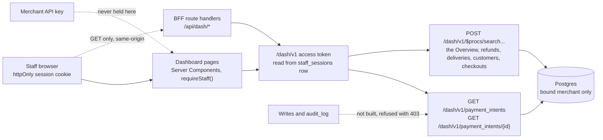

# The staff dashboard

The dashboard is a Next.js app a merchant's staff sign in to, to see what
happened to that merchant's payments. Its founding decision is that it
**observes and does not administer**: it reads records, it never changes
configuration, and it never holds a merchant API key. In <Release /> it is
**read-only** — a staff member can sign in, land on an Overview of counts, and
read payments, refunds, webhook deliveries, customers and checkout sessions, and
cannot do anything at all to any of them. No deployment of it is on record: vpay
is being tested for live use on some clusters (the owner's statement,
2026-10-21), but no dashboard pod and no result from that testing is recorded.

Agents working on this should load [vpay-dashboard](skill:vpay-dashboard).

## The boundary

> A `/dash/v1` request reads exactly one tenant's rows: the one
> `dashboard_client.merchant_id` names, fixed in YAML and checked at boot.

The tenant does **not** come from the caller's credential, the way `/v1`
resolves one. No claim in any token can change it. A deployment whose staff must
see two merchants registers two dashboard clients.

Four checks stand between a request and a row, each in a different place so no
single edit removes the boundary:

1. The token validates — signature, expiry, issuer, and an audience equal to the
   registered `dashboard_client.client_id` — against vpay's own JWKS.
2. It carries a `vpay_merchant_id` claim equal to the bound merchant. Only the
   staff sign-in grant stamps that claim, so **no `client_credentials` token can
   ever read `/dash/v1`**. The claim is compared, never used: a forged one buys
   a `403`, never another merchant's rows.
3. It carries the registration's single scope.
4. Every query filters by the bound `merchant_id`.

Any method other than `GET`/`HEAD` is refused by the boundary **before** the
router matches, with a `403`. That is what makes "read-only" structural rather
than a promise: a write mounted later cannot arrive unlogged. Two boot checks
back this up — a `dashboard_client.merchant_id` no merchant registers is fatal,
and so is a merchant registration listing the dashboard's client id in its
`allowed_audiences`. A deployment with no `dashboard_client` mounts no
`/dash/v1` at all.

How a staff member gets that token is
[Dashboard authentication](/dashboard/authentication).

## From browser to `/dash/v1`

The browser never holds a vpay token. It holds an httpOnly session cookie on the
dashboard's own origin; the dashboard's **server** looks up the `/dash/v1`
access token in the `staff_sessions` row on every render and makes the call.

- **Pages read on the server.** Each page is a Server Component that calls
  `requireStaff()` and reads `/dash/v1` itself. The payments list, the payment
  detail and, since <Release />, the other four lists then hand what they read
  to Refine's hooks as initial data; the Overview renders its counts directly
  and uses no client data layer. A browser-side read was tried and withdrawn
  after it broke the end-to-end suite.
- **The BFF** (`/api/dash/*`) is a same-origin, `GET`-only proxy that
  authenticates on the same cookie. A request with no cookie never reaches vpay;
  a request the dashboard did not issue is refused by an `Origin` /
  `Sec-Fetch-Site` check; the bearer token appears in no response header or
  body; no caller-supplied merchant id, audience or scope is forwarded. Every
  other method gets a `405`. It has six handlers — one per list plus the
  payment detail — and Refine's two data providers are wired to it, but vpay records
  that no page issues a read through it: every read is made on the server, and
  Refine is configured to treat a server-seeded query as the answer and not read
  it again. A twelve-step click-through, run against a fake of `/dash/v1` kept
  outside the vpay repository, made no BFF request. It was attacked in a
  security review and driven from a real browser.
- **The payments list** is served by two REST routes and is cursor-paged, like
  the merchant API. **The other four lists** are CrateStack procedures under
  `/dash/v1/$procs/`, which the dashboard's server calls with `POST` on the
  browser's behalf; they are offset-paged, twenty to a page. Since <Release />
  the server makes those calls through `@vpay/dash-client`, a TypeScript client
  generated from `schemas/vpay.cstack`, with `@cratestack/refine` as their
  Refine data provider. `just check-schema` fails if the committed client is
  stale, and a filter key a procedure does not declare is refused before
  anything is sent. The payments list stays on its hand-written provider,
  because it is cursor-paged. Refunds,
  deliveries and checkouts pass one filter through to their procedure (a status,
  or a state for deliveries); customers take none. **The Overview** reads those
  four procedures and `searchPaymentIntents` for its counts.

The dashboard is not an SDK surface: the merchant SDKs speak `/v1`, and a
`/dash/v1` method in one would be a merchant credential reaching for a staff
surface. The detail response is vpay's own shape
(`object: "dashboard.payment_detail"`), not a pretend Stripe object.

## The screens

| Page                                       | What it shows                                                                                                                               |
| ------------------------------------------ | ------------------------------------------------------------------------------------------------------------------------------------------- |
| `/`                                        | Nothing of its own: it sends a signed-in browser to `/overview` and any other to `/login`                                                   |
| `/login`, `/login/totp`, `/login/password` | The sign-in — see [authentication](/dashboard/authentication). With single sign-on configured, `/login` also offers "Sign in with Keycloak" |
| `/overview`                                | The home screen: twelve counts, each a link to the rows it counts, and the six newest payments. See below                                   |
| `/payments`                                | The bound merchant's intents, newest first; status chips, a created-range picker, cursor paging                                             |
| `/payments/{id}`                           | The intent, its charge, its refunds, the last error with its failure code, the event timeline                                               |
| `/refunds`, `/deliveries`, `/checkouts`    | Read-only lists, newest first, twenty to a page; chips filter by status (by state, for deliveries). Refunds and checkouts link to payments  |
| `/customers`                               | A read-only list of saved customers, newest first, twenty to a page; no filter                                                              |

The navigation is generated from one array and a test fails if it ever links to
a page that does not exist — a menu entry for an unwritten page is the same lie
as an empty table. The Overview is the rail's top item, and the other five
screens sit in three sections: Money, Customers and Integrations.

### The Overview

`/overview` is where a staff member lands after signing in. It answers "is
anything wrong for this merchant right now?" with counts, and **every count is
one vpay computed**: the `totalCount` of a search procedure called with
`limit: 1` and the filter the tile links to. Twelve reads are made in parallel
on the server:

- All payments, and the payments in each of the five statuses. "All payments" is
  its own unfiltered read, not the sum of the five, which could disagree with it
  while payments are being written.
- Failed refunds, pending refunds, failed webhook deliveries, deliveries whose
  retries are exhausted, open checkout sessions, and customers.

The six newest payments come from the "All payments" read. Each tile is a link to
the list filtered by the value it counted, so the screen never shows a number an
operator cannot open. The heading states the UTC instant the counts were read.

It keeps the rules about absence. Nothing on it is summed, averaged or
estimated, and there is no money total anywhere, because vpay serves no
aggregate. A read vpay refuses is drawn as a dash, with the refusal shown once
above the tiles — never as a `0`. A failed-refund, failed-delivery or
exhausted-delivery count is painted in the danger tone when it is above zero.

What backs it is narrower than the sign-in does. Three vitest cases run the
Overview's reads against a stubbed `fetch`: each tile asks for the filter it
links to, each count is vpay's `totalCount` and never a sum, and a refused count
stays refused. A headless browser has also run it, against a fake of the
`/dash/v1` contract kept outside the vpay repository. **No Cypress case reads an
Overview count**; the spec asserts only that sign-in ends on `/overview`. See
[the redesign's verification page](vpay:docs/status/verification/2026-10-21-dashboard-md3e.md).

### Moving between screens, and the theme

The signed-in layout renders the shell once and keeps it mounted: the rail, a
top app bar with the merchant, and an account block with who is signed in and
Sign out. The layout runs the same `requireStaff()` gate as every page, shared
with the page it wraps, so a full render costs one session read. Every page
still runs the gate itself on every navigation; Refine's own `check` makes no
request.

The rail's links are plain anchors from the UI package, which would load a whole
new document for every click. The shell turns an ordinary same-tab click into a
client-side navigation (`src/client-navigation.ts`), and leaves a modified,
middle-button, `target` or `download` click to the browser. Each route has a
`loading.tsx` skeleton, shown in the page area as soon as a link is followed.
One fixed click-through (a payment, back, each of the five lists, the next page)
loaded six full documents before the change and one, the first, after it; each
navigation read the staff session twice before and once after. That was
measured in headless Chromium against the same fake of `/dash/v1`, not against a
real vpay.

The theme has two controls: a one-tap light and dark button in the top app bar
(and on the signed-out card), and System, Light and Dark in the account block.
The choice is kept in the browser. A script that runs first in `<body>` applies
it before the first paint; the document is dark until then.

### What a screen may show

A dashboard that looks complete is the failure mode this project fears most, so
the screens are held to rules about **absence**:

- **No "Rail" column on the list.** The list response carries no charge, only
  `payment_method_types` — the rails an intent _may_ use. So the column is
  headed **Methods**. The detail page has a real rail, from the charge.
- **The payer's phone is always a dash.** `charges.payer_ref_masked` is never
  written, so the detail page renders a real `null` as `—` and must never fall
  back to the unmasked value. There is no payer column on the list and no search
  by phone, because both would be sourced from a column that is always empty.
  The customers list is a different record: it shows each saved customer's name,
  email and phone in full, and no address.
- **No page count on the payments list.** Its route returns cursors and
  `has_more`, never a total, so "page 3 of 12" would be invented. "Next" appears
  only when `has_more` says so. The four procedure lists do show a total ("1–20
  of 143 so far"), because their procedures return vpay's own `totalCount`.
- **An unknown status renders as text**, not as a coloured pill. A green badge
  on an unfamiliar status is a claim.
- **The timeline names what it cannot show.** Under it, a banner says the
  timeline is not the whole history of a payment and names the two event types
  nothing writes, `payment_intent.created` and `payment_intent.processing` — see
  [Webhooks](/api/webhooks). Until vpay 0.6.0 it named five, three of which had
  gained writers; its test now also refuses the three that have one. One gap is
  read from the code and not yet tested: a refund's events are stored against
  the refund's own `re_…` id, and the timeline asks only for the intent's and
  the charge's, so a real refund's events may not reach it.
- **The merchant is on every signed-in page**, in the top app bar, and the
  account block names who is signed in, so an empty list is distinguishable from
  looking at the wrong merchant. The page that says vpay could not be reached has
  no session to read them from, and shows neither.
- **A refused read is never an empty list.** On the procedure lists an unknown
  filter value is a `400` naming the field, and it is drawn as a refusal with its
  request id, not as a table that reads "none in this state".
- **Payer credentials never appear.** The checkout list's source type does not
  even carry `client_secret_suffix` or `return_token`.
- **`?customer=` is refused.** It is `/v1`'s
  [customer filter](/api/#filtering-a-list-by-customer), and on
  `GET /dash/v1/payment_intents` it is a `400` naming `customer`. Until vpay
  0.6.0 it was silently ignored there, answering every customer's intents.
- **Configuration fails closed.** The API URL, client id, redirect URI and scope
  are read at container start; if one is missing, `/login` names the variables
  and offers no form.

## What it cannot do

- **Anything to a payment.** ADR-0008 describes per-record writes — re-poll a
  charge, replay a webhook, issue a refund, annotate a charge — each with an
  `audit_log` row. **None is built**, so there is no `audit_log` either.
- **Balances and the ledger, settings, rail health** (slices 4–6) are not
  started. Webhook deliveries are a list only; retries and signature replay are
  not started.
- **No deployment of it is on record.** The Helm chart templates a Deployment
  for the app (`dashboard.enabled`, off by default) and a separate
  `/dash/v1`-only backend tier (`management.enabled`). The image was run by hand
  with a read-only root filesystem and answered its health path — but **no
  Kubernetes pod running it is on record**, nor any other pod of the chart. On
  2026-10-18 a real cluster refused to start the dashboard image because it
  declared a named `USER node`; the image now declares the numeric
  `USER 1000:1000`, and no pod of it has been seen starting since.

::: warning Two deployment traps, already documented
The management tier does **not** serve `POST /v1/oauth/token` (that mints the
merchant credential); the staff grant is `/dash/v1/oauth/token`. And publishing
`/dash/v1` through the chart's HTTPRoute with `networkPolicy.enabled` requires
the Gateway's namespace in `networkPolicy.managementIngress.namespaceSelector` —
a chart guard refuses the combination. Whether this tier should face a public
gateway at all is an open maintainer decision. See
[Deployment](/operate/deployment).
:::

## Status in this release

| Part                                                      | Status                   | Evidence                                                                                                                                                                                                                                                                                                                                                                                                      |
| --------------------------------------------------------- | ------------------------ | ------------------------------------------------------------------------------------------------------------------------------------------------------------------------------------------------------------------------------------------------------------------------------------------------------------------------------------------------------------------------------------------------------------- |
| `/dash/v1` boundary, the two payment reads, boot refusals | <Status s="built" />     | `backends/tests/integration/tests/dashboard_read_surface.rs` over a booted server and real Postgres                                                                                                                                                                                                                                                                                                           |
| Sign-in and the pages, in a real browser                  | <Status s="built" />     | `dashboard.cy.ts` signs in through the real OP against the compose stack, lands on `/overview` and reads payments                                                                                                                                                                                                                                                                                             |
| Single sign-on routes                                     | <Status s="partial" />   | Built and covered by vitest against stubbed `fetch`; no browser has run them                                                                                                                                                                                                                                                                                                                                  |
| Overview, and navigation without reloads                  | <Status s="partial" />   | Vitest against a stubbed `fetch`, and a headless browser against a fake of `/dash/v1`. Since <Release /> a Cypress case opens the Overview against the compose stack and asserts that no read was refused; none asserts a count's value                                                                                                                                                                       |
| Refunds, deliveries, customers, checkouts lists           | <Status s="partial" />   | Read-only lists over CrateStack procedures, read through a generated client and `@cratestack/refine` since <Release />; status or state chips on three, none on customers. A Cypress case opens each against the compose stack, with WireMock rails, and asserts rows or the empty-state sentence and no refused read; the stack writes no refund and no customer, so those two showed only their empty state |
| The BFF read surface                                      | <Status s="partial" />   | Six handlers, reviewed and browser-tested; pages render from server-side reads, not through it                                                                                                                                                                                                                                                                                                                |
| Writes and `audit_log`                                    | <Status s="not-built" /> | Refused at the boundary; ADR-0008's writes are designed, unbuilt                                                                                                                                                                                                                                                                                                                                              |
| Slices 4–6                                                | <Status s="not-built" /> | Not started                                                                                                                                                                                                                                                                                                                                                                                                   |
| Real data on screen                                       | <Status s="partial" />   | Every payment it has shown settled against a WireMock rail                                                                                                                                                                                                                                                                                                                                                    |
| Running in Kubernetes                                     | <Status s="not-built" /> | Chart templates exist; no pod is on record                                                                                                                                                                                                                                                                                                                                                                    |

The theme script has to run first in `<body>`. In v0.10.0's dashboard image it
sat in `<head>`, where it failed React hydration in the document Cypress serves
and took 17 of the spec's 18 cases down with it; v0.10.1 moved it, and a unit
test pins the placement. With it moved, all 18 cases of `dashboard.cy.ts` passed
in CI's compose job on the branch that carried the fix. No real user's browser
was measured. See [the hydration record](vpay:docs/status/verification/2026-10-21-dashboard-hydration.md).

The full record is [dashboard.md § Status](vpay:docs/flows/dashboard.md#status)
and its three status pages. Overall standing is on [Status](/guide/status).

## Go deeper

- [The dashboard flow](vpay:docs/flows/dashboard.md) — the invariant, the
  slices, the boundary
- [What slice 1 did not build](vpay:docs/flows/dashboard/slice-1-gaps.md) —
  including the rules about absence
- [The read seam, the BFF, and its security review](vpay:docs/flows/dashboard/status-read-seam-and-bff.md)
- [What is built and proven](vpay:docs/flows/dashboard/status-built-and-not-built.md)
- [ADR-0008: the dashboard observes; it does not administer](vpay:docs/adr/0008-dashboard-scope.md)
- [ADR-0022: surface isolation and independent scaling](vpay:docs/adr/0022-surface-isolation-and-independent-scaling.md)
- [The app's README](vpay:frontends/apps/dashboard/README.md)
- [The redesign and the reload fixes, measured](vpay:docs/status/verification/2026-10-21-dashboard-md3e.md)
  · [The hydration failure and its fix](vpay:docs/status/verification/2026-10-21-dashboard-hydration.md)
- Skills: [vpay-dashboard](skill:vpay-dashboard),
  [vpay-frontend](skill:vpay-frontend)
