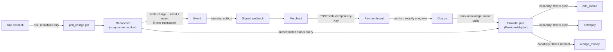
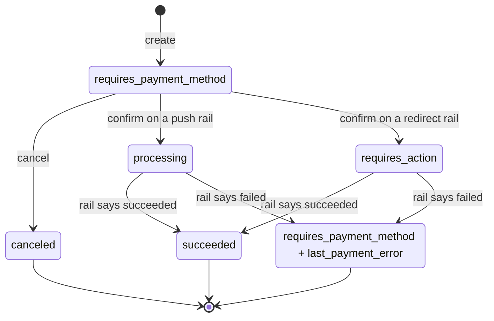
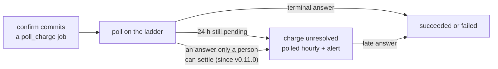

# Core concepts

vpay has a small number of ideas that everything else depends on. Most of them
exist because mobile money behaves differently from cards: the payer approves
the payment somewhere vpay cannot see, callbacks cannot be trusted, and a
payment that is still pending after fifteen minutes can succeed hours later.
Each section below is a short summary with a link to the full page.

::: info Designed is not the same as built
vpay's flow documents describe the _design_. Where a concept is only proven
against WireMock stubs, this page says so. See [What works
today](/guide/status).
:::

## How the concepts fit together



## PaymentIntent and Charge

A **PaymentIntent** is the merchant-facing object. It follows Stripe's shape: it
is created in `requires_payment_method`, it is confirmed, and it ends in
`succeeded`, in `canceled`, or back in `requires_payment_method` with a
`last_payment_error`. A **Charge** is the single attempt at a rail that a
confirm creates.



`confirm` always submits. `requires_action` happens only on redirect rails, and
a redirect intent settles or fails straight from it, without passing through
`processing`. Neither state ends until the rail gives a terminal answer: timers
fire, but they never decide the outcome. `canceled` is reachable only before a
rail has the request. Full page: [Payment lifecycle](/payments/lifecycle).

## Money is integer minor units

Every amount is an **integer count of the currency's minor unit**. There is no
floating point anywhere in the money path, and `clippy::float_arithmetic` is
denied across the workspace. XAF, the Central African CFA franc, is
**zero-decimal**, so `amount: 5000, currency: "xaf"` means 5,000 FCFA, not
50.00. This is the same way Stripe handles zero-decimal currencies. Amounts are
converted for a rail in exactly one place (`Money::to_provider_string`, with an
integer twin, `Money::to_provider_minor`). Full page: [Money](/payments/money).

## Rails and the provider port

A payment rail is reached only through one trait, `ProviderAdapter`, in
`backends/crates/vpay-provider`. The core owns the lifecycle, the ledger,
reconciliation and the failure taxonomy. An adapter owns one rail's wire
protocol and maps that rail's failures into vpay's `FailureCode` and
`ProviderError`. Providers are rows in a table, never enum variants
([ADR-0002](vpay:docs/adr/0002-provider-port.md)). Full page:
[Provider port](/rails/provider-port).

## Capabilities, not provider codes

The core never asks _which_ rail it is talking to. It reads the rail's declared
**capabilities** and branches on their values:

| Capability                 | `mtn_momo` | `orange_money` | `notchpay` |
| -------------------------- | ---------- | -------------- | ---------- |
| `flow`                     | `Push`     | `Redirect`     | `Push`     |
| `supports_refunds`         | `true`     | `true`         | `true`     |
| `supports_partial_refunds` | `true`     | `false`        | `true`     |

That is three of the eleven the port declares; the others are listed on
[the provider port](/rails/provider-port#branch-on-capabilities-never-on-provider-codes).

Code outside an adapter crate that branches on a provider code, as in
`if provider == "mtn_momo"`, is a defect. Adding a rail means making the one
shared conformance suite pass, not writing a new suite.

## Payment-method types: the payer picks a network, vpay picks the rail

Since v0.12.0 a **payment-method type** is separate from a rail. A type is what
the payer uses, such as `mtn_wallet` or `orange_wallet`; a rail is the adapter
that processes it, and each rail declares the types it serves (`notchpay`
serves both). `payment_method_types` takes either: a rail code still means that
rail, pinned, and a type lets vpay choose. On a confirm by type, a router in
`vpay-core` keeps the rails that serve the type, are enabled and settle the
currency, ranks them, charges the first, and records why in the charge's
transaction. The ranking today has one provisional component, a weight the
operator configures; the fee is the next component, and is not built. No
measured quantity moves traffic on its own. A decline never moves the intent
to another rail. Neither SDK can send a confirm by type. Since v0.13.0 a routed
charge can be refunded under its type, so a merchant need not know which rail
won, and since v0.14.0 the intent says anyway: `payment_method_details` names
its charge's type and rail. The ranking behind the choice is on no `/v1`
object. Full pages: [the merchant API](/api/) and
[the provider port](/rails/provider-port).

## Callbacks are hints

Mobile-money callbacks are usually unauthenticated and unsigned, and they can be
late, missing or duplicated. So a callback **never changes state**.
`POST /provider/{code}/callback` asks the adapter's `parse_callback` for
**identifiers only**, never a status, and enqueues a status query. Since
v0.12.0, on a rail that signs its callbacks and whose signature vpay checks
(Notch Pay only), a callback that fails the check enqueues nothing; one that
passes is still only a hint. The only
thing that moves money is the **authenticated status query** vpay makes to the
rail. `parse_callback` is synchronous on purpose: it cannot make a network call,
so it cannot sneak a status in from the request. A missed callback costs
latency and nothing else, because the poll ladder queries the rail on its own
schedule whether or not one arrives. MTN's own documentation says it sends a callback once and
never retries it. No Orange source says either way. Notch Pay's reference asks
for a `200` so that it does not retry, and vpay answers `202`; whether that
counts is an open question. Full page: [Reconciler](/payments/reconciler).

::: warning Never received from a real rail
The callback route and Notch Pay's signature check are proven against WireMock.
MTN, Orange and Notch Pay have never called the route. On 2026-10-24 Notch
Pay's sandbox delivered four webhooks to a capture endpoint registered in its
dashboard, and the signature check verified them offline; none reached vpay.
:::

## One charge per intent

```sql
CREATE UNIQUE INDEX one_charge_per_intent ON charges (payment_intent_id);
```

This is a plain unique index, not a partial one. If it covered only live states,
a charge that moved to `failed` would stop counting, and a second charge could
be inserted, possibly before the rail's answer was final. So a failed intent
stays failed, and **a retry means a new PaymentIntent**. This is the one place
vpay deliberately differs from Stripe's ergonomics.

## Crash safety has two enforcement points

The invariant is: **never let a payer act on a transaction you cannot later
name.** The two flow shapes enforce it at different moments, because the payer
can act at different moments.

- **Push (MTN):** MTN acknowledges `requesttopay` with a `202` and an empty
  body. The only id is the `X-Reference-Id` vpay sent. So vpay **commits the
  reference before calling the rail**. A retry reuses the same reference,
  because a new reference on retry is how a customer gets charged twice.
- **Redirect (Orange):** the payer cannot act until vpay hands over the payment
  URL. So vpay **commits the rail's `pay_token` before the redirect**. If the
  submit response is lost, no payment can have happened.

Notch Pay, a push rail, fits neither: it names a payment by its own reference,
which exists only in the answer to its first call. Since v0.11.0 vpay calls
it in two steps, with the reference committed after the first, which prompts
nobody, and before the second, which prompts the payer. That is proven against
WireMock and a real Postgres only.

vpay also writes an attempt row before it calls a rail, and recovery reads that
row back. An answered `submit` row on a `submitting` charge means "the rail took
it", so the row is marked answered only when that is true. A submit the rail
**declined** fails the charge first, and only then is the row marked answered.
A submit that ended in any other error, such as a `Malformed` answer, leaves the
row unanswered, because the charge's fate is unknown and the next poll must ask
the rail rather than move on. The API's confirm and the worker's resubmit both
follow that order.

Full page: [Crash safety](/payments/crash-safety).

## Idempotency keys

Every `POST` on `/v1` **requires** an `Idempotency-Key`. That is stricter than
Stripe, where the key is optional. The key is scoped to the merchant and kept
for 24 hours. A replayed key returns the same object and writes no second row.
Both merchant SDKs always send one. Full page: [The merchant API](/api/).

## Events and webhooks

vpay emits **only real Stripe event types**, such as `payment_intent.succeeded`
and `payment_intent.payment_failed`. A custom type would be silently dropped by
merchants whose code uses `stripe-node`'s typed union. Deliveries are signed
with Stripe's scheme under a `Vpay-Signature` header. They go through a
**two-step outbox**: the event is written in the same transaction as the state
change, and a separate fan-out step creates one delivery per endpoint. Delivery
is **at least once, in no guaranteed order**, so receivers must dedupe by
`event.id`. Full page: [Webhooks](/api/webhooks).

::: warning Never reached a merchant
No delivery to a merchant endpoint outside the repository is on record. Every
receiver on record is a container on a compose network.
:::

## The reconciler

Payer prompts expire and callbacks may never arrive, so the worker
(`vpay-server worker`) drives every payment to a terminal state, or hands it to
a human. It polls each charge on a ladder: every 10 to 90 seconds at first, then
every 120 seconds, then every 15 minutes out to 24 hours.



The design also marks a payer's prompt expired after `prompt_ttl_seconds`
(default 900) and tells the merchant's UI to stop waiting. **That half is not
built**: no column, no configuration key and no event exist at <Release />.

A late success, at minute 40 or at hour 30, is normal. The intent stayed
`processing` the whole time, so it moves to `succeeded` and emits a plain
`payment_intent.succeeded`. A status read the adapter cannot make sense of is
refused as `Malformed` and settles nothing: the charge stays as it was and the
polling goes on. A read it understood perfectly and cannot accept, such as a
Notch Pay `complete` for less than the charge's amount, settles nothing either,
and since v0.11.0 it makes the charge `unresolved` for a person at once
instead of after 24 hours. Full page: [Reconciler](/payments/reconciler).

## Status in this release

| Concept                        | Status                  | Evidence                                                                                                                                                                                                                                                                    |
| ------------------------------ | ----------------------- | --------------------------------------------------------------------------------------------------------------------------------------------------------------------------------------------------------------------------------------------------------------------------- |
| Integer minor-unit money       | <Status s="built" />    | `Money` in `vpay-core`, float arithmetic denied workspace-wide                                                                                                                                                                                                              |
| One charge per intent          | <Status s="built" />    | The unique index, proven against a real Postgres                                                                                                                                                                                                                            |
| Provider port and capabilities | <Status s="partial" />  | All three adapters pass the shared conformance suite, against WireMock containers. `mtn_momo` and `notchpay` have also met their rails' sandboxes through vpay, and `orange_money` has never been called                                                                    |
| Idempotency keys               | <Status s="partial" />  | Required on every `/v1` `POST`, and stored for 24 hours                                                                                                                                                                                                                     |
| Crash safety                   | <Status s="partial" />  | `SIGKILL` tests cover two of the three kill points on MTN. Orange is not exercised by the kill test. Notch Pay's two-step recovery is proven against WireMock and a real Postgres, not under a real signal                                                                  |
| Reconciler                     | <Status s="partial" />  | Ladder and 24-hour escalation are built and tested, and so is the immediate escalation of an answer only a person can settle; the prompt-expiry rung is not built. Rail evidence is WireMock, over seven successful MTN sandbox payments and six Notch Pay sandbox payments |
| Callbacks as hints             | <Status s="unproven" /> | Route and Notch Pay's signature check proven against WireMock; the check verified four real Notch Pay sandbox webhooks offline (2026-10-24); the route has never been called by a real rail                                                                                 |
| Payment-method types           | <Status s="partial" />  | Types, the router and the recorded decision proven against WireMock and a real Postgres; one provisional score component; the checkout page's rendering of a type is untested, and the SDKs cannot send one                                                                 |
| Webhooks                       | <Status s="partial" />  | Signed and delivered through the outbox, to receivers on a compose network only                                                                                                                                                                                             |

Each concept's own page carries the full record. The index of vpay's flow
documents is [`docs/flows/README.md`](vpay:docs/flows/README.md).

## Go deeper

- [docs/flows/README.md](vpay:docs/flows/README.md): one document per process,
  and the difference between an ADR, a flow and a reference page
- [docs/README.md](vpay:docs/README.md): which vpay document answers which
  question
- [payment-lifecycle.md](vpay:docs/flows/payment-lifecycle.md),
  [money.md](vpay:docs/flows/money.md),
  [provider-port.md](vpay:docs/flows/provider-port.md),
  [crash-safety.md](vpay:docs/flows/crash-safety.md),
  [reconciler.md](vpay:docs/flows/reconciler.md) and
  [webhooks.md](vpay:docs/flows/webhooks.md)
- Agents working on the money path should load
  [vpay-payments](skill:vpay-payments). For the worker, load
  [vpay-reconciler](skill:vpay-reconciler).
