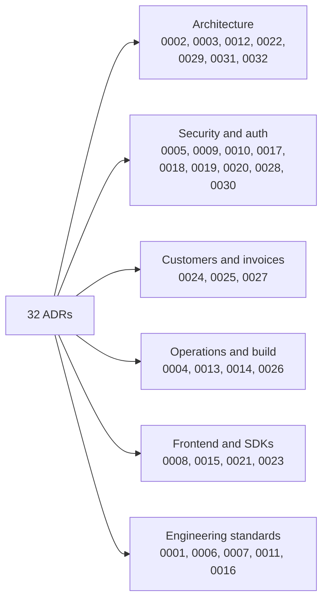
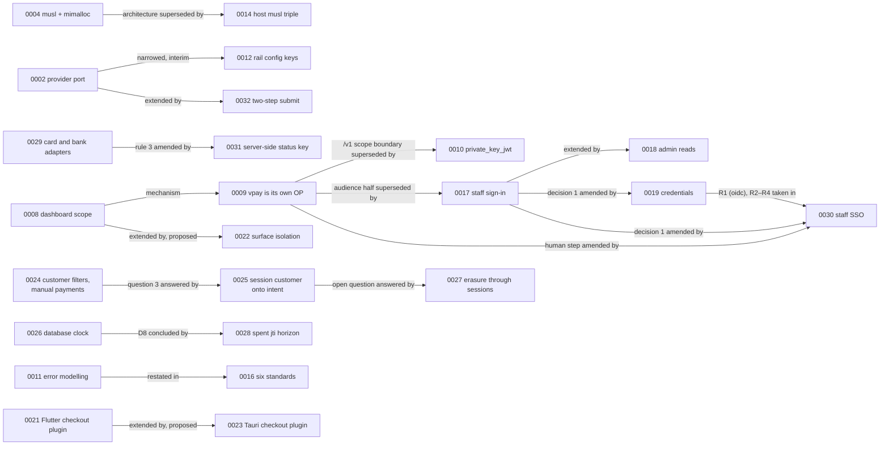

# Architecture decisions

vpay records every architecturally significant choice as a numbered
**architecture decision record** (ADR) in
[`docs/adr/`](vpay:docs/adr/0001-record-architecture-decisions.md). An ADR
records a decision that has been _taken_. It describes neither the process that
follows from it (that is a flow document) nor the code that implements it (that
is a reference page). <Release /> carries 32 ADRs, 0001 to 0032. This page gives each
one a single sentence. Read the ADR itself for the context, the alternatives
that were rejected and the consequences.

::: info ADRs are immutable
Once an ADR is accepted, it is never edited to change what it decided. To change
a decision, a new ADR supersedes it, in whole or in part, and the old one says
so in its status line. Where the implementation differs from the decision, vpay
adds a **dated addendum** or amendment instead of rewriting the decision. 0004
and 0008 carry addenda of that kind; 0010 and 0011 carry amendments. When a later
ADR changes an accepted one, the older ADR's status line gets a dated note
pointing at it: 0009, 0017 and 0019 point at 0030, and 0029 points at 0031.
:::

## How the decisions relate

Several ADRs refine earlier ones. This is how the chain of supersession and
extension looks at <Release />:

## Architecture

| ADR                                                                                                                                              | Status                             | Decision                                                                                                                                                                                                                                                                                                                                                                                                                                                                                                                                                                                                                                                                                                          |
| ------------------------------------------------------------------------------------------------------------------------------------------------ | ---------------------------------- | ----------------------------------------------------------------------------------------------------------------------------------------------------------------------------------------------------------------------------------------------------------------------------------------------------------------------------------------------------------------------------------------------------------------------------------------------------------------------------------------------------------------------------------------------------------------------------------------------------------------------------------------------------------------------------------------------------------------- |
| [0002](vpay:docs/adr/0002-provider-port.md): Rails live behind a port                                                                            | Accepted                           | Every rail is reached through one `ProviderAdapter` trait. The core branches on capability values (`flow`, `supports_refunds`), never on a provider code, and providers are table rows, not enum variants                                                                                                                                                                                                                                                                                                                                                                                                                                                                                                         |
| [0003](vpay:docs/adr/0003-yaml-configuration.md): Administration is YAML in git                                                                  | Accepted                           | All administration is YAML, loaded and validated at boot. A validation failure exits before any traffic is served, and the dashboard cannot change any of it                                                                                                                                                                                                                                                                                                                                                                                                                                                                                                                                                      |
| [0012](vpay:docs/adr/0012-rail-configuration-requirements-in-config.md): Rail config keys in `vpay-config`                                       | Accepted (interim)                 | `REQUIRED_RAIL_KEYS`, a small table keyed by rail code, is the one sanctioned place outside an adapter that matches on a provider code. It stays until the port grows a hook to replace it                                                                                                                                                                                                                                                                                                                                                                                                                                                                                                                        |
| [0022](vpay:docs/adr/0022-surface-isolation-and-independent-scaling.md): Surface isolation and independent scaling                               | **Proposed**                       | One image and one binary, with configuration choosing which surfaces a process serves. It would mean two server Deployments and a chart guard on the Postgres connection budget. Three decisions are left to the maintainer                                                                                                                                                                                                                                                                                                                                                                                                                                                                                       |
| [0029](vpay:docs/adr/0029-card-and-bank-adapters-and-payment-method-routing.md): Card and bank providers as adapters, and payment-method routing | **Accepted in part**, partly built | Every provider that meets four hard rules gets its own adapter, a method type is separate from a rail, and one charge per intent, with no automatic cascading. D12 and D13 were confirmed on 2026-10-23: one method type per wallet network, which the payer picks while the router picks the rail. The same day, [RFC-0008](vpay:docs/rfc/0008-payment-method-routing.md)'s revision replaced "cheapest first" with a score per checkout: fees become one component of it, the order is score then rail code, and no measured quantity moves traffic. D14–D16 still need the maintainer's confirmation. On 2026-10-24 the maintainer amended D10: a decision's outcome is on the `/v1` intent, its record is not |
| [0031](vpay:docs/adr/0031-a-status-read-authenticated-by-a-server-side-key.md): A status read authenticated by a server-side key                 | Accepted (amends 0029)             | A status read authenticated by a key the provider calls public is admissible when the deployment holds it server-side, every secret is sent on every call, boot refuses a config without the secret, and the exposure is documented and logged at boot. It admits `notchpay`                                                                                                                                                                                                                                                                                                                                                                                                                                      |
| [0032](vpay:docs/adr/0032-a-rail-issued-reference-is-committed-before-the-prompt.md): A rail-issued reference is committed before the prompt     | Accepted, built                    | A rail that issues its own reference before it prompts the payer is called in two port calls, `prepare` then `submit`, and the core commits the reference between them, so a crash can no longer lose a reference for a payer who was prompted. Only `notchpay` declares it. The maintainer accepted its six decisions on 2026-10-23                                                                                                                                                                                                                                                                                                                                                                              |

## Security and authentication

| ADR                                                                                                                     | Status                                   | Decision                                                                                                                                                                                                                                                                                          |
| ----------------------------------------------------------------------------------------------------------------------- | ---------------------------------------- | ------------------------------------------------------------------------------------------------------------------------------------------------------------------------------------------------------------------------------------------------------------------------------------------------- |
| [0005](vpay:docs/adr/0005-rustls-only.md): rustls everywhere                                                            | Accepted                                 | Every TLS client uses rustls. `deny.toml` bans `openssl`, `openssl-sys` and `native-tls`, and TLS verification is never disabled, not even against stub hosts                                                                                                                                     |
| [0009](vpay:docs/adr/0009-dashboard-oidc-provider.md): vpay is its own OpenID Provider for `/dash/v1`                   | Accepted, **partly superseded**, amended | Staff sign in with authorization code + PKCE, against `authkestra-op` handlers hosted by vpay itself. Its `/v1` scope boundary is superseded by 0010, its audience half by 0017, and 0030 lets the human step (not the tokens) federate                                                           |
| [0010](vpay:docs/adr/0010-merchant-auth-private-key-jwt.md): Merchants use `client_credentials` + `private_key_jwt`     | Accepted, amended                        | Each merchant is a statically registered OAuth2 client, with its public JWK in YAML. No API key of any shape is accepted on `/v1`, and no refresh token is issued                                                                                                                                 |
| [0017](vpay:docs/adr/0017-staff-authentication.md): How a staff member signs in                                         | Accepted, amended by 0030                | Staff authenticate against a vpay-owned `staff_members` table with two mandatory factors: an argon2id password with a deployment pepper, and RFC 6238 TOTP, enrolled at first sign-in. Since 0030 this is the break-glass path, unchanged                                                         |
| [0018](vpay:docs/adr/0018-cross-tenant-admin-reads.md): A cross-tenant admin role                                       | Accepted                                 | An admin is a `staff_members.is_admin` column, re-read on every request like the rest of the staff row, rather than a claim baked into a token                                                                                                                                                    |
| [0019](vpay:docs/adr/0019-credential-model.md): Credentials are their own object                                        | Accepted (amends 0017)                   | Credentials move to one `credentials` table, generic over kind and subject. Federated identity is keyed on `(iss, sub)`, never on email. Its reserved R1 (for `oidc`), R2, R3 and R4 were taken in 0030                                                                                           |
| [0020](vpay:docs/adr/0020-privacy-controls-and-evidence.md): Privacy controls share one inventory                       | Accepted                                 | vpay keeps one exhaustive, machine-readable inventory of its processing surfaces, and every privacy control builds on that inventory and one shared evidence architecture                                                                                                                         |
| [0028](vpay:docs/adr/0028-a-spent-jti-outlives-the-validators-leeway.md): A spent `jti` outlives the validator's leeway | Accepted                                 | The sweep keeps a spent client-assertion `jti` for five minutes past its `exp`, applied by the database's clock, so an assertion still inside the validator's 60-second leeway cannot be replayed                                                                                                 |
| [0030](vpay:docs/adr/0030-staff-sign-in-federates-to-an-oidc-provider.md): Staff sign-in federates to an OIDC provider  | Accepted (amends 0009, 0017, 0019)       | Configured by `staff_auth.sso`, the human step can federate to an OpenID Connect provider such as Keycloak. vpay verifies the id_token, requires it to prove a second factor, gates on a group and keeps roles local. The `/dash/v1` tokens stay vpay's, and password + TOTP stays as break-glass |

## Customers and invoices

| ADR                                                                                                                     | Status   | Decision                                                                                                                                                                                                                                                                                   |
| ----------------------------------------------------------------------------------------------------------------------- | -------- | ------------------------------------------------------------------------------------------------------------------------------------------------------------------------------------------------------------------------------------------------------------------------------------------ |
| [0024](vpay:docs/adr/0024-customer-filters-and-manual-payments.md): Customer filters and manual invoice payments        | Accepted | `customer` filters `GET /v1/payment_intents`, `GET /v1/checkout/sessions` and `GET /v1/refunds`, and `POST /v1/invoices/{id}/pay` accepts `paid_out_of_band=true` to record a payment made outside vpay (cash, cheque, bank transfer or other) as a compare-and-swap from `open` to `paid` |
| [0025](vpay:docs/adr/0025-session-customer-onto-intent.md): A session's customer is written onto a customer-less intent | Accepted | When a checkout session names a customer and its intent has none, the same transaction writes the customer onto the intent with a compare-and-swap. A different customer is still refused                                                                                                  |
| [0027](vpay:docs/adr/0027-erasure-reaches-through-checkout-sessions.md): Erasure reaches through checkout sessions      | Accepted | Erasing a customer also reaches a customer-less intent that a checkout session naming that customer points at, in the same transaction, with one lock order: the customer, then the intent                                                                                                 |

## Operations and build

| ADR                                                                                                  | Status                             | Decision                                                                                                                                                                                   |
| ---------------------------------------------------------------------------------------------------- | ---------------------------------- | ------------------------------------------------------------------------------------------------------------------------------------------------------------------------------------------ |
| [0004](vpay:docs/adr/0004-musl-mimalloc.md): Static musl with mimalloc                               | Accepted, **superseded in part**   | Shipping binaries are statically linked musl, in `FROM scratch` images, with mimalloc. The architecture it named is superseded by 0014, and an addendum retires its "two binaries" framing |
| [0013](vpay:docs/adr/0013-database-backups-and-retention.md): Backups, PITR and retention            | **Proposed**                       | It proposes RPO ≤ 5 minutes and RTO ≤ 60 minutes, met by continuous WAL archiving with point-in-time recovery. **Nothing in it is implemented, and no backup has ever been taken**         |
| [0014](vpay:docs/adr/0014-builder-host-musl-triple.md): The builder's host musl triple               | Accepted (supersedes 0004 in part) | Build for the builder's own musl triple (`x86_64` or `aarch64`), never cross-compile, and list every published triple in `.cargo/config.toml`                                              |
| [0026](vpay:docs/adr/0026-the-database-clock-schedules-jobs.md): The database's clock schedules jobs | Accepted                           | Anything Postgres compares with its own `now()` is computed by Postgres from a duration (`now() + delay`), never stamped with the application host's clock                                 |

## Frontend and SDKs

| ADR                                                                              | Status                         | Decision                                                                                                                                                                                                            |
| -------------------------------------------------------------------------------- | ------------------------------ | ------------------------------------------------------------------------------------------------------------------------------------------------------------------------------------------------------------------- |
| [0008](vpay:docs/adr/0008-dashboard-scope.md): The dashboard observes            | Accepted, **writes not built** | The dashboard acts on records and never on configuration, and never holds a merchant secret. An addendum records that the per-record writes it describes are designed but unbuilt, and that `/dash/v1` is read-only |
| [0015](vpay:docs/adr/0015-sdk-parity.md): Merchant SDKs are held to parity       | Accepted                       | `sdks/rust` and `sdks/nodejs` agree capability by capability, checked by machine. A capability lands in both in one PR, or it is recorded as a dated gap with an owner                                              |
| [0021](vpay:docs/adr/0021-flutter-checkout-plugin.md): A Flutter checkout plugin | Accepted                       | `vpay_checkout_flutter` shows the hosted page in a native window and gets the outcome by polling `GET /v1/browser/payment_intents/{id}`. It never reads the outcome off a URL                                       |
| [0023](vpay:docs/adr/0023-tauri-checkout-plugin.md): A Tauri v2 checkout plugin  | **Proposed**                   | `tauri-plugin-vpay-checkout` carries 0021's decisions over to Tauri v2 unchanged: one guest-JS state machine drives an Android, iOS, desktop and plain-browser host, and the outcome still comes only from the poll |

## Engineering standards

| ADR                                                                                             | Status            | Decision                                                                                                                                                                                                                                                                                                                  |
| ----------------------------------------------------------------------------------------------- | ----------------- | ------------------------------------------------------------------------------------------------------------------------------------------------------------------------------------------------------------------------------------------------------------------------------------------------------------------------- |
| [0001](vpay:docs/adr/0001-record-architecture-decisions.md): Record decisions                   | Accepted          | Every significant decision is a numbered ADR. An accepted ADR is immutable, and changing it means writing a new ADR that supersedes it                                                                                                                                                                                    |
| [0006](vpay:docs/adr/0006-no-mocks-in-main-processes.md): No test doubles in shipping processes | Accepted          | No mock, fake or stub may be reachable from a shipping binary. A stub rail is a WireMock host in configuration, and `cargo xtask verify-no-mocks` enforces this                                                                                                                                                           |
| [0007](vpay:docs/adr/0007-lint-policy.md): A panic in a payment path is a defect                | Accepted          | `unwrap`, `expect`, `panic`, `todo`, `unimplemented` and float arithmetic are denied workspace-wide, and `unsafe` is forbidden. Tests are exempt                                                                                                                                                                          |
| [0011](vpay:docs/adr/0011-error-modelling.md): Error modelling                                  | Accepted, amended | Errors are typed at the leaves, composed per layer and classified once through `Classify`. `anyhow` appears only at a binary's edge. Its 2026-10-23 amendment adds `NeedsReconciliation`, a rail answer only a person can resolve, which the worker escalates to `unresolved` at once instead of retrying it for 24 hours |
| [0016](vpay:docs/adr/0016-engineering-standards.md): Six engineering standards                  | Accepted          | The six standards are errors, adapters, serde `snake_case`, SOLID/DRY, repositories as traits, and compiled doctests with externalised docs. Three are machine-checked                                                                                                                                                    |

## Status in this release

Most ADRs describe decisions that are in force. The ones below are where the
decision and the code do not match yet, and the ADR says so itself:

| Decision                              | Status                   | Evidence                                                                                                                                                                                                                                                                                                                                                                                                                                                                                                                                                                                                                            |
| ------------------------------------- | ------------------------ | ----------------------------------------------------------------------------------------------------------------------------------------------------------------------------------------------------------------------------------------------------------------------------------------------------------------------------------------------------------------------------------------------------------------------------------------------------------------------------------------------------------------------------------------------------------------------------------------------------------------------------------- |
| 0008: dashboard per-record writes     | <Status s="not-built" /> | The 2026-09-20 addendum says `/dash/v1` mounts reads only, and the writes are designed but unbuilt                                                                                                                                                                                                                                                                                                                                                                                                                                                                                                                                  |
| 0029: card and bank adapters, routing | <Status s="partial" />   | _Accepted in part_: D14–D16 still need the maintainer's confirmation. Built on 2026-10-23: method types (D6), the parts of the candidate filter that need no new capability (D7), the recorded decision (D10) and a router that scores with one provisional component, a configured weight. Not built: the fee component (no fee schedule exists), card and bank adapters, the `pm_…` object. D10 was amended on 2026-10-24: since v0.14.0 a decision's outcome, the method type and the rail, is on the `/v1` intent as `payment_method_details`, and the decision record still is not. Neither SDK can send a method-type confirm |
| 0031: server-side status key          | <Status s="partial" />   | The `notchpay` adapter it admits has met Notch Pay's sandbox only: six test-mode payments, two succeeded, three failed with the mapped code, and one read as paid short was never counted as a success. Production is untried, no Notch Pay webhook has ever been received, the sandbox answered `403` to a refund, and the written question to Notch Pay stays unanswered                                                                                                                                                                                                                                                          |
| 0032: two-step submit                 | <Status s="partial" />   | _Accepted_ on 2026-10-23. It is built for `notchpay` and proven against WireMock and a real Postgres. Notch Pay's sandbox answered the two calls as the design needs when a probe made them (an initialized payment stayed `pending` for at least an hour and a process sent 300 s later completed it), but **vpay itself has never run the split against Notch Pay**                                                                                                                                                                                                                                                               |
| 0013: backups, PITR, retention        | <Status s="not-built" /> | The status is _Proposed_. No backup, restore or drill has ever happened                                                                                                                                                                                                                                                                                                                                                                                                                                                                                                                                                             |
| 0022: surface isolation               | <Status s="partial" />   | The status is _Proposed_, pending maintainer acceptance, with three decisions deliberately left open                                                                                                                                                                                                                                                                                                                                                                                                                                                                                                                                |
| 0023: Tauri checkout plugin           | <Status s="partial" />   | The status is _Proposed_: its seven decisions were taken by the implementing agent, and four questions are left to the maintainer. The plugin it describes exists — see [Tauri checkout](/checkout/tauri)                                                                                                                                                                                                                                                                                                                                                                                                                           |
| 0012: rail config keys                | <Status s="partial" />   | An interim exception to 0002 until the port grows a `required_settings()`-style hook                                                                                                                                                                                                                                                                                                                                                                                                                                                                                                                                                |

Each ADR's own status line is authoritative. The directory is
[`docs/adr/`](vpay:docs/adr/0001-record-architecture-decisions.md).

## Go deeper

- [ADR-0001](vpay:docs/adr/0001-record-architecture-decisions.md): why vpay
  records decisions at all
- [ADR-0016](vpay:docs/adr/0016-engineering-standards.md): the standards every
  change applies, and which gate enforces each
- [docs/flows/README.md](vpay:docs/flows/README.md): how ADRs, flows and
  reference pages divide the work
- [AGENTS.md](vpay:AGENTS.md) § Architecture rules: the rules these ADRs
  produce, in one place
- Agents applying the standards should load
  [vpay-conventions](skill:vpay-conventions).
