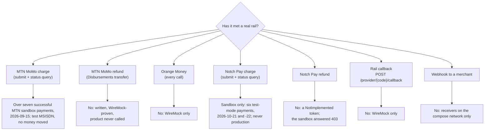
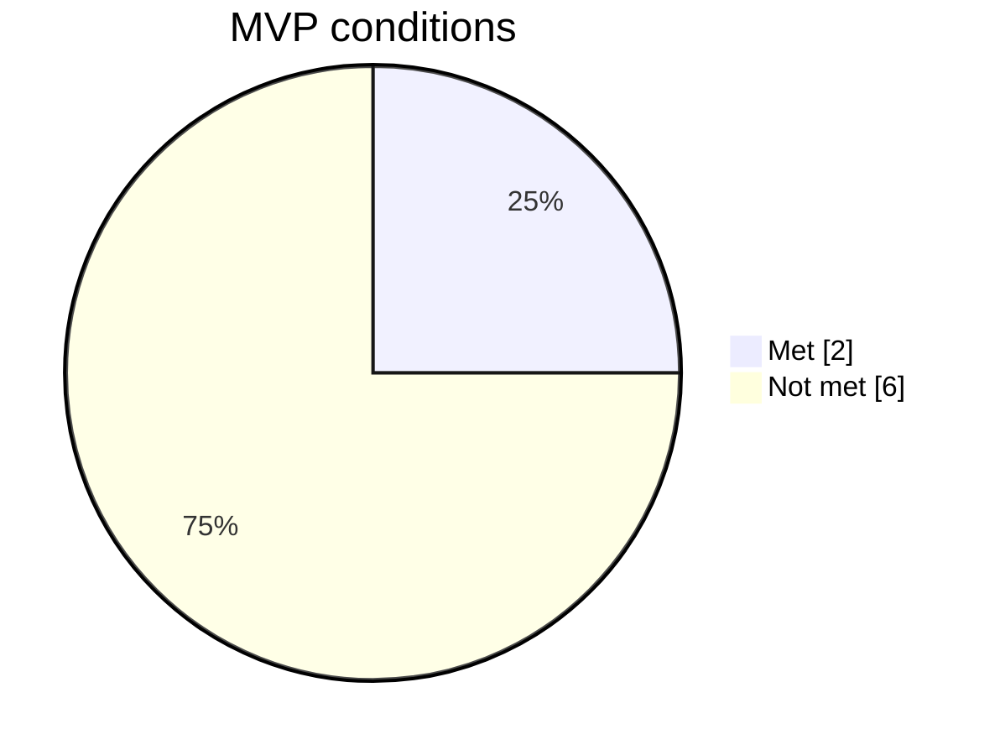

# What works today

This page tells you what vpay <Release /> actually does. Most of the other pages on
this site describe how vpay is _designed_ to work. They mark what is built, but
this page is the honest summary. The source of truth is vpay's own
[`docs/status.md`](vpay:docs/status.md), and a build gate reads that file, so it
cannot silently fall behind the code.

::: warning vpay is in live testing, not generally available
vpay is no longer a scaffold: its maintainers are testing it for live use on
some clusters (the owner's statement, 2026-10-21). That statement adds no
evidence to the tables below. At <Release /> no result from those tests is
recorded, so what this page marks unproven is still unproven. Check each
feature's status before you rely on it.
:::

## Real sandbox evidence {#the-one-real-rail-call}

Over seven EUR `mtn_momo` payments succeeded against **MTN's real sandbox**
during testing on 2026-09-15. The first recorded intent,
`pi_xxd2xj1e914e16c6m63gezag`, reached `succeeded` after the worker's
authenticated status query reported its charge paid.

Valantine Suh (@Valsuh45), who performed the tests, confirmed the corrected
count on 2026-10-20; vpay's record had reported one payment, and until later the
same day it named the maintainer as the tester. This corrects the historical
testing evidence summarized here; it does not describe a new test run.

On 2026-10-21 vpay itself (server, worker and Postgres, `livemode=false`, test
keys) took three test-mode payments through its [Notch Pay](/rails/notchpay)
adapter to **Notch Pay's real sandbox**, at Notch Pay's documented sandbox
outcome numbers
([the run](vpay:docs/status/verification/2026-10-21-notchpay-step5.md)):

- 210 XAF reached `succeeded` on the worker's status read, with a 210 XAF
  capture posted to the ledger.
- 220 XAF reached `failed`, and the intent went back to
  `requires_payment_method`.
- 230 XAF was read `complete` by Notch Pay for less than its amount. vpay
  refused every read after the first as `Malformed`, so the charge was never a
  success and was still `pending` 15 minutes later. Its escalation to
  `unresolved` was not observed. Since v0.11.0 that answer escalates the
  charge to `unresolved` on the first such read, which is proven against
  WireMock and a real Postgres and has not been run against Notch Pay.

On 2026-10-22 the same stack took Notch Pay's other three outcome numbers
through
([the run](vpay:docs/status/verification/2026-10-22-notchpay-b3b.md)):

- 240 XAF, the MTN timeout number, failed `payer_timeout`.
- 250 XAF, the MTN canceled number, failed `payer_declined`.
- 260 XAF, Notch Pay's **Orange** success number, reached `succeeded` with a
  260 XAF capture. That is an Orange payer through Notch Pay's push; Orange's
  own API, behind the `orange_money` adapter, is still untouched.

The same day vpay's sandbox probe asked Notch Pay's `POST /refunds` four times,
and each answer was `403` with nothing refunded
([the probe](vpay:docs/status/verification/2026-10-22-notchpay-refunds.md)).
All six payments ran the one-call build. Since v0.11.0 vpay splits Notch Pay's
push into two calls with a commit between them, and vpay has not run that
split against Notch Pay.

On 2026-10-23 the probe, not vpay, measured what v0.12.0 builds on
([the session](vpay:docs/status/verification/2026-10-23-notchpay-sandbox-two-step-and-channels.md)):

- Notch Pay's side of the two-call split: a payment initialized and never
  processed waited `pending` for at least an hour, and one processed 300 s
  after its initialize completed.
- MTN's five outcome numbers on `cm.mtn` and Orange's five on `cm.orange` read
  what they read on `cm.mobile`, and a number from the other network was
  refused with a `422`.
- A webhook endpoint created through Notch Pay's API delivered nothing. That
  is why v0.12.0 leaves a Notch Pay account's webhook endpoints alone unless
  told otherwise. (Its listing shows `"url": null`, but so does every
  endpoint's, a working one included.)

On 2026-10-24 the probe recorded Notch Pay's first webhooks
([the session](vpay:docs/status/verification/2026-10-24-notchpay-dashboard-webhooks.md)):
four, for two sandbox payments, delivered to a capture endpoint the maintainer
registered in Notch Pay's dashboard. Each was signed over the raw body, as
vpay checks, and vpay's check verified all four offline. They name the event
under `event`, which vpay could not parse until v0.13.0. None went through a
running vpay.

The limits remain:

> No real payer, no production rail, and no rail other than the MTN and Notch
> Pay sandboxes are on record as touched.

Concretely:

- The MTN payer number was an MTN-sandbox test MSISDN that the sandbox settles
  by itself. No handset was prompted and **no money moved**. Notch Pay's payer
  numbers were its documented sandbox outcome numbers, not real payers.
- **Orange's redirect rail has never been called.** One Orange sandbox number
  has been run through vpay on Notch Pay, which prompts the payer the way MTN's
  does.
- **Notch Pay's production has never been called**, no live key has been used,
  **no webhook from Notch Pay has reached a running vpay**, and vpay has never
  registered a webhook endpoint on a real Notch Pay account. vpay checks Notch
  Pay's callback signature since v0.12.0: through its route only on stub
  deliveries, and offline on the four real sandbox webhooks of 2026-10-24.
- **No webhook has ever reached a merchant endpoint** outside the repository.
- **No rail has ever refunded anything.** MTN's Disbursements product, which is
  what an MTN refund is, has never been called. `orange_money::refund` is
  `NotImplemented`, and so is `notchpay::refund`; Notch Pay's sandbox answered
  `403` to the probe's refunds.
- **No cluster run is on record.** The owner reported live testing on some
  clusters on 2026-10-21, but no result from it is recorded at <Release />.

## Where things stand, area by area

In this table, a <Status s="partial" /> chip means some of the area is real and
the rest is listed on the linked page. On vpay's side, every 🟡 and ⛔ is there
because a test says so, and nothing is marked ✅ unless a test would fail if it
broke.

| Area                                                       | Status                  | Today                                                                                                                                                                                                                                                                                                                                                                                                                                                                                                                                                                                                                                                                                                                                                                                                                                                                                                                                                                                                  | Detail                                                                                                                                                 |
| ---------------------------------------------------------- | ----------------------- | ------------------------------------------------------------------------------------------------------------------------------------------------------------------------------------------------------------------------------------------------------------------------------------------------------------------------------------------------------------------------------------------------------------------------------------------------------------------------------------------------------------------------------------------------------------------------------------------------------------------------------------------------------------------------------------------------------------------------------------------------------------------------------------------------------------------------------------------------------------------------------------------------------------------------------------------------------------------------------------------------------ | ------------------------------------------------------------------------------------------------------------------------------------------------------ |
| **Backend**: `/v1`, `/dash/v1`, `/provider`, `/v1/browser` | <Status s="partial" />  | Real routes, real rows and real adapters. Every rail call went to a stub until 2026-09-15, when the MTN push first reached MTN's real sandbox. Since v0.12.0 a confirm may name the payer's network (`mtn_wallet`, `orange_wallet`) and a scored router picks the rail; its formula is provisional, one configured weight per rail                                                                                                                                                                                                                                                                                                                                                                                                                                                                                                                                                                                                                                                                     | [status/backend.md](vpay:docs/status/backend.md)                                                                                                       |
| **Adapter**: `mtn_momo` charge                             | <Status s="partial" />  | Wire calls proven against WireMock. Since 2026-09-15 the charge path is also proven against MTN's real sandbox                                                                                                                                                                                                                                                                                                                                                                                                                                                                                                                                                                                                                                                                                                                                                                                                                                                                                         | [status/backend.md](vpay:docs/status/backend.md)                                                                                                       |
| **Adapter**: `mtn_momo` refund                             | <Status s="unproven" /> | The Disbursements `transfer` call is written and WireMock-proven. It has never been called, and no real Disbursements credential exists in the project                                                                                                                                                                                                                                                                                                                                                                                                                                                                                                                                                                                                                                                                                                                                                                                                                                                 | [status.md](vpay:docs/status.md)                                                                                                                       |
| **Adapter**: `orange_money`                                | <Status s="unproven" /> | Wire calls proven against WireMock. Never called                                                                                                                                                                                                                                                                                                                                                                                                                                                                                                                                                                                                                                                                                                                                                                                                                                                                                                                                                       | [status/backend.md](vpay:docs/status/backend.md)                                                                                                       |
| **Adapter**: `notchpay`                                    | <Status s="partial" />  | New in v0.9.0, admitted under ADR-0031. Wire calls proven against WireMock. Since 2026-10-21 the charge path is also proven against Notch Pay's real sandbox: six test-mode payments over two days, of which two succeeded, three failed with the mapped code and one short collection was refused. Since v0.11.0 its push is two calls with a commit between them. Since v0.12.0 the payer's network picks the channel (`cm.mtn` or `cm.orange`), a number from the other network is `invalid_payer`, vpay leaves the account's webhook endpoints alone unless configured to register one, and a callback's signature is checked where the Hash Key is configured. vpay has run all of that against WireMock only. `notchpay::refund` is a `NotImplemented` token, no webhook from Notch Pay has reached a running vpay (four reached a dashboard-registered capture endpoint on 2026-10-24 and verified offline), no live key or production call exists, and every boot logs its public-key exposure | [status/providers.md](vpay:docs/status/providers.md)                                                                                                   |
| **Frontend**: checkout page, dashboard, demo shop          | <Status s="partial" />  | Built, and walked by a real browser against a stub rail                                                                                                                                                                                                                                                                                                                                                                                                                                                                                                                                                                                                                                                                                                                                                                                                                                                                                                                                                | [status/frontend.md](vpay:docs/status/frontend.md)                                                                                                     |
| **Infrastructure**: images, compose, Helm, migrations      | <Status s="partial" />  | Boots in compose and in CI. **No pod run is on record**                                                                                                                                                                                                                                                                                                                                                                                                                                                                                                                                                                                                                                                                                                                                                                                                                                                                                                                                                | [status/infrastructure.md](vpay:docs/status/infrastructure.md)                                                                                         |
| **Data layer**: sqlx, CrateStack, the schema               | <Status s="partial" />  | `schemas/vpay.cstack` compiles into `vpay-db`. The drift between migrations and models is counted but not closed                                                                                                                                                                                                                                                                                                                                                                                                                                                                                                                                                                                                                                                                                                                                                                                                                                                                                       | [status/cratestack.md](vpay:docs/status/cratestack.md)                                                                                                 |
| **Merchant SDKs**: `sdks/rust`, `sdks/nodejs`              | <Status s="partial" />  | Parity is machine-checked in both directions. The gaps are dated and each has an owner. Both can create an intent with a payment-method type; neither can confirm one by type yet                                                                                                                                                                                                                                                                                                                                                                                                                                                                                                                                                                                                                                                                                                                                                                                                                      | [status/merchant-sdks.md](vpay:docs/status/merchant-sdks.md), [sdks/parity.md](vpay:docs/sdks/parity.md)                                               |
| **Payer-device plugins**: `sdks/flutter`, `sdks/tauri`     | <Status s="partial" />  | Not merchant SDKs. `just ci` builds and tests neither, apart from the Tauri plugin's TypeScript half. The Tauri plugin (2026-09-22) has driven two checkouts to `succeeded` on an Android emulator and an iOS simulator, against a running vpay whose rail was WireMock. No physical device, and desktop has never run a checkout                                                                                                                                                                                                                                                                                                                                                                                                                                                                                                                                                                                                                                                                      | [status/mobile-flutter-plugin.md](vpay:docs/status/mobile-flutter-plugin.md), [status/mobile-tauri-plugin.md](vpay:docs/status/mobile-tauri-plugin.md) |
| **An MVP**                                                 | <Status s="partial" />  | Two of eight conditions met (see below). It is not an MVP                                                                                                                                                                                                                                                                                                                                                                                                                                                                                                                                                                                                                                                                                                                                                                                                                                                                                                                                              | [status/mvp.md](vpay:docs/status/mvp.md)                                                                                                               |

### What "partial" means in practice

A few rows from the area pages show where the limits sit:

- **Refunds.** The five `/v1` refund routes and both SDKs' refund surfaces
  exist. A refund is written as `pending`, and `charge.refunded` is emitted.
  **Nothing settles a `pending` refund**, because there is no refund poll
  ladder, so every refund stays `pending`.
- **Webhooks.** Signing and the two-step outbox are real, and delivered
  signatures have been verified by both SDKs and by `stripe`'s `constructEvent`.
  Every receiver has been a container on the same compose network.
- **The dashboard.** A staff member can sign in with a password and TOTP, and
  read one merchant's payments in a browser, against the local stack; since
  v0.10.0 the home screen is an Overview of counts. Since vpay 0.8.0 they can
  also sign in through an OpenID Connect provider such as Keycloak
  ([staff sign-in](/dashboard/authentication)); that path is built and no
  browser has run its routes. No deployment of the dashboard is on record.
  `/dash/v1` has no write routes.
- **Infrastructure.** The Helm chart renders and is schema-validated, and images
  are built and signed by the release workflow. **Database backups, PITR and
  retention are not implemented**: no backup has ever been taken
  ([ADR-0013](vpay:docs/adr/0013-database-backups-and-retention.md) is only
  _proposed_). Nothing has ever scraped `/metrics`.

## What would make it an MVP

vpay keeps a list of eight conditions it must meet before it can call itself an
MVP. Two are met.

| #   | Condition                                                                         | Status                  | Why                                                                                                                                                                |
| --- | --------------------------------------------------------------------------------- | ----------------------- | ------------------------------------------------------------------------------------------------------------------------------------------------------------------ |
| 1   | Database schema and migrations, with the `one_charge_per_intent` unique index     | <Status s="built" />    | The index exists, and a test proves the database rejects a second charge                                                                                           |
| 2   | Both adapters making real HTTP calls and passing the shared conformance suite     | <Status s="unproven" /> | The literal words are met, with no `#[ignore]`s. But every conformance case talks to a WireMock container, and Orange has never been called                        |
| 3   | The worker's job loop, poll ladder and reconciler, with crash tests               | <Status s="partial" />  | Built and tested, including real `SIGKILL` tests for two of three kill points. One kill point is simulated, and the rail is still a stub                           |
| 4   | `/v1/payment_intents` create and confirm, form-encoded, idempotent, authenticated | <Status s="partial" />  | Works end to end, and the worker settles it. What decides the item is that the rail is a stub                                                                      |
| 5   | Signed webhooks with the two-step outbox                                          | <Status s="partial" />  | Real and SSRF-guarded, but no merchant endpoint has ever been POSTed to, and the long retry rungs have never elapsed                                               |
| 6   | `just test-e2e` green against the compose stack                                   | <Status s="built" />    | Green, with four Cypress specs. The rails behind them are WireMock hosts                                                                                           |
| 7   | `/dash/v1` login end to end: issue a token, verify it, rotate a signing key       | <Status s="partial" />  | Staff sign-in works against a real Postgres. Key rotation is restart-based and has never been observed on a deployment                                             |
| 8   | A hosted payment page, in an iframe version and a fully hosted version            | <Status s="partial" />  | Both pages are built and driven by a real browser, but they are not ready for production. Stub rails, and no browser has been observed enforcing `frame-ancestors` |

Items 2, 3, 4, 5 and 8 remain open: beyond the MTN and Notch Pay sandbox
testing, the rail evidence is still stub-based, and every webhook receiver has
been a stub. Sandbox payments to test numbers do not prove these broader
conditions: no money moved, and Orange has never been called.

## The `NotImplemented` declaration

vpay's second rule is that code which has not been written returns
`ProviderError::NotImplemented("<crate>::<fn>")` instead of faking a success.
`cargo xtask verify-status` scans the shipping code for every such token and
**fails in both directions**. A token that `docs/status.md` does not declare
fails the build, and so does a declared token that no shipping code still
carries.

At <Release /> **two** tokens are declared:

| Token                  | What it means                                                                                                                                                                                                                                                                                                                     |
| ---------------------- | --------------------------------------------------------------------------------------------------------------------------------------------------------------------------------------------------------------------------------------------------------------------------------------------------------------------------------- |
| `orange_money::refund` | An Orange refund is an outbound **transfer** back to a payee (RFC-0003 § 5). The repository holds no Orange transfer specification, so writing the call would mean inventing an endpoint in the money path. The rail declares `supports_refunds: true`: the gap is vpay's, not Orange's. `supports_partial_refunds` stays `false` |
| `notchpay::refund`     | Notch Pay documents refunds back to the payer in a guide, but its `POST /refunds` is absent from the specification and carries nothing that makes a replay safe, so a lost answer re-sent would pay twice. It stays a token until Notch Pay confirms a replay-safe refund in writing and its sandbox answers `POST /refunds`      |

::: warning A short list is the weakest claim, not the strongest
A missing token only means that no function body is missing. It says nothing
about whether a written call has ever run. `mtn_momo::refund` left the list on
2026-09-15 because its code was written. **It has never been called.**
:::

There is also something that is declared but never filled in: the refund `fee`.
The column, the wire field and both SDKs' `Refund.fee` exist, but it stays
`null`. No rail response that carries a fee has ever been seen, and an adapter
must never invent one.

## Status in this release

| Part                           | Status                   | Evidence                                                                                                                                                                                                                                                                                                                                                 |
| ------------------------------ | ------------------------ | -------------------------------------------------------------------------------------------------------------------------------------------------------------------------------------------------------------------------------------------------------------------------------------------------------------------------------------------------------- |
| Taking a real payment          | <Status s="not-built" /> | `docs/status.md` records no real payment: no real payer prompted, no money moved                                                                                                                                                                                                                                                                         |
| End to end against stub rails  | <Status s="partial" />   | `just demo` settles six payments on both rails, and `just test-e2e` is green                                                                                                                                                                                                                                                                             |
| MTN sandbox charge             | <Status s="partial" />   | Over seven payments succeeded on 2026-09-15; the first recorded intent is shown above                                                                                                                                                                                                                                                                    |
| Notch Pay sandbox charge       | <Status s="partial" />   | Six test-mode payments on 2026-10-21 and -22: two succeeded, three failed with the mapped code, one read as paid short stayed `pending`                                                                                                                                                                                                                  |
| Routing by payment-method type | <Status s="partial" />   | Built and proven against WireMock and a real Postgres; the score has one provisional component; the SDKs cannot confirm by type; since v0.13.0 a routed charge is refunded under its method type or its rail's code; since v0.14.0 the intent names its charge's type and rail (`payment_method_details`), and the decision record is on no `/v1` object |
| Notch Pay callback signature   | <Status s="partial" />   | Checked through vpay's route on stub deliveries; `Verified`, offline, on four real sandbox webhooks (2026-10-24); none has reached a running vpay                                                                                                                                                                                                        |
| Declared unimplemented paths   | <Status s="partial" />   | Two tokens, `orange_money::refund` and `notchpay::refund`, gate-checked in both directions                                                                                                                                                                                                                                                               |

The full record is in [`docs/status.md`](vpay:docs/status.md). Its history,
verbatim and dated, is in [`docs/status/`](vpay:docs/status/README.md).

## Go deeper

- [docs/status.md](vpay:docs/status.md): the banner, the area table and the
  declaration
- [docs/status/mvp.md](vpay:docs/status/mvp.md): all eight MVP conditions, item
  by item
- [docs/status/backend.md](vpay:docs/status/backend.md),
  [frontend.md](vpay:docs/status/frontend.md) and
  [infrastructure.md](vpay:docs/status/infrastructure.md): row-by-row evidence
- [The 2026-09-15 verification page](vpay:docs/status/verification/2026-09-15.md)
  and [the live-sandbox runbook](vpay:docs/runbooks/live-sandbox-test.md)
- [The 2026-10-21 Notch Pay run](vpay:docs/status/verification/2026-10-21-notchpay-step5.md)
  and [the 2026-10-22 one](vpay:docs/status/verification/2026-10-22-notchpay-b3b.md):
  the six payments, every output, and what was not run
- [The 2026-10-23 probe session](vpay:docs/status/verification/2026-10-23-notchpay-sandbox-two-step-and-channels.md)
  and [the signature check's verification](vpay:docs/status/verification/2026-10-23-webhook-signatures.md)
- This site's own [parity gate](/about/parity), which keeps these pages tied to
  a vpay release
- Agents updating status should load [vpay-docs-status](skill:vpay-docs-status).
