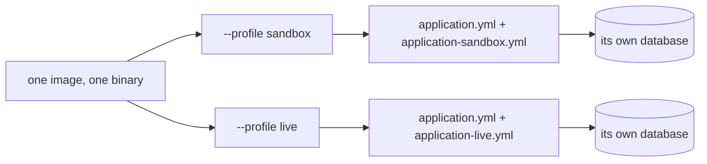
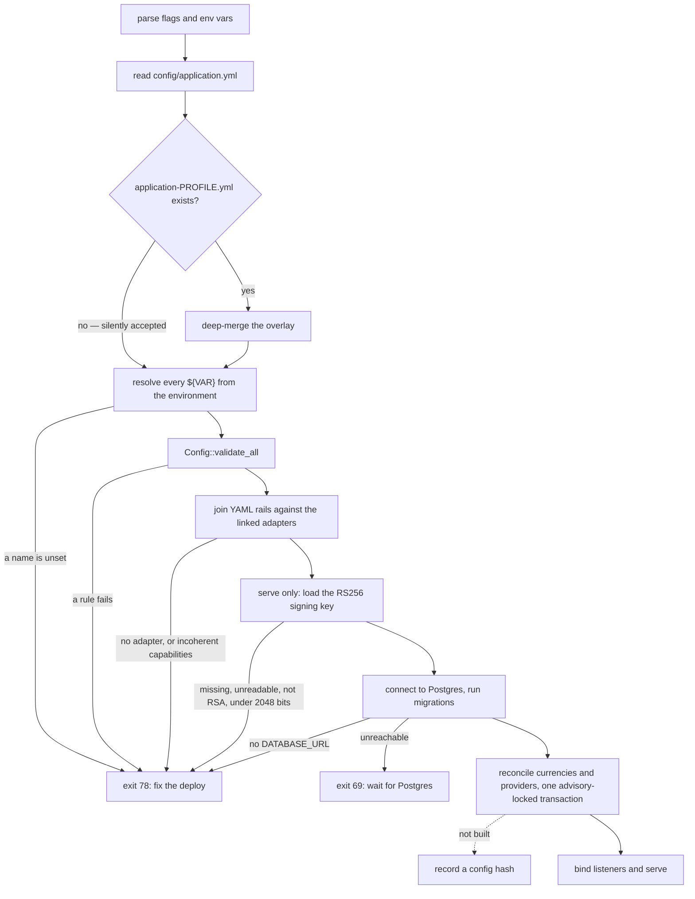

# Configuration

Everything that decides where money goes — which rails exist, their hosts and
credentials, which merchants may authenticate, where webhooks are sent — lives
in YAML files in git, is loaded once at boot, and is validated hard enough that
a bad file stops the process before it binds a port. There is no admin UI and
the dashboard cannot change any of it
([ADR-0003](vpay:docs/adr/0003-yaml-configuration.md)). A change is a reviewed
pull request and a redeploy, which is the point: configuration gets diffs,
review and rollback, and a half-configured gateway never serves traffic.

Agents working on configuration should load [vpay-ops](skill:vpay-ops).

## Two layers: flags, then the file

Both processes — `vpay-server` in its default `serve` mode and the same binary
run as `vpay-server worker` — first parse a small CLI in which every flag also
resolves from an environment variable, an explicit flag beating its variable.
The two modes share one flag definition, so they cannot drift on a name or a
default.

| Flag                                    | Env var                       | Default        |
| --------------------------------------- | ----------------------------- | -------------- |
| `--bind` (serve only)                   | `VPAY_BIND`                   | `0.0.0.0:8080` |
| `--database-url`                        | `DATABASE_URL`                | none           |
| `--profile`                             | `VPAY_PROFILE`                | `sandbox`      |
| `--config`                              | `VPAY_CONFIG`                 | none           |
| `--observability-bind`                  | `VPAY_OBSERVABILITY_BIND`     | `0.0.0.0:9090` |
| `--oauth-signing-key-file` (serve only) | `VPAY_OAUTH_SIGNING_KEY_FILE` | none           |
| `--log-filter`                          | `RUST_LOG`                    | `info`         |
| `--log-format` (`json` or `text`)       | `VPAY_LOG_FORMAT`             | `json`         |
| `--shutdown-grace-seconds`              | `VPAY_SHUTDOWN_GRACE_SECONDS` | `25`           |
| `--worker-concurrency` (worker only)    | `VPAY_WORKER_CONCURRENCY`     | `4`            |

`cargo run -p vpay-server -- --help` prints the live set and beats this table if
they ever disagree. Everything else — rails, merchants, checkout, the dashboard
client — is in the YAML file `--config` names.

## A profile selects a file, never a code path

vpay borrows Spring Boot's idiom: `config/application.yml` is the base, and
`application-{profile}.yml` in the same directory is deep-merged over it. The
rule that makes this safe is strict: **a profile may select values, never
behaviour.** There is a sandbox _environment_ — a deployment whose YAML points
at rail sandboxes or WireMock, with its own database — but there is no sandbox
_mode_: no `if (sandbox)`, no code that exists only outside production.



Two merge details matter when you write an overlay. Dictionaries merge key by
key, so an overlay only needs the keys that differ. **Lists replace wholesale**
— `providers` and `merchant_clients` in an overlay are the complete lists for
that profile, which is why `config/application-live.yml` restates its one
merchant and one rail in full.

The repository ships four files. `application.yml` is deliberately
sandbox-shaped (`livemode: false`, rail hosts pointing at the compose WireMock
stubs). `application-sandbox.yml` is the CLI's default profile.
`application-live.yml` is a _prod-shaped local_ overlay: it still has
`livemode: false`, but points `mtn_momo` at MTN's real sandbox — it is what the
[live sandbox runbook](/operate/runbooks#live-sandbox-test) runs.
`application-notchpay-sandbox.yml`, new in v0.9.0, does the same for
`notchpay` and Notch Pay's real sandbox, with `notchpay` as its only rail; it is
what the [Notch Pay sandbox runbook](/operate/runbooks#test-notch-pay-against-its-sandbox)
runs. It took six test-mode payments through Notch Pay's sandbox on 2026-10-21
and -22. It sets the rail's `callbacks.register` to `check`, so a worker
started for the runbook lists the sandbox account's webhook endpoints but never
creates one; registering is a deliberate step of the runbook (B4), which
changes that line to `ensure`. It configures no webhook signing secret, so
vpay's signature check answers `NoSecret` under it. None of the four is a
production configuration.

## How a configuration is resolved at boot



The exit codes are a contract an operator can act on: **78 means fix the
deployment, and restarting will not help; 69 means the database is not there
yet, and waiting is correct.** Every configuration failure in the diagram is
checked before the database is contacted except the missing `DATABASE_URL`,
which is raised at the connection step and is still 78.

**Unresolved placeholders are fatal, never empty.** vpay's resolver has no
default syntax: a `${VAR}` naming an unset variable is
`ConfigError::UnresolvedPlaceholder`, exit 78, in both modes. An empty
subscription key would otherwise fail much later, at a first charge, looking
like a rail outage. _Empty_ is a value, though — only _unset_ refuses to boot.

**Reconcile is the mirror, configuration is the authority.** After migrations,
both modes make the `currencies` and `providers` tables match the YAML in one
transaction under a Postgres advisory lock, so replicas booting together cannot
interleave. A rail present in the file is upserted; a rail removed from it is
set `enabled = false` rather than deleted, because a rail that has ever taken
money must stay nameable. Capabilities (flow, refund support) come from the
linked adapter, never from YAML ([the provider port](/rails/provider-port)).

## Rail credentials

Credentials are written as `${VAR}` placeholders and resolved from the process
environment. This is the `mtn_momo` block from `config/application.yml`, with
its comments removed:

```yaml
providers:
  - code: mtn_momo
    host:
      url: http://wiremock-mtn:8080
      label: mtn-sandbox-wiremock
    display_name:
      en: MTN Mobile Money
      fr: MTN Mobile Money
    currency: EUR
    settings:
      subscription_key_header: Ocp-Apim-Subscription-Key
      target_environment: sandbox
      api_user: ${MTN_API_USER}
      disbursement_api_user: ${MTN_DISBURSEMENT_API_USER}
    credentials:
      subscription_key: ${MTN_SUBSCRIPTION_KEY}
      api_key: ${MTN_API_KEY}
      disbursement_subscription_key: ${MTN_DISBURSEMENT_SUBSCRIPTION_KEY}
      disbursement_api_key: ${MTN_DISBURSEMENT_API_KEY}
```

`settings` are printed in full by the config's `Debug` output; `credentials` are
redacted, which is why anything secret belongs in `credentials`. The base file
references ten variables in total: nine rail variables (`MTN_*` above plus
`ORANGE_MERCHANT_KEY`, `ORANGE_CLIENT_ID`, `ORANGE_CLIENT_SECRET`) and
`MERCHANT_WEBHOOK_SECRET` for webhook signing. Every environment that loads the
file must define all ten — including the server, which never delivers a webhook
but validates the same document.

A rail missing a key its adapter cannot work without refuses to boot, and a
present-but-empty value counts as missing. This table is the one sanctioned
place outside an adapter crate that matches on a rail code — a recorded interim
until the port grows a hook for it
([ADR-0012](vpay:docs/adr/0012-rail-configuration-requirements-in-config.md)):

| Rail           | Required keys                                                                                                                                                                                                                                                                                                                                  |
| -------------- | ---------------------------------------------------------------------------------------------------------------------------------------------------------------------------------------------------------------------------------------------------------------------------------------------------------------------------------------------- |
| `mtn_momo`     | `settings.target_environment`, `settings.api_user`, `credentials.subscription_key`, `credentials.api_key`                                                                                                                                                                                                                                      |
| `orange_money` | `credentials.merchant_key`, `credentials.client_id`, `credentials.client_secret`                                                                                                                                                                                                                                                               |
| `notchpay`     | `settings.channel` (exactly `cm.mobile`; a charge routed by the payer's network is sent `cm.mtn` or `cm.orange` instead), `credentials.public_key`, `credentials.private_key`, currency `XAF`; the keys' test marker (`test.` or `test_`) must agree with `deployment.livemode`; in livemode only, `settings.accept_public_key_exposure: true` |

The `notchpay` block ships **commented out** in `config/application.yml`.
Because boot checks every configured rail, enabled or not, uncommenting it makes
`NOTCHPAY_PUBLIC_KEY` and `NOTCHPAY_PRIVATE_KEY` mandatory for every deployment
of the file, and every boot then logs the rail's public-key exposure at `WARN`.
Read [Notch Pay](/rails/notchpay#the-production-risk) before you uncomment it.

### Callbacks: registration and signatures

A rail can carry an optional `callbacks:` block, and a rail whose adapter
checks signatures takes a signing secret among its credentials:

```yaml
providers:
  - code: notchpay
    # …
    credentials:
      # …
      callback_signing_secret: ${NOTCHPAY_HASH_KEY} # the endpoint's Hash Key
      # callback_signing_secret_previous: ${NOTCHPAY_HASH_KEY_PREVIOUS} # during a rotation only
    callbacks: # optional
      register: off # or `check` (list, never create) or `ensure` (create vpay's endpoint)
      # verify: off # livemode without a signing secret only
```

**`register`** is read by the worker's `ensure_callbacks` job, at every worker
start and hourly, and by `vpay-server callbacks ensure`, and only for an
**enabled** rail whose adapter keeps its callback URL registered with the
account — today `notchpay` alone. Unset (no block, or `callbacks: {}`), it is
the rail's own default, which its adapter declares: `ensure`, except
`notchpay`, which is `off` since v0.12.0, so vpay asks a Notch Pay account
nothing unless told to ([Notch Pay](/rails/notchpay#callbacks)). With `ensure`
vpay lists the account's webhook endpoints and creates its own when it is
missing; it never modifies or deletes one. A misspelt key inside the block is
refused, not ignored. The pass has been proven against a WireMock Notch Pay
only, never against a real account
([RFC-0013](vpay:docs/rfc/0013-vpay-registers-its-own-callbacks.md)).

**`credentials.callback_signing_secret`**, and `callback_signing_secret_previous`
while a rotation is in flight, is the secret a rail that signs its callbacks is
checked against; for Notch Pay it is the endpoint's Hash Key
([RFC-0014](vpay:docs/rfc/0014-verifying-rail-callbacks.md)). It is a
credential like any other: livemode demands a `${VAR}`, `Debug` redacts it, and
no message prints it. **`verify`** is `on` by default and is an
acknowledgement, not a switch: a configured secret is checked whatever it says.
`verify: off` is what lets a livemode deployment boot a signing rail with no
secret, and the server warns at every boot that says it. The boot rules are in
the table below. The check itself is proven against stubs, and on 2026-10-24
it verified four real sandbox webhooks offline; none has reached a running
vpay ([Notch Pay](/rails/notchpay#webhook-signatures)).

### Routing weights

An optional `routing:` block weighs each rail, per payment-method type, for the
router that picks a rail when the payer chose a network
([the provider port](/rails/provider-port),
[RFC-0008](vpay:docs/rfc/0008-payment-method-routing.md)):

```yaml
routing:
  weights:
    - rail: notchpay
      method_type: mtn_wallet # optional; without it the weight is the rail's for every type
      weight: 300 # 0 ..= 1000
```

The most specific entry wins: a rail and a type, then the rail alone, then
`100`. With no block every rail weighs `100`, and the lower rail code breaks a
tie. The weight is the only component of the score today, so the formula is
called `provisional-1`. The estimated fee is the next component, and is not
built; the completion rate is reported for an operator to turn into a weight
here by hand, never scored automatically. A weight is not a switch: `0` ranks a
rail last, never off, and `enabled: false` is how a rail is taken out.

::: warning The Disbursements keys are defined, not real
The three `MTN_DISBURSEMENT_*` variables feed MTN refunds. They are deliberately
_not_ required keys, so an empty value boots and a refund then fails loudly. No
deployment holds a real MTN Disbursements credential; the compose stack's values
are stubs aimed at WireMock. See [MTN MoMo](/rails/mtn-momo).
:::

## Rules that refuse to boot

A selection of what boot refuses, most of it in `Config::validate_all` and the
rest at boot against the linked adapters. Each is exit `78`:

| Rule                                                                                                                                             | Why                                                                                                                                      |
| ------------------------------------------------------------------------------------------------------------------------------------------------ | ---------------------------------------------------------------------------------------------------------------------------------------- |
| Every merchant registration has a unique `merchant_id`                                                                                           | It is the `/v1` tenancy boundary, and no foreign key backs it                                                                            |
| Currency exponents match the canonical table                                                                                                     | A 100x amount bug is otherwise silent ([Money](/payments/money))                                                                         |
| `livemode` ⇒ every host is `https://`                                                                                                            |                                                                                                                                          |
| `livemode` ⇒ no host labelled `wiremock`, `stub`, `mock` or `localhost`                                                                          | What makes "the code cannot tell a stub from a real rail" safe                                                                           |
| `livemode` ⇒ secrets are written as `${VAR}`, never literals                                                                                     | Checked against the file's _text_, before resolution                                                                                     |
| `checkout.public_base_url` is a well-formed origin, `https://` under `livemode`                                                                  | Every payer link is built on it                                                                                                          |
| `checkout_origins` entries are canonical origins, no duplicates across merchants                                                                 | They become `frame-ancestors`; a non-canonical spelling would be dropped silently                                                        |
| `--worker-concurrency` ≤ 5 (worker only)                                                                                                         | Half the 10-connection pool; see [Crash safety](/payments/crash-safety)                                                                  |
| No `callbacks:` block on a rail told its callback URL on every submit (`mtn_momo`, `orange_money`)                                               | The block would do nothing there, and a setting that does nothing is one somebody believes in                                            |
| A linked adapter that registers its callback URL must declare that it calls back                                                                 | A registered endpoint that is never called is incoherent; refused at boot, exit 78                                                       |
| A linked adapter that checks callbacks must declare that it calls back                                                                           | A check on a rail that never calls back would demand a secret nothing reads                                                              |
| `livemode` and a rail that checks signatures ⇒ `callback_signing_secret`, or `callbacks.verify: off`                                             | Otherwise its callbacks would go unchecked in production; outside livemode it is a `WARN`                                                |
| No signing setting on a rail that checks none, and never `verify: off` beside a secret                                                           | A setting that does nothing is one somebody believes in                                                                                  |
| No signing secret with surrounding whitespace, and no previous secret without a current one                                                      | A trailing newline would become part of the key, and every genuine callback would be refused                                             |
| `routing.weights`: a configured rail, a known method type, a weight up to 1000, no duplicates                                                    | Each a named error in `validate_all`                                                                                                     |
| `routing.weights`: a type the rail's adapter serves; every enabled rail serves at least one type                                                 | Checked at boot against the linked adapter                                                                                               |
| `merchant_clients[].cose_keys`: each an Ed25519 public key in unpadded base64url, any label 1–64 characters, no key registered twice in the file | New in <Release />. The keys are registered for a signed transport that is not in this release, and no request is verified with them yet |

`livemode` is a single boolean under `deployment:`. Every file in the repository
sets it `false`, so none of them exercises the livemode rules outside tests.

## The checkout page reads its own files

`frontends/apps/checkout` — the container serving the payment page — does not
read `application.yml`. It reads `branding.yaml` and `config.yaml` (defaults
under `/etc/vpay/checkout/`, examples in `config/checkout/`) with the opposite
policy: a bad value costs that one key and a `WARN`, and the page still renders.
Nothing reconciles its copy of `checkout.public_base_url` with the server's.
**The Helm chart templates no ConfigMap for either file**, so a Kubernetes
deployment has no supported way to supply them yet. See
[Hosted checkout](/checkout/hosted).

## What can go wrong

- **A typo in the profile boots cleanly on the baked sandbox file.** A missing
  overlay is not an error, so `VPAY_PROFILE=prodcution` yields a healthy pod
  with WireMock rail hosts and placeholder merchant keys. Nothing detects it;
  check the rendered mount path against `VPAY_PROFILE` before you deploy
  ([Deployment](/operate/deployment#what-can-go-wrong)).
- **A stale `VPAY_PUBLIC_BASE_URL` is silently ignored.** The flag was removed;
  the issuer comes from `deployment.public_base_url` in YAML.
- **No replica can tell it booted from a different file.** The config hash that
  would detect it is not built.
- **Changing a rail's host, currency or payee under in-flight charges.** The
  flow page classes these as identity-defining — a charge submitted to host A
  must be polled at host A — while credentials, TTLs and webhook endpoints are
  safe to change. Nothing described in its Status section enforces this; plan
  such changes for when no charge is in flight.

## Status in this release

| Part                                                       | Status                   | Evidence                                                                                                                                                                            |
| ---------------------------------------------------------- | ------------------------ | ----------------------------------------------------------------------------------------------------------------------------------------------------------------------------------- |
| CLI / env layer                                            | <Status s="built" />     | Flag parsing, env resolution and precedence tested in `vpay-config`                                                                                                                 |
| YAML load, overlay, `${VAR}` resolution, validation        | <Status s="built" />     | `Config::load` wired into both modes; exit 78 proven by subprocess tests                                                                                                            |
| Reconcile into `currencies` / `providers`                  | <Status s="built" />     | Advisory-locked, one transaction; proven against real Postgres                                                                                                                      |
| Livemode guard rules                                       | <Status s="partial" />   | Implemented and unit-tested; no livemode deployment has ever booted                                                                                                                 |
| Config hash (detect replicas on different files)           | <Status s="not-built" /> | "Nothing records or compares one"                                                                                                                                                   |
| `providers[].callbacks.register` and its two boot refusals | <Status s="partial" />   | Parsed, defaulted per adapter and refused in unit and integration tests; the pass it drives has met a WireMock Notch Pay only                                                       |
| Callback signing settings and their six boot refusals      | <Status s="partial" />   | Each refusal tested in `boot.rs` in both modes and mutation-checked; the check they configure verified four real sandbox webhooks offline (2026-10-24), none through a running vpay |
| `routing.weights` and its six refusals                     | <Status s="partial" />   | Each refusal tested and mutation-checked; the weight is the score's only component, and the fee is not built                                                                        |
| `merchant_clients[].cose_keys` and its two boot refusals   | <Status s="partial" />   | Each refusal unit-tested in `vpay-config`. The base file leaves the list empty, and no request path reads it                                                                        |
| Hot reload                                                 | <Status s="not-built" /> | By design: a config change is a redeploy                                                                                                                                            |
| Checkout-page files in Kubernetes                          | <Status s="not-built" /> | The chart templates no ConfigMap for them                                                                                                                                           |

The full record, including every test name, is the Status section of
[docs/flows/configuration.md](vpay:docs/flows/configuration.md#status).

## Go deeper

- [docs/flows/configuration.md](vpay:docs/flows/configuration.md) — the flow,
  boot order and every refusal rule
- [ADR-0003: administration is YAML in git](vpay:docs/adr/0003-yaml-configuration.md)
- [ADR-0012: rail configuration requirements in config](vpay:docs/adr/0012-rail-configuration-requirements-in-config.md)
- [config/application.yml](vpay:config/application.yml),
  [config/application-sandbox.yml](vpay:config/application-sandbox.yml),
  [config/application-live.yml](vpay:config/application-live.yml),
  [config/application-notchpay-sandbox.yml](vpay:config/application-notchpay-sandbox.yml)
  — all four read as annotated examples
- [Deployment](/operate/deployment) — how the file and its secrets reach a pod
- Skill: [vpay-ops](skill:vpay-ops)
