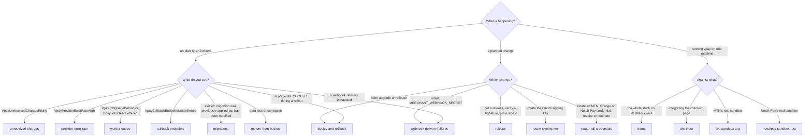

# Runbooks

vpay ships fifteen runbooks. Each answers three questions: how do I know this
is happening, what do I do, and how do I know it is fixed. This page is the
index a human reads first — one section per runbook, the gist in a few lines,
and a link to the real procedure, which is where the SQL and the commands are.

::: warning Most of these have never been followed against a deployment
vpay is being tested on some clusters (the owner's statement, 2026-10-21), but
no `kubectl` or `helm` command in any runbook is on record as run against one. The evidence that does exist is narrower and is
named in each section below: SQL executed against a scratch Postgres, states
produced by integration tests, and three procedures (the demo, the checkout
integration and the MTN sandbox test) that have genuinely been run end to end on
one machine. A fourth, the Notch Pay sandbox test, has been run against Notch
Pay's sandbox, except that no webhook has reached a running vpay and vpay's own
endpoint registration (B4) has not run. Every alert
threshold is proposed. Since v0.11.0 each of the six alert rules is tested by
`promtool` against **synthetic** series, which proves each expression fires on
the series it is written for; no Prometheus has ever scraped a vpay process.
:::

Agents working on operations should load [vpay-ops](skill:vpay-ops); for what
the runbooks and status pages claim and how that is checked,
[vpay-docs-status](skill:vpay-docs-status); for a failing local stack,
[vpay-troubleshooting](skill:vpay-troubleshooting).

## Which runbook do I need?

The alert names are the rules in the chart's `PrometheusRule`; each rule's
`runbook_url` points at its page. The rule set is off by default and every rule
carries `provisional: "true"`. Since v0.11.0 `just test-alert-rules` renders
the six rules and runs `promtool test rules` over a firing and a silent case for
each, in CI's chart job; that tests the expressions against made-up series, not
against anything vpay has emitted.

## Incidents

### Unresolved charges

**When:** `VpayUnresolvedChargesRising` fires — a charge passed its 24-hour
escalation with no terminal answer from the rail, or, since v0.11.0, a rail
answered something only a person can settle and the charge was escalated at
once (`error_kind = 'charge_needs_reconciliation'` on its latest
`provider_requests` row; only Notch Pay and Orange raise it).

- The payment is **escalated, not lost**: it is still polled hourly and the
  intent stays `processing`. The question is whether the payer was debited.
- Read the `provider_requests` timeline, and read its `operation` column first:
  the same `error_kind` means different things on a `submit` row and on a
  `query_status` row. On a `submit` row, `status_code IS NULL` means the outcome
  is unknown — on a push rail that is the genuinely ambiguous case.
  `status_code = 0` is a sentinel for "answered, no HTTP status": an accepted
  submit, a decline, or — on a `query_status` row only — a status read the rail
  answered, including one the adapter refused to act on. A `submitting` charge
  beside a `0` submit row is not a declined charge: recovery reads it as "the
  rail accepted it".
- Query the rail directly by reference, then reconcile against its settlement
  statement. There is no annotation field to record the finding in.
- On Notch Pay, find the payment in its dashboard by its `trx.…` reference
  (`provider_ref_extra.notchpay_reference`) when the charge holds one, and by
  amount, payer number and time when it does not.
- Never force a charge terminal because it is old, and never create a
  replacement charge on the same intent.

[docs/runbooks/unresolved-charges.md](vpay:docs/runbooks/unresolved-charges.md)
· background: [The reconciler](/payments/reconciler)

### Provider error rate

**When:** `VpayProviderErrorRateHigh` — more than 5% of calls to one rail not
succeeding over 15 minutes (both numbers proposed).

- **Step 0 is splitting by `error_kind`**, because the rule counts every
  non-success — including ordinary declines, which on mobile money are a large
  normal share. Expect it to fire on a healthy system.
- `provider_unavailable` is the rail being down (see unresolved charges);
  `misconfigured` is your YAML or credentials; `provider_error` is the adapter
  seeing a rail error string it does not know.
- For `provider_error`, group by `charges.failure_raw`; a dominant new string is
  a mapping to add. Never widen an existing mapping to swallow it. A
  `provider_error` can also be an answer the adapter refused to act on: on a
  `query_status` row of `provider_requests` that reads `status_code = 0`, meaning
  the rail answered and vpay could not use it.
- `charge_needs_reconciliation` (since v0.11.0) is not a rate problem: it is one
  charge that only a person can settle, already escalated. Go to unresolved
  charges.

[docs/runbooks/provider-error-rate.md](vpay:docs/runbooks/provider-error-rate.md)
· background: [Failures](/payments/failures)

### Worker queue

**When:** a dead-lettered job, a stranded lease, an `unresolved` escalation, or
a rail contradicting a settled charge.

- All worker work is a row in `jobs`. A dead letter is parked at
  `run_at = 'infinity'`; fix what `last_error` names, then re-arm it with the
  guarded `UPDATE` the runbook gives. Never delete a parked `poll_charge` row.
- Stranded leases are reaped automatically by any running worker; free them by
  hand only when no worker runs.
- A rail contradicting a settled charge is logged and **not acted on** — a
  charge settles once. Reconcile by hand; never `UPDATE charges SET state`.
- The throughput knob is `--worker-concurrency` up to 5, then more replicas.

_Evidence:_ its SQL ran against a fully migrated database, and the states it
looks for are produced by the worker's integration suite.
[docs/runbooks/worker-queue.md](vpay:docs/runbooks/worker-queue.md)

### Callback endpoints

**When:** `VpayCallbackEndpointUnconfirmed` fires — for three hours, no pass of
the worker's `ensure_callbacks` job confirmed vpay's callback endpoint on a rail
that keeps it registered with the account (today only Notch Pay). New in
v0.11.0.

- **It never fires for a rail whose `register` is `off`**: the pass skips that
  rail and counts nothing. Since v0.12.0 that is Notch Pay's default, so on a
  deployment that leaves `register` unset the alert says nothing about Notch
  Pay at all, and the operator registers the endpoint in Notch Pay's dashboard.
  Set `register: check` to have it watch a hand-registered endpoint, which must
  then carry vpay's description.
- **It costs latency, not money.** Callbacks are hints: every charge still
  settles by polling, but nothing pulls the poll forward. It is a `warning`,
  never `critical`.
- Read the pass's log line, or run it read-only:
  `vpay-server callbacks ensure --check` prints one line per rail and exits
  non-zero for `missing`, `locked` or `failed`.
- `missing` under `register: check` means vpay may not create the endpoint: set
  `ensure`, or register it by hand with **vpay's description**, because Notch
  Pay lists every endpoint with `"url": null` and vpay recognises its endpoint
  by description only. On Notch Pay prefer the hand-made one: in the sandbox
  an endpoint created through the API, as `ensure` does, delivered nothing,
  while one registered in the dashboard delivered (2026-10-24). `drifted` means vpay's endpoint lacks one of the five payment events:
  delete it in Notch Pay's dashboard and let the next `ensure` pass create a
  correct one, because vpay never modifies or deletes an endpoint. `locked` for
  three hours means something holds the advisory lock `vpaycbk`.
- It cannot fire before a worker's second pass, an hour after it starts, and it
  does not see whether callbacks actually arrive.

_Evidence:_ written with the rule on 2026-10-23; the rule is tested by
`promtool` against synthetic series only, and the registration it watches has
never run against a real Notch Pay account.
[docs/runbooks/callback-endpoints.md](vpay:docs/runbooks/callback-endpoints.md)
· background: [Notch Pay](/rails/notchpay#callbacks)

### Webhook delivery failures

**When:** a delivery reaches `exhausted`, a delivery job is dead-lettered, an
event was never fanned out, an endpoint has no secret, or you rotate
`MERCHANT_WEBHOOK_SECRET`.

- **vpay never tells a merchant a delivery failed** — no failure event, no
  email. Their fallback is polling `GET /v1/events`.
- Replay is two writes in one transaction (reset the row, re-enqueue the job);
  there is no replay endpoint or CLI.
- Rotation: add the new secret _beside_ the old (at most two), restart both
  workloads, move the receiver, remove the old one. Both SDK verifiers accept
  any matching `v1=`.
- Most "vpay is not sending webhooks" reports are the receiver: verify the raw
  bytes, check the clock, and answer inside the 10-second delivery deadline.

_Evidence:_ most of its SQL was executed, including the replay; no replayed
delivery has ever been seen reaching a receiver.
[docs/runbooks/webhook-delivery-failures.md](vpay:docs/runbooks/webhook-delivery-failures.md)
· background: [Webhooks](/api/webhooks)

### Migrations

**When:** a process exits 78 at boot with
`migration <n> was previously applied but has been modified`.

- A shipped migration file is never edited: sqlx hashes each file's whole bytes,
  comments included, and refuses a database whose recorded hash moved.
- The page repairs one known case (migration 0028, where only a comment changed)
  by writing the _current_ checksum into `_sqlx_migrations`. For any other
  version, do not copy it: check whether SQL changed first.
- Correct an applied migration with a new migration, never an edit.

_Evidence:_ its `UPDATE` is parsed out of the markdown and executed by the
integration suite; the `kubectl` steps have run nowhere.
[docs/runbooks/migrations.md](vpay:docs/runbooks/migrations.md)

### Restore from backup

**When:** data loss or corruption, and the quarterly drill ADR-0013 proposes.

- **No backup of any vpay database has ever been taken.** This page exists so
  the drill can run the first time there is one.
- Always restore into a scratch database; check that every ledger transaction
  balances and that `one_charge_per_intent` still holds before promoting it.
- Both modes migrate at boot, so pick and pin the image version _before_
  starting anything. Start the server before the worker: a restored
  `resubmit_charge` job can move money.
- The signing-key Secret is the second restore input — a key the restored
  database already retired is exit 78.

_Evidence:_ its SQL ran against a scratch Postgres with a deliberately torn
ledger transaction, which the check caught.
[docs/runbooks/restore-from-backup.md](vpay:docs/runbooks/restore-from-backup.md)
· background: [The ledger](/payments/ledger)

## Planned changes

### Release

**When:** cutting a `v*` tag, verifying an image or chart signature, pinning a
digest in Helm values.

- A tag builds three images natively on two architectures, signs each manifest
  list with keyless cosign, publishes the Helm chart to
  `oci://ghcr.io/vaam-apps/charts/vpay`, and publishes the npm packages.
- Before tagging: `master` green, and `Chart.yaml`'s `version:`, `appVersion`
  and the tag in agreement, or `publish-chart` refuses.
- Pin by digest; there is no `latest`. A failed run is re-run, never re-tagged.
- The same tag push runs `notify-docs.yml`, a separate workflow that tells
  vaam-apps/vpay-docs a release landed; it cannot block or fail the release,
  and `gh workflow run notify-docs.yml -R vaam-apps/vpay -f tag=vX.Y.Z`
  re-sends the announcement by hand. vpay-docs also polls every 3 hours, so a
  missed dispatch costs only latency.

_Evidence:_ the workflow has run on `master` and on tags. `cosign verify` has
never been run by anyone against anything this repository produced. The runbook
at <Release /> records `notify-docs.yml` as run on every `v*` tag from
v0.5.0 to v0.10.2, each followed by a `release-parity` dispatch here; this
site's own runs show the same for v0.10.3, v0.10.4 and v0.11.0
([How these docs stay current](/about/parity)).
[docs/runbooks/release.md](vpay:docs/runbooks/release.md) · background:
[Deployment](/operate/deployment#the-release-pipeline)

### Deploy and rollback

**When:** a `helm upgrade`, a rollback, or a pod exiting during a rollout.

- `helm upgrade --install … --atomic --timeout 10m`; the chart's `grace-period`
  guard keeps the kubelet from killing a draining process.
- Three things a rollback does not undo: a migration (there are no
  down-migrations), a signing-key rotation, and anything a rail already did.
- Exit 78 is configuration and restarting never fixes it; 69 is the database; 1
  is a drain cut short.

_Evidence:_ none against a cluster — written from the chart and the binaries'
shutdown code and tests.
[docs/runbooks/deploy-and-rollback.md](vpay:docs/runbooks/deploy-and-rollback.md)

### Rotate the signing key

**When:** rotating the RS256 key the server signs `/v1` tokens with, or a server
crash-looping on a retired `kid`.

- Rotation is a restart: replace the Secret, restart the server Deployment. The
  old key keeps verifying for a 24-hour overlap.
- **Rolling back to a retired key is exit 78, not a fix.** Roll forward — put
  the current key back or rotate to a new one.
- Only the server mounts the key; there is nothing to restart on the worker.

_Evidence:_ unit and integration tests against containers; no rotation has ever
been performed on a deployment.
[docs/runbooks/rotate-signing-key.md](vpay:docs/runbooks/rotate-signing-key.md)

### Rotate rail credentials

**When:** rotating an MTN, Orange or Notch Pay credential, or revoking a
merchant client.

- A rail credential is a `${VAR}` from one Secret: replace the whole Secret (a
  dropped key is an unresolved placeholder, exit 78) and restart **both**
  workloads.
- Notch Pay's `public_key` and `private_key` are mandatory only once its
  commented-out block is enabled. Treat `public_key` as a secret too: it can
  read and initiate payments on the account.
- A bad credential shows up as `error_kind = 'misconfigured'` from the moment
  you restarted — it reads like a rail outage.
- vpay holds no merchant secret. Revoking a merchant is an insert into
  `disabled_clients`, effective on the next token request; tokens already issued
  live out their 900-second TTL.

_Evidence:_ no `kubectl` step has been run, and no credential rotation has been
observed. The MTN sandbox tests of 2026-09-15 used real sandbox credentials, but
they do not exercise this procedure.
[docs/runbooks/rotate-rail-credentials.md](vpay:docs/runbooks/rotate-rail-credentials.md)
· background: [Configuration](/operate/configuration#rail-credentials)

## Running it yourself

### Demo

**When:** bringing vpay up from nothing on one machine and walking payments
through both rails.

- `just demo` generates throwaway keys, builds the images, and boots nine
  services — Postgres, three WireMock hosts (MTN, Orange, the webhook receiver),
  the server, the worker, vpay's checkout page, the demo shop and the dashboard
  — then runs `examples/merchant-demo`: six payments, every outcome each rail
  documents, each walked to its signed webhook.
- `just demo-down` removes containers **and** volumes.
- Its output is a pasted real run, and it found a real confirm/worker race that
  was then fixed.

_What it does not prove:_ anything about MTN or Orange — both rails are
WireMock. No money moved. [docs/runbooks/demo.md](vpay:docs/runbooks/demo.md) ·
[what it proves](vpay:docs/runbooks/demo/what-it-proves.md) · see also
[Quickstart](/guide/quickstart)

### Checkout

**When:** integrating vpay's own payment page, hosted or embedded, using
`examples/shop` as the worked example.

- Hosted: create an intent, then a Checkout Session, redirect to `session.url`.
  Embedded: frame vpay's page from an origin listed in `checkout_origins`.
- **Mark an order paid from the signed webhook only**, never from the return
  page.
- An unregistered origin is refused; the runbook shows how to see it.

_Evidence:_ its buying flow is driven end to end in a real browser by Cypress
against the demo stack; its `docker compose` and `psql` checks are not.
[docs/runbooks/checkout.md](vpay:docs/runbooks/checkout.md) · background:
[Hosted checkout](/checkout/hosted)

### Live sandbox test

**When:** reproducing a payment against **MTN's real sandbox** on your own
machine — server, worker, payer page and dashboard.

- Runs the binaries with `--profile live` (still `livemode: false`) against a
  local Postgres, with your own MTN Collections sandbox credentials.
- The currency is **EUR**: MTN's sandbox rejects XAF. The test MSISDN
  `46733123454` auto-settles, so no handset is prompted.
- The worker's authenticated status query is what settles the charge, not the
  callback.

_Evidence:_ the first page whose commands ran against a real rail, on
2026-09-15. It is not evidence of MTN production, Orange, refunds or a cluster.
[docs/runbooks/live-sandbox-test.md](vpay:docs/runbooks/live-sandbox-test.md) ·
background: [MTN MoMo](/rails/mtn-momo)

### Test Notch Pay against its sandbox

**When:** taking the `notchpay` rail to **Notch Pay's real sandbox**, with a
Notch Pay test-mode account.

- **Part A** is a probe, `cargo build -p vpay-notchpay --example sandbox_probe`,
  that asks Notch Pay's sandbox the open questions and writes a redacted report.
  It runs in phases: a read-only one first, then payments, then webhooks, and
  a read-only `search` phase that looks a payment up by reference. **A7**
  adds four more: `two-step` (initialize now, process later), `channels`
  (every outcome number on `cm.mtn` and `cm.orange`), `webhook-receive` (one
  endpoint at a URL you can read) and `webhook-update`.
- **Part B** runs vpay itself with `--profile notchpay-sandbox` (still
  `livemode: false`) and takes three sandbox payments through the adapter: one
  that succeeds, one that fails, and one that collects less than was asked. That
  third must never reach `succeeded` or `requires_payment_method`; since
  v0.11.0 the worker escalates it to `unresolved` on its first read. **B3b**
  takes the other three outcome numbers through: an MTN timeout, an MTN cancel
  and an Orange success. **B4** registers vpay's webhook endpoint on the
  account, one `POST /webhooks` that Notch Pay keeps until someone deletes it in
  the dashboard; the profile ships with `register: check` so that nothing else
  creates one. Since v0.12.0 no deployment registers one unless told to, and
  the runbook says to run B4 only to measure it again, on the maintainer's
  approval.
- **Delete any API-created endpoint before running payments.** In the 2026-10-23
  run the endpoint `webhook-receive` created could not be read, repaired or
  deleted through the API (`404`), and every payment processed after it existed
  stayed `processing`. Delete it in the dashboard, by the id the probe printed,
  and run `read` first to confirm the list is empty.
- **A8 measures the route that delivers**: an endpoint added by hand in the
  dashboard. The probe's `dashboard-deliveries` phase creates and deletes no
  endpoint; it makes two payments, waits, and lists the endpoints again, and
  `verify-signature` checks each recorded body against its header.
- Test keys only: boot refuses a key with neither `test.` nor `test_` outside
  livemode. Keep them in an env file outside the repository, and never paste
  one anywhere.
- vpay trusts only its vendored root certificates and ignores proxy variables,
  so a TLS-intercepting proxy stops every call. The probe alone accepts an extra
  CA bundle, for a Claude Code cloud session only; vpay itself never does.

_Evidence:_ written on 2026-10-20. **Part A ran against Notch Pay's sandbox on
2026-10-21**, from a cloud session with the probe's cloud-only `--ca-bundle`, on
the maintainer's approval
([verification](vpay:docs/status/verification/2026-10-21-notchpay-sandbox-run.md)).
Its answers corrected the adapter (see [Notch Pay](/rails/notchpay)); the
webhook step (A4) was not run, so the webhook signature was not measured
that day (A8 measured it on 2026-10-24).
**Part B ran the same day**, on the maintainer's own machine, with a Postgres in
Docker: three payments through vpay itself, read back from Postgres and the
worker's log
([verification](vpay:docs/status/verification/2026-10-21-notchpay-step5.md)).
The runbook's commands were corrected from that run. **B3b ran on 2026-10-22**
from the same machine: the timeout number failed `payer_timeout`, the canceled
number failed `payer_declined` and the Orange number succeeded, each terminal
about 12 s after create
([verification](vpay:docs/status/verification/2026-10-22-notchpay-b3b.md)).
The probe's refund phase (A6) ran the same day, and every `POST /refunds`
answered `403`
([verification](vpay:docs/status/verification/2026-10-22-notchpay-refunds.md)).
**A7 ran on 2026-10-23**, from a cloud session, through the probe and not vpay
([verification](vpay:docs/status/verification/2026-10-23-notchpay-sandbox-two-step-and-channels.md)):
Notch Pay's side of the two-step split and of the per-network channels was
measured, and an endpoint created at a public capture inbox through the API
received nothing in 21 minutes. **A8 ran on 2026-10-24**, also through the
probe ([verification](vpay:docs/status/verification/2026-10-24-notchpay-dashboard-webhooks.md)):
an endpoint the maintainer registered in the dashboard received four signed
payment webhooks for two payments, each signed over the raw body, and the
adapter's `verify_callback` answered `Verified` for all four offline. They
name the event under `event`, which vpay could not parse before v0.13.0.
**B4 and A4 have not been run.** It is evidence about Notch Pay's sandbox
only: no production, no live key, no refund, no webhook through a running
vpay, no endpoint registered by vpay, and
through vpay the one-call build only, not the two-step submit or the
per-network channels. The profile configures no signing secret, so the run
also says nothing about vpay's signature check.
[docs/runbooks/notchpay-sandbox-test.md](vpay:docs/runbooks/notchpay-sandbox-test.md)
· background: [Notch Pay](/rails/notchpay)

## Status in this release

| Runbook group                                               | Status                  | Evidence                                                                                                                                                                                                                                                                                                                                                                              |
| ----------------------------------------------------------- | ----------------------- | ------------------------------------------------------------------------------------------------------------------------------------------------------------------------------------------------------------------------------------------------------------------------------------------------------------------------------------------------------------------------------------- |
| Demo, checkout, live sandbox test                           | <Status s="built" />    | Executed end to end on one machine; checkout in CI via Cypress                                                                                                                                                                                                                                                                                                                        |
| Worker queue, webhook failures, migrations, restore         | <Status s="partial" />  | SQL executed against real Postgres; procedures never followed on a deployment                                                                                                                                                                                                                                                                                                         |
| Deploy/rollback, both rotations, release                    | <Status s="unproven" /> | Written from the chart and code; no `kubectl`/`helm` step ever run against a cluster                                                                                                                                                                                                                                                                                                  |
| Unresolved charges, provider error rate, callback endpoints | <Status s="unproven" /> | Rules tested by `promtool` against synthetic series only; never evaluated against vpay's own metrics; thresholds proposed                                                                                                                                                                                                                                                             |
| Notch Pay sandbox test                                      | <Status s="partial" />  | Part A (the probe) and Part B (three payments through vpay) run against the sandbox on 2026-10-21, B3b (three more) and A6 (refunds, all `403`) on 2026-10-22, A7 (two-step, channels, a capture endpoint) on 2026-10-23 and A8 (four webhooks to a dashboard endpoint) on 2026-10-24 through the probe; no webhook through a running vpay; A4 and endpoint registration (B4) not run |

The authoritative account of what each page has and has not been exercised
against is [docs/runbooks/README.md](vpay:docs/runbooks/README.md).

## Go deeper

- [docs/runbooks/README.md](vpay:docs/runbooks/README.md) — the index, with each
  page's evidence
- [Deployment](/operate/deployment) and [Configuration](/operate/configuration)
- Skills: [vpay-ops](skill:vpay-ops),
  [vpay-docs-status](skill:vpay-docs-status),
  [vpay-troubleshooting](skill:vpay-troubleshooting)
