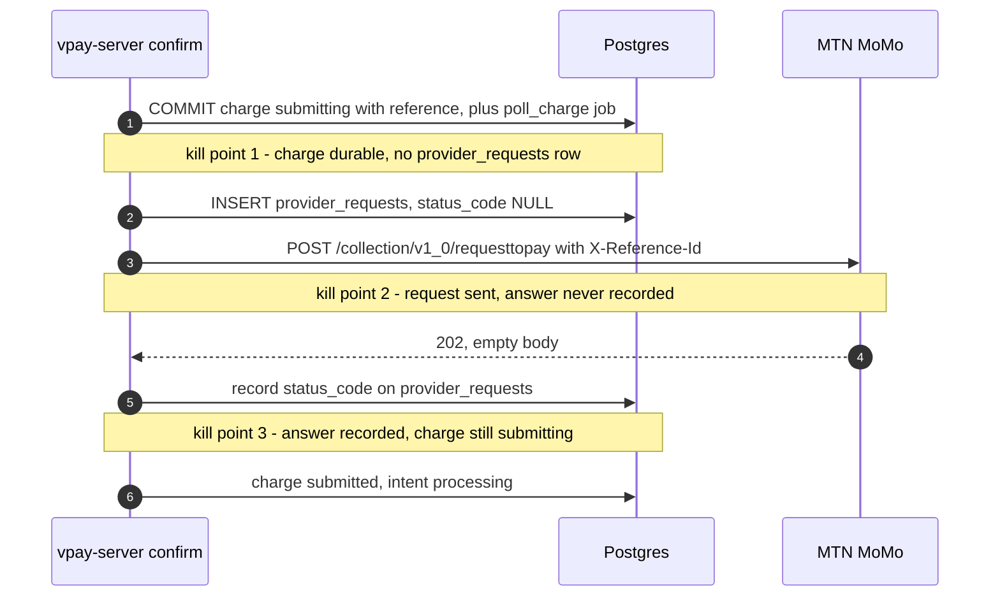
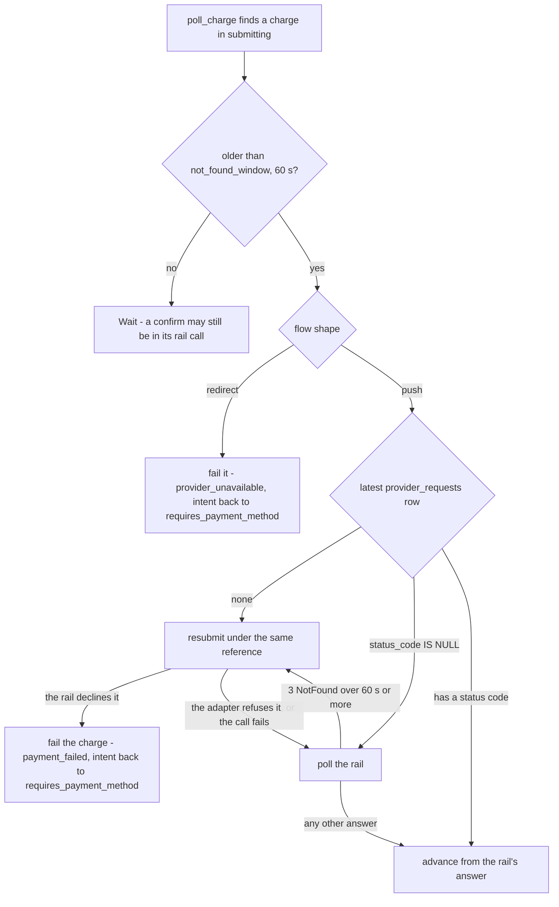
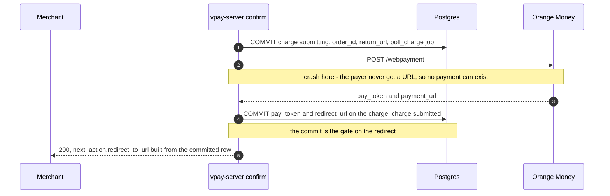

# Crash safety

A process can die at any instant — between a database commit and a network call,
or halfway through reading a rail's answer. On a payment path the question is
always the same: after the restart, can vpay still name the transaction the
payer may have acted on? vpay's crash-safety design is one sentence applied
twice:

> **Never let a payer act on a transaction you cannot later name.**

The two flow shapes apply it at different moments, because the payer becomes
able to act at different moments. On a **push** rail the payer can act as soon
as the request leaves vpay, so the reference must be durable _before_ submit. On
a **redirect** rail the payer can act only once they hold a URL, so the rail's
token must be durable _before_ the redirect.

Agents working on this should load [vpay-reconciler](skill:vpay-reconciler).

## Push rails (MTN MoMo): persist the reference before submit

MTN acknowledges `requesttopay` with **202 and an empty body**. There is no
transaction id in the response — the id _is_ the `X-Reference-Id` vpay sent. The
payer's handset starts prompting before vpay knows whether its request
succeeded. Generate a reference in memory, send it, crash before writing it
down, and you have created a payment you can never observe.

So the confirm path writes first and calls the network second:

1. mint the `provider_reference_id`;
2. **commit** the charge in `submitting` carrying that reference, together with
   the `poll_charge` job that will drive it, in one transaction;
3. insert a `provider_requests` row with `status_code IS NULL` — "about to
   send";
4. call the adapter's `submit`;
5. record what came back on that row, and move the charge to `submitted`.

The diagram shows the accepted case. Step 5 has two orders, chosen by the
answer. An **accepted** submit records the row first and moves the charge
second, so a crash between them is kill point 3: an answered row beside a
`submitting` charge, which the worker reads as "the rail took it" and advances.
A **declined** submit does the opposite: vpay fails the charge first (charge
`failed`, intent back to `requires_payment_method` with the reason, one
`payment_intent.payment_failed`, in one transaction) and only then records the
row as answered
([`finish_confirm`](vpay:backends/crates/vpay-api/src/v1/payment_intents.rs)).
Recorded first, a crash or a refused settlement would leave that same answered
row beside a `submitting` charge, and the worker would advance a charge the rail
had refused. As it is, a refused settlement leaves the charge `submitting` and
the row unanswered, which is what a crash before the answer leaves: the worker
resubmits into the same decline and fails the charge itself. If the row cannot
be completed after the decline has settled, the confirm still answers
`409 charge_declined`; the failure is logged and the row stays pending.

Every kill point leaves a committed charge **and** a job behind, because the job
is committed in step 2's transaction. That is the reason it is enqueued there
rather than beside step 5: kill points 1 and 2, precisely the recovery cases,
would otherwise leave a charge nothing would ever ask the rail about.

When that job becomes claimable is decided on **Postgres' clock**, not the API
host's. Step 2 passes the poll's grace period as a delay and the statement
computes `now() + grace`
([ADR-0026](vpay:docs/adr/0026-the-database-clock-schedules-jobs.md)), so an API
host whose clock runs behind or ahead of the database neither eats into nor
stretches the grace. No ordering and no kill point changed with it.

[Notch Pay](/rails/notchpay), the other push rail, creates the payment with the
charge's own UUID, but since v0.9.1 it processes and reads it by **Notch Pay's**
`trx.…` reference, because its sandbox answered `404` to anything else. That
reference comes back only in the first call's answer and is kept as key
material once `submit` returns. A duplicate submit answers `409`, which the
adapter treats as the crash-retry case when the charge already holds Notch
Pay's reference: it reads the payment rather than failing it. When the charge
holds none, a crash fell between the first call and `submit` returning, and
vpay cannot find the payment: the `409` is `Malformed`, the charge's fate is
left unknown for an operator, and only Notch Pay's dashboard can tell whether
the payer paid. A resubmit refused that way is recorded as unanswered, so
recovery keeps asking the rail rather than treating the charge as accepted. That
window is open, and Notch Pay offers no way to close it
([the adapter flow](vpay:docs/flows/adapter-notchpay.md)).

### The retry rule

If submit times out or errors, **do not generate a new reference** — retry with
the same one. The adapter contract requires a duplicate submission to be
reported as `Submitted`, not as an error, which is what makes a resubmit safe. A
fresh reference on retry is how you double-charge a customer.

### Recovering a `submitting` charge

`submitting` covers two physically different situations, and the worker tells
them apart with `provider_requests`. It reads the latest **`submit`** row and
nothing else:

| Evidence                          | What happened                  | Action                                                                                                                               |
| --------------------------------- | ------------------------------ | ------------------------------------------------------------------------------------------------------------------------------------ |
| Charge younger than 60 s          | A confirm may still be running | **Wait** — reschedule once, for the rest of the window, and touch nothing                                                            |
| No `provider_requests` row        | Crashed before the POST        | **Resubmit**, same reference                                                                                                         |
| Row exists, `status_code IS NULL` | POST issued, outcome unknown   | **Poll**. Only after 3 consecutive `NotFound` **and** at least 60 s, treat it as never received and resubmit with the same reference |
| Row has a status code             | The rail answered              | Advance the bookkeeping from the code — no rail call                                                                                 |

Three details matter:

- **The age guard comes first.** A charge in `submitting` is also the ordinary
  state of a confirm still inside its rail call; younger than the window,
  nothing on disk distinguishes the two. The age is measured by Postgres at both
  ends, so a worker host with a fast clock cannot shrink the window.
- **A bare `NotFound` never fails a charge.** Resubmitting is always safe, so
  every ambiguity resolves toward "find out", never "give up". The threshold
  needs both conditions because three polls can happen in under a second, and a
  rail that is merely slow to index a new charge looks identical to one that
  never received it.
- **The table applies only while the charge is `submitting`.** Once the rail has
  answered, a `NotFound` is an ordinary pending answer: the ladder keeps
  running.

The table is a pure function, `vpay_worker::recovery::recovery_step`, over the
flow shape, the latest submit attempt, the `NotFound` streak, the charge's age
and the window.

Three more things about the rows it reads:

- **`NULL` on a `submit` row means the outcome is unknown, not that the rail
  said nothing.** A resubmit that ends in any error other than a decline is
  written `NULL` with its `error_kind`: a transport failure, a misconfiguration,
  or an answer the adapter refuses as `Malformed`, which Notch Pay's
  unresolvable `409` and MTN's unfollowed `307` both are. The next poll then
  reads the middle row and polls, instead of reading the bottom row and
  advancing a charge whose fate nobody knows.
- **A resubmit the rail declines ends the table for that charge.** The worker
  fails it (charge `failed`, intent back to the payer with the reason, one
  `payment_intent.payment_failed`) and only then marks the attempt row answered,
  so no path leaves an answered row beside a `submitting` charge. A failed
  charge is not polled, so nothing resubmits it again. The decline is trusted
  because a resubmit happens only when the rail has no record of the reference,
  and the port's contract is that a duplicate is reported as `Submitted`, never
  as an error. A rail that declined a duplicate instead would break that
  contract, and vpay would not see a payment the rail then took. No resubmit
  has yet met a real rail.
- **A status read is a different operation, and no row of this table reads
  it.** A read the rail answered and the adapter refused is written with the
  `0` sentinel and an `error_kind`, because `NULL` on a read would claim "no
  answer" for an answer that came. A read that never reached the rail, or one
  the rail answered with a `5xx`, stays `NULL`: the port cannot tell those
  apart.

## Redirect rails (Orange Money): persist the token before redirect

The ordering is reversed, and it is safe for a reason worth stating plainly: the
payer cannot act until vpay hands them a URL.

**If the submit response is lost, no payment can have occurred** — the payer was
never given the URL. That `order_id` is dead: the worker fails the charge with
`provider_unavailable` and the merchant creates a new PaymentIntent. It does
this without asking the rail, because Orange's `transactionstatus` needs the
`pay_token`, and the `pay_token` was in the response that was lost.

What would **not** be safe is emitting `redirect_to_url` before the token is
committed: a crash would then strand a payer mid-payment on Orange's page
against a charge vpay cannot query. So `next_action` is built only from the
committed row.

When a Checkout Session drives the charge, its `return_url` is also written
**before** the first commit and read back from that row at submit, so what the
rail is told, what `next_action` renders and what a resubmit would send are one
column.

::: tip Why Orange is integrable at all
Read naively, "status must be queryable by a reference you generated" would
disqualify Orange: its status call requires a `pay_token` that only exists in
the submit response. It does not disqualify it, because of the asymmetry above.
That is why vpay states its rail preconditions **per flow shape** rather than
universally.
:::

## One charge per intent

Both enforcement points lean on a database index:
`one_charge_per_intent ON charges (payment_intent_id)`, plain and not partial. A
confirm that is retried cannot produce a second charge
(`a_second_confirm_cannot_produce_a_second_charge`), and the runbook for stuck
charges says it outright: do not create a replacement charge on the same intent
— the database refuses it, and this scenario is why. See
[the payment lifecycle](/payments/lifecycle#one-charge-per-intent-forever).

A related consequence: because confirm moves the intent only **after** the rail
answers, every kill point leaves a live charge against an intent still reading
`requires_payment_method`. The settlement's guard accepts that status alongside
`processing` and `requires_action`, so a recovered charge settles instead of
dead-lettering.

## How it is tested

- **Written crash states.** `worker_recovery.rs` builds each of the three kill
  points directly against a real Postgres, aged ninety seconds, then runs the
  real handler against a WireMock rail. The decisive assertion is that every
  `provider_requests` row for the charge carries the **same**
  `provider_reference_id`. Unaged copies of the same fixtures assert that
  nothing moves. The same file pins how a refused attempt is recorded: a status
  read the adapter refuses is answered and a `503` is not; a resubmit refused
  as `Malformed` stays unanswered; a resubmit the rail declines fails the
  charge, is recorded answered, and is not sent again by the poll that follows;
  and a declined submit whose settlement was lost is failed by the worker.
- **The confirm's order on a decline.** `confirm_rails.rs` makes Postgres
  refuse the decline's settlement and asserts that the confirm leaves the
  attempt unanswered, and makes the attempt row refuse its completion after a
  settled decline and asserts that the merchant still gets the decline.
- **Real `SIGKILL`s.** `worker_kill9.rs` spawns the shipping binary as real
  processes against real Postgres and WireMock and kills them with signal 9: a
  worker killed mid-poll (the charge settles exactly once after its lease is
  reaped) and a server killed mid-submit (kill point 2 — the worker recovers by
  polling and **never** resubmits).
- **Graceful stops** are covered on
  [the reconciler page](/payments/reconciler#sigterm-and-the-drain).

## Status in this release

| Part                                                 | Status                   | Evidence                                                                                                                                                                                                                                                                                         |
| ---------------------------------------------------- | ------------------------ | ------------------------------------------------------------------------------------------------------------------------------------------------------------------------------------------------------------------------------------------------------------------------------------------------ |
| Write-before-network ordering in confirm             | <Status s="built" />     | `redirect_confirm_commits_the_rails_material_before_it_answers`, `an_unreachable_rail_leaves_the_charge_where_recovery_expects_it`                                                                                                                                                               |
| Recovery table read by the worker                    | <Status s="built" />     | `worker_recovery.rs`, 28 cases against real Postgres, none ignored                                                                                                                                                                                                                               |
| A declined submit fails the charge before its row    | <Status s="partial" />   | Same order in `vpay-api`'s confirm and the worker's resubmit (`a_decline_the_database_refuses_to_settle_leaves_the_attempt_unanswered`, `a_resubmit_the_rail_declines_fails_the_charge_and_is_recorded_as_answered`); proven against real Postgres, with the decline itself coming from WireMock |
| Kill point 2 and mid-poll crash under real `SIGKILL` | <Status s="partial" />   | `worker_kill9.rs` — MTN only, rail is a WireMock container                                                                                                                                                                                                                                       |
| Kill point 1 under a real signal                     | <Status s="not-built" /> | Only written, not caused: there is no network call at that instant for a signal to land during                                                                                                                                                                                                   |
| Any kill case on Orange Money                        | <Status s="not-built" /> | Neither kill case exercises the redirect rail                                                                                                                                                                                                                                                    |
| Recovery against a real rail                         | <Status s="unproven" />  | Every recovery case is proven against a stub speaking the documented protocol. Neither the MTN sandbox payments of 2026-09-15 nor Notch Pay's of 2026-10-21 exercised a recovery case                                                                                                            |

What is proven is that vpay executes its recovery table correctly — not that the
rails behave as vpay's documents claim. The full record is the status notes in
[the crash-safety flow](vpay:docs/flows/crash-safety.md).

## Go deeper

- [docs/flows/crash-safety.md](vpay:docs/flows/crash-safety.md) — the source of
  truth, including the test history
- [docs/reference/vpay-worker.md § Recovering a `submitting` charge](vpay:docs/reference/vpay-worker.md)
  — the code's side
- [docs/runbooks/unresolved-charges.md](vpay:docs/runbooks/unresolved-charges.md)
  — reading `provider_requests` by hand
- [Reconciler](/payments/reconciler) — the worker that runs the recovery
- Skill: [vpay-reconciler](skill:vpay-reconciler)
