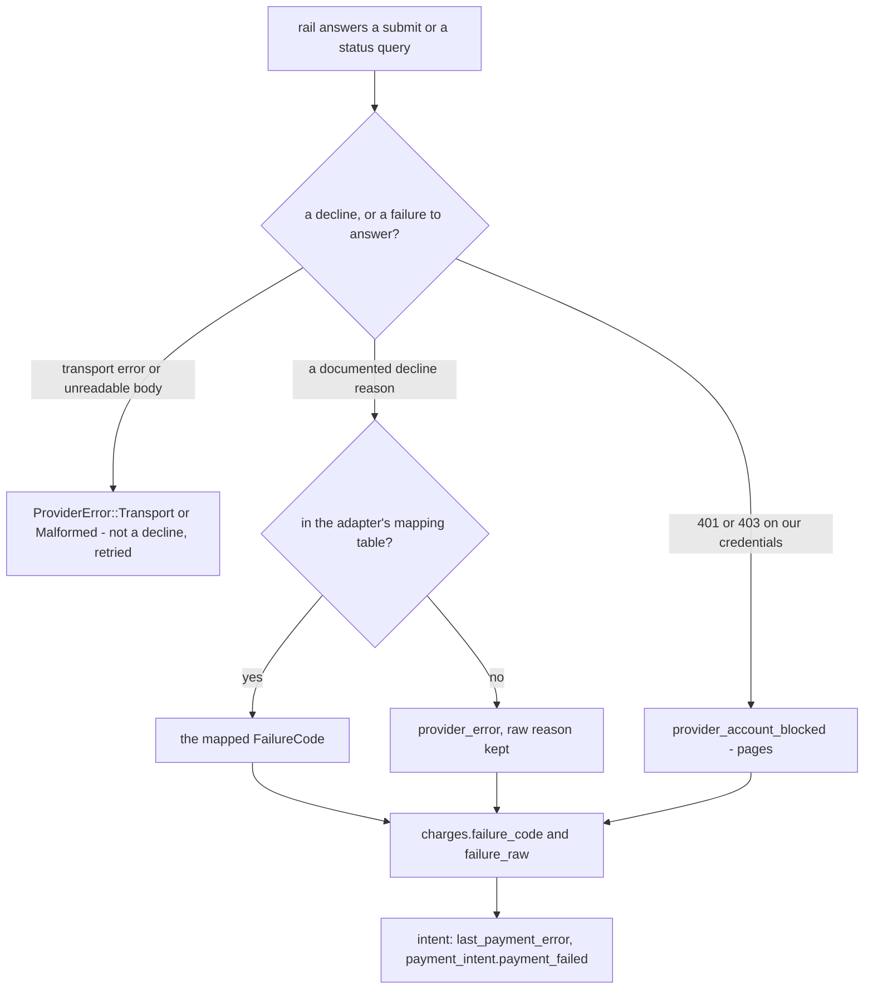

# Failure codes

When a rail declines a payment, the merchant does not see MTN's, Orange's or
Notch Pay's error string. They see a **`FailureCode`**: a closed vocabulary of eleven codes
owned by vpay's core, into which each adapter maps its rail's own reasons. A
merchant integrates against the list once, and it does not grow when a rail is
added. This page gives the vocabulary, how rail reasons map into it, and — just
as important — which codes each rail can actually produce.

Agents working on this should load [vpay-payments](skill:vpay-payments).

## The vocabulary

| Code                       | Meaning                                 | Payer can retry?    | Whose problem     |
| -------------------------- | --------------------------------------- | ------------------- | ----------------- |
| `insufficient_funds`       | Not enough balance                      | Yes, new intent     | Payer             |
| `payer_timeout`            | Never approved in time                  | Yes, new intent     | Payer             |
| `payer_declined`           | Actively rejected the prompt            | Yes, new intent     | Payer             |
| `invalid_payer`            | Identifier not valid on this rail       | No — fix the number | Payer/merchant    |
| `payer_limit_reached`      | Wallet or KYC-tier limit                | Later               | Payer             |
| `payer_account_blocked`    | Payer account not active                | No                  | Payer             |
| `invalid_payee`            | Merchant's receiving account invalid    | No                  | Merchant config   |
| `payee_account_blocked`    | Merchant's receiving account not active | No                  | Merchant config   |
| `provider_account_blocked` | **Your** partner account is blocked     | No                  | **Page yourself** |
| `provider_unavailable`     | Rail down or timing out                 | Yes, later          | You               |
| `provider_error`           | Unmapped; carries the raw reason        | Unknown             | Investigate       |

"New intent" is literal: an intent can hold only one charge, ever, so a retry is
a new PaymentIntent
([lifecycle](/payments/lifecycle#one-charge-per-intent-forever)).

## How a rail's answer becomes a code

The rail's own word survives in `failure_raw`, which is stored and logged. Only
the taxonomy code and a generic message are public. A decline at submit answers
the confirm with `409 charge_declined`. A decline found later arrives as the
same `payment_intent.payment_failed` event, whether the poll ladder found it or
the worker met it resubmitting a charge the confirm left unresolved.

## Which rail can produce which code

The vocabulary says what each code **means**. It does not say whether anything
can **produce** it — and MTN can produce all eleven, while Orange can produce
three and Notch Pay four.

| Code                       | MTN MoMo                                    | Orange Money                | Notch Pay (stub only)                                        |
| -------------------------- | ------------------------------------------- | --------------------------- | ------------------------------------------------------------ |
| `insufficient_funds`       | `NOT_ENOUGH_FUNDS`                          | —                           | —                                                            |
| `payer_timeout`            | `COULD_NOT_PERFORM_TRANSACTION`, `EXPIRED`  | `EXPIRED`                   | `expired`, `abandoned`                                       |
| `payer_declined`           | `PAYMENT_NOT_APPROVED`, `APPROVAL_REJECTED` | —                           | `canceled`                                                   |
| `invalid_payer`            | `PAYER_NOT_FOUND`                           | —                           | —                                                            |
| `payer_limit_reached`      | `PAYER_LIMIT_REACHED`                       | —                           | —                                                            |
| `payer_account_blocked`    | `SENDER_ACCOUNT_NOT_ACTIVE` †               | —                           | —                                                            |
| `invalid_payee`            | `PAYEE_NOT_FOUND`                           | —                           | —                                                            |
| `payee_account_blocked`    | `PAYEE_NOT_ALLOWED_TO_RECEIVE`              | —                           | —                                                            |
| `provider_account_blocked` | `NOT_ALLOWED`, HTTP 401/403                 | HTTP 401/403                | HTTP 401/403                                                 |
| `provider_unavailable`     | `SERVICE_UNAVAILABLE` on a `FAILED` body    | —                           | —                                                            |
| `provider_error`           | anything unmapped                           | `FAILED`, anything unmapped | `failed`, `rejected`, a `400`/`422` on initialize or process |

† `SENDER_ACCOUNT_NOT_ACTIVE` and `COULD_NOT_PERFORM_TRANSACTION` are **not** in
MTN's published `ErrorReason` enum. Both are mapped anyway, and declared as
unpublished reasons in the adapter.

### Why Orange can say so little

Orange documents five statuses — `INITIATED`, `PENDING`, `SUCCESS`, `EXPIRED`,
`FAILED` — and no sub-reason for `FAILED`. Its protocol cannot say "not enough
funds" or "no such payer". A payer who clicks _Cancel_ on Orange's page arrives
as `EXPIRED`, indistinguishable from one who walked away, so `payer_declined` is
unreachable on Orange. vpay refuses to invent a `CANCELLED` to make the rails
look alike.

### Why Notch Pay can say so little

Notch Pay's status read carries a status and no reason. On 2026-10-21 its
sandbox, asked through vpay's probe, read its outcome numbers as `complete`,
`failed` (other failure), `expired` (timeout) and `canceled` (canceled by
user), with no reason field. So `insufficient_funds` is unreachable there.
Since v0.9.1 `canceled` maps to `payer_declined`, on that evidence; it was
`provider_error` before. Anyone holding the merchant's public key can cancel a
payment too ([Notch Pay](/rails/notchpay#the-production-risk)), so a `canceled`
read is evidence of a decline, not proof of whose. The "insufficient funds" number read
`complete` for less than was asked, which the adapter now refuses as
`Malformed` rather than counting as a success. A `503` or a timeout is a
transport error, never a decline, which is why `provider_unavailable` is a
dash.

**The column heads say "stub only" because each row's proof is a WireMock
case.** The adapter has read Notch Pay's sandbox once, the same day: three
test-mode payments went through vpay itself. One read `failed` and became
`provider_error`, and the "insufficient funds" number's short `complete` was
refused as `Malformed` on every read after the first. `failed` is the only row
of the mapping the sandbox has witnessed through the adapter. The timeout and
canceled numbers were not run through vpay, and Notch Pay's production has
never been called.

::: tip For merchants
Write one branch per code — that is the right integration. Do **not** assume
every branch is reachable on the rail in front of you: on Orange only
`payer_timeout`, `provider_account_blocked` and `provider_error` can occur, and
Notch Pay adds `payer_declined`.
:::

### No code is deleted

A code nothing produces is a documented reservation, not dead weight. The
vocabulary is a wire contract, and removing a variant would break a merchant
deserialising it. What keeps promises honest instead is a test:
`the_declines_prove_every_code_each_rail_can_produce` holds the conformance
cases against each adapter's `PRODUCED_FAILURE_CODES`, so a code that gains a
producer without a case — or a case for a code the adapter does not declare —
fails.

## `provider_error` is an alert, not a resting place

A rising `provider_error` rate means an adapter's mapping table has drifted
behind the rail's real error strings. Alert on it; do not tolerate it. The
runbook is [provider-error-rate](vpay:docs/runbooks/provider-error-rate.md).

## Status in this release

| Part                                | Status                  | Evidence                                                                                                                                                                                                                                                                                                          |
| ----------------------------------- | ----------------------- | ----------------------------------------------------------------------------------------------------------------------------------------------------------------------------------------------------------------------------------------------------------------------------------------------------------------- |
| The taxonomy                        | <Status s="built" />    | `vpay-core::failure`                                                                                                                                                                                                                                                                                              |
| MTN mapping table                   | <Status s="partial" />  | Row by row in both directions; checked against MTN's published enum; every mapped reason has a WireMock case                                                                                                                                                                                                      |
| Orange mapping                      | <Status s="partial" />  | Its documented statuses mapped and tested; proven only against WireMock                                                                                                                                                                                                                                           |
| Notch Pay mapping                   | <Status s="partial" />  | The eleven documented statuses mapped and unit-tested; five driven against WireMock; the sandbox's outcome numbers read by a probe on 2026-10-21; through the adapter the sandbox witnessed `failed` becoming `provider_error`, and no other row                                                                  |
| Decline reaching the merchant       | <Status s="partial" />  | `409 charge_declined`, `last_payment_error`, one `payment_intent.payment_failed` — rails are stubs                                                                                                                                                                                                                |
| Mappings faithful to the real rails | <Status s="unproven" /> | Every decline at submit came from WireMock. MTN's sandbox was called on one day (2026-09-15) and produced no decline. Notch Pay's sandbox failed one payment (2026-10-21), and it landed in `provider_error`, so it tested no mapped reason. Orange has never been called, and neither has Notch Pay's production |

The first documented sandbox session took three runs: the first two stopped at
the token mint on adapter bugs, and the third settled its charge. Over seven
payments succeeded across the 2026-09-15 testing; no charge decline was
observed, so those successes did not test any row of the tables above. The
initial session is recorded in
[vpay's verification log for 2026-09-15](vpay:docs/status/verification/2026-09-15.md).

Notch Pay's sandbox run of 2026-10-21 put three payments through the adapter:
one succeeded, one read `failed` and became `provider_error`, and one read
`complete` for less than its amount and was refused. It saw no decline with a
mapped reason either
([vpay's verification log](vpay:docs/status/verification/2026-10-21-notchpay-step5.md)).

The full record is the **Status** section of
[the failure taxonomy flow](vpay:docs/flows/failures.md#status).

## Go deeper

- [docs/flows/failures.md](vpay:docs/flows/failures.md) — the source of truth,
  including the conformance case per row
- [docs/flows/adapter-mtn-momo.md](vpay:docs/flows/adapter-mtn-momo.md) and
  [docs/flows/adapter-orange-money.md](vpay:docs/flows/adapter-orange-money.md)
  and [docs/flows/adapter-notchpay.md](vpay:docs/flows/adapter-notchpay.md) —
  each rail's mapping
- [Errors](/payments/errors) — how `charge_declined` is classified, and why it
  is not the `FailureCode` itself
- Skill: [vpay-payments](skill:vpay-payments)
