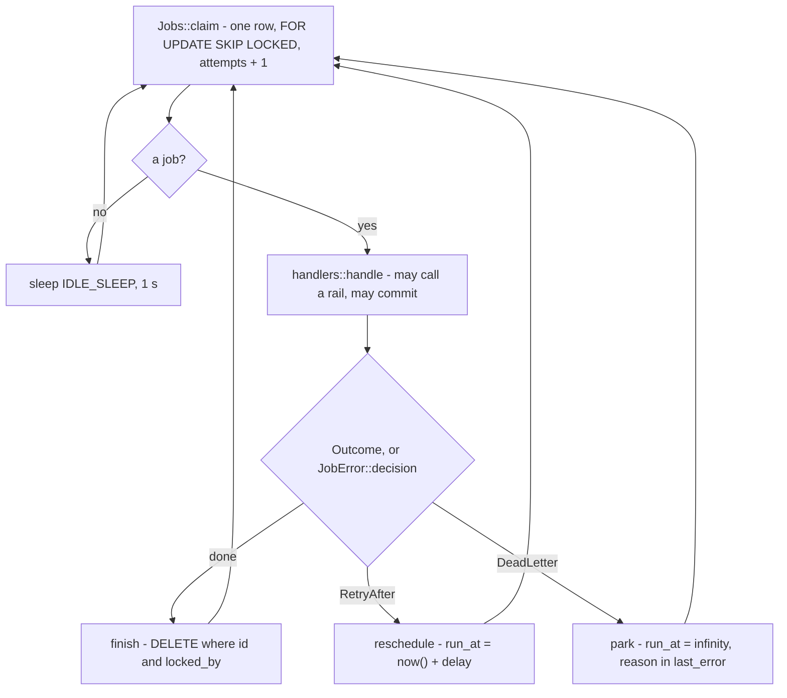
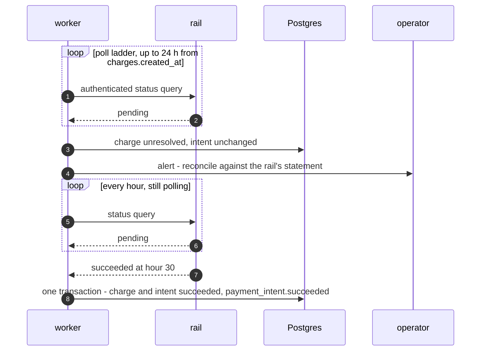
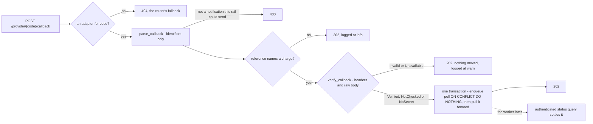
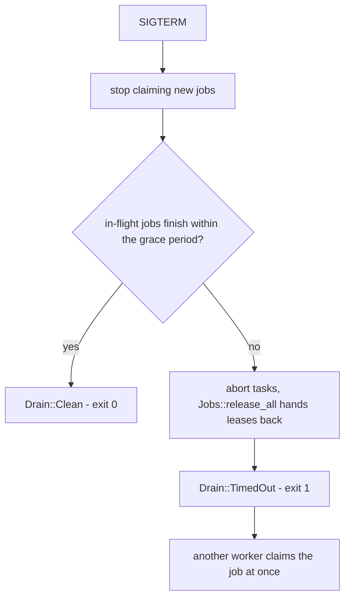

# Reconciler

Payer prompts expire. Callbacks may never arrive. So vpay does not wait to be
told how a payment ended: a worker process — `vpay-server worker`, the same
binary as the API run with a different subcommand — asks the rail, on a
schedule, until the rail gives a terminal answer or until a human has to step
in. This page explains the job queue that drives it, the poll ladder, the
24-hour escalation, and what keeps it correct when a worker dies or is stopped.

Agents working on this should load [vpay-reconciler](skill:vpay-reconciler).

## The job queue

Everything the worker does is a row in the `jobs` table. A job's `dedupe_key`
names its work — `poll:<charge_id>`, `resubmit:<charge_id>`, `sweep:expired`,
`scan:live`, `ensure:callbacks` — and the same queue carries webhook fan-out and
delivery (see [webhooks](/api/webhooks)).

- **Claiming is safe under concurrency.** The claim is
  `UPDATE … WHERE id = (SELECT … FOR UPDATE SKIP LOCKED LIMIT 1)`, leased on
  `locked_by`, and two workers never take the same job.
- **Every write that ends a lease is guarded on `locked_by`.** A worker whose
  lease was reaped mid-run discards its answer instead of overwriting whoever
  holds the job now. The gauge line counts those as `lost`; any non-zero value
  means a handler outran the five-minute lease.
- **The loop owns the row; the handler does not.** A handler returns an
  `Outcome` and cannot delete or park its own row. Because a handler may commit
  a settlement and then fail before the `jobs` write, every handler is a
  compare-and-swap: re-running it matches no rows and answers "done".
- **The poll job is born with the charge**, in the same transaction, so every
  kill point in [crash safety](/payments/crash-safety) leaves work behind. The
  `scan:live` job runs every ten minutes and is only a backstop for charges
  nothing has touched for ten minutes; in a healthy deployment it finds none.

## The poll ladder

`vpay_worker::poll_delay(attempt)`, tested for monotonicity:

| Attempt | Delay                        |
| ------- | ---------------------------- |
| 0–5     | 10s, 20s, 30s, 45s, 60s, 90s |
| 6–19    | 120s                         |
| 20+     | 15 min, out to 24 hours      |

A rung is one `UPDATE jobs SET run_at = now() + delay`. The queue adds at most
the one-second idle sleep on top: measured on the shipping loop, the last of a
backlog of eight was claimed 1.028 s after it committed at worst.

**One clock decides when a job is due: Postgres'.** The rungs always were. Since
[ADR-0026](vpay:docs/adr/0026-the-database-clock-schedules-jobs.md), a job's
_first_ `run_at` is too: the confirm's poll, the backstop's re-enqueues, a
resubmission, every webhook delivery job, the singletons a worker seeds at boot
and the callback route's enqueue all pass a delay, and the statement computes
`now() + delay`. Before that, each stamped its own host's clock while the claim
judged it with the database's, so a skewed host made jobs run early or late. The
queue-age gauge is subtracted in SQL for the same reason. No rung, interval or
ordering changed.

**An answer the adapter could not read is retried, not failed.** If a status
query comes back with something the adapter cannot make sense of, such as a
garbled body or an undocumented status, it is `Malformed`: the poll rides the
ladder with a warning and no alert, because asking again may fix it, and the
charge reaches `unresolved` only at the 24-hour horizon. The attempt is
recorded in `provider_requests` as answered (`status_code` `0`, `error_kind`
`provider_error`), so an operator can tell it from a read the rail never
answered; see [the unresolved-charges runbook](vpay:docs/runbooks/unresolved-charges.md).

**An answer only a person can settle is escalated at once.** Since v0.11.0
([vaam-apps/vpay#313](https://github.com/vaam-apps/vpay/issues/313)), an adapter
that has read the rail perfectly and knows asking again cannot change the
answer says so with `ProviderError::NeedsReconciliation`. The worker then moves
the charge to `unresolved` on the **first** poll or resubmit that gets it, at
any age, and alerts. Only `notchpay` raises it: for a `complete` whose sum is
not the charge's (the short collection Notch Pay's sandbox produced), for an
initialize `409` on a charge whose payer may have been prompted, and for a
charge with no `trx.…` to read by. These were `Malformed` and rode the ladder
quietly for 24 hours before. The read is recorded with `error_kind`
`charge_needs_reconciliation`.

## Timers assert nothing

- **At 24 hours still pending**, the charge moves to `unresolved`. It is still
  polled, once an hour, and it raises an alert for a human to reconcile against
  the rail's settlement statement. The intent stays where it was. **The payment
  is not lost; it is escalated.** It is never dead-lettered.
- **The escalation does not depend on the rail answering.** A rail whose
  endpoint is down still has its charges escalated at the horizon.
- **It does not always wait for the horizon.** A `NeedsReconciliation` answer
  takes the same escalation on the first read that gets it. A resubmit that
  gets one escalates from `submitting` once; when its job runs again an hour
  later it finds the charge outside `submitting` and finishes, so the rail is
  never sent the charge again. Four cases in `worker_recovery.rs` prove this
  against WireMock's Notch Pay and a real Postgres, at the production 24-hour
  horizon. No real Notch Pay charge has reached `unresolved` this way.
- **A late success is a normal transition** — minute 40, or hour 30 from
  `unresolved`. It emits a plain `payment_intent.succeeded`, no special case. A
  late decline settles the same way.

::: warning The prompt-expiry half is not built
The design also has a rung at `prompt_ttl_seconds` (default 900): mark
`prompt_expired_at`, clear `next_action`, and emit `payment_intent.processing`
with `expired: true` so a merchant's UI can stop saying "check your phone".
**None of that exists in <Release />** — no column, no config key, no event. It was
deferred deliberately. Only the 24-hour rung runs.
:::

## Callbacks are hints

A rail's callback never changes state. `POST /provider/{code}/callback` extracts
identifiers only (the adapter's `parse_callback` cannot return a status), looks
the reference up, asks the rail's adapter to check the callback, and in one
transaction enqueues the charge's poll (a no-op if it already exists) and pulls
it forward. The authenticated status query is the only thing that moves money.

The route answers `202` whether or not the reference names a charge — on
purpose, so that an unauthenticated endpoint is not an oracle for "does this
charge exist". Only two things get a different answer: a `{code}` that names
no rail this process links is a `404`, identical to the router's own fallback,
and a body that is not a notification the rail could have sent is a `400`.

It pulls a poll forward only if the poll is parked further out than the ladder's
first rung (10 s), and refuses a leased or dead-lettered one, so an
unauthenticated caller cannot spend a rail request on a poll that was about to
happen anyway. There is **no rate limit** on the route beyond that, and **no
rail has ever called it**: every body it has parsed was transcribed from vpay's
own adapter docs.

**A rail that signs its callbacks has them checked**
([RFC-0014](vpay:docs/rfc/0014-verifying-rail-callbacks.md), since v0.12.0).
Between finding the charge and moving its poll, the route hands the adapter the
headers and the raw body (`verify_callback`). Only `notchpay` checks: its
`x-notch-signature`, where the rail's Hash Key is configured
([Notch Pay](/rails/notchpay#webhook-signatures)). MTN and Orange answer
`NotChecked`. A refused callback gets the same `202` and moves nothing, and the
ladder still asks the rail at its next rung. A verified one is still only a
hint: what the check buys is that an anonymous POST stops pulling a signing
rail's polls forward. Each verdict is counted on
`vpay_provider_callbacks_total{provider,verdict}`. The check is proven against
a WireMock Notch Pay and a real Postgres
([verification](vpay:docs/status/verification/2026-10-23-webhook-signatures.md)),
and on 2026-10-24 offline against four real Notch Pay webhooks a capture
endpoint recorded, all `Verified`; **none has reached a running vpay**
([verification](vpay:docs/status/verification/2026-10-24-notchpay-dashboard-webhooks.md)).

**Where a rail sends its callbacks** is a capability of the adapter
(`Capabilities::callback_url_mode`). MTN and Orange are told the URL on every
submit. Notch Pay holds it registered against the merchant's account. The
worker's sixth singleton, `ensure_callbacks`, can keep it there: with a rail's
`callbacks.register: ensure` it lists the account's endpoints at every worker
start and hourly and creates vpay's when it is missing, and with `check` it
only lists and reports
([RFC-0013](vpay:docs/rfc/0013-vpay-registers-its-own-callbacks.md)). It never
modifies or deletes an endpoint, and it is proven against a WireMock Notch Pay
only. **Since v0.12.0 Notch Pay's default is `off`**: with `register` unset,
vpay asks a Notch Pay account nothing, and the operator registers vpay's URL in
Notch Pay's dashboard ([Notch Pay](/rails/notchpay#callbacks)). In the sandbox
an endpoint created through Notch Pay's API delivered nothing, and one
registered in the dashboard delivered (2026-10-24). None of this changes what a callback can do, and a rail with no
endpoint registered sends nothing: its charges settle by polling.

**A callback that never arrives costs time, not correctness.** MTN's own
documentation says it sends a callback once and has no retry mechanism, and no
Orange source says either way. Of the rails linked, only Notch Pay's reference
mentions retrying, and it asks for a `200`, so whether it counts vpay's `202` as
delivered is an open question. A callback vpay misses is not resent. The poll
ladder queries the rail at its next rung whether or not one arrives.

Two more things about real callbacks are open, and each would cost latency only.
MTN's own pages disagree on whether it calls back with `PUT` or `POST`; the
route is `POST` only, so a `PUT` would be refused. And third-party sources
describe Orange's notification with no `order_id`, which Orange's parser
requires, so every real Orange callback would be a `400`. Neither has been
settled, because no real callback has reached vpay.

## Leases and crash recovery

A worker that is killed leaves its jobs with `locked_at` set, and the claim
matches only `locked_at IS NULL`. Leases older than `RecoveryPolicy::lease`
(five minutes) are reaped in three places, on purpose:

| Where                  | Why                                                                            |
| ---------------------- | ------------------------------------------------------------------------------ |
| At worker boot         | The dead worker may have been holding `sweep:expired`, the job that also reaps |
| Every `lease / 2`      | On its own timer, so a strand is freed within roughly one lease                |
| Inside `sweep:expired` | The hourly housekeeping sweep                                                  |

The charge behind a stranded job is then recovered by the table on
[crash safety](/payments/crash-safety#recovering-a-submitting-charge).

## SIGTERM and the drain

A `SIGTERM` is a different property from a `kill -9`. On shutdown the worker
stops **claiming**, and each task finishes the job it is on. The grace clock
(`--shutdown-grace-seconds`) starts when the signal arrives.

Both arms are exercised under a real signal to the shipping binary:

- **Clean drain.** A worker signalled while its webhook POST is inside the
  merchant's receiver finishes the delivery and exits `0`; the receiver sees
  **one** signed POST.
- **Timed-out drain.** With the grace below the receiver's delay, the worker
  exits `1`, logs `released=1`, and leaves the job unleased so a restarted
  worker finishes it. The merchant is told **twice** — a timed-out drain is
  at-least-once at the receiver, which is why webhook consumers must dedupe on
  the event id. The money is unaffected.

## What the worker does not do

- **Refunds have no poll ladder.** The port has no refund status read, and
  nothing settles a `pending` refund — so every refund vpay can create today
  stays `pending`. See [ledger](/payments/ledger).
- **Contradictions are logged, not acted on.** A rail that reports the opposite
  of a settled charge raises an alert and changes nothing. The classifier is
  unit-tested; neither call site is reached by any test.
- **Orange's `notif_token` is not checked** against the stored one; the callback
  route discards it rather than trusting it.

## What can go wrong

The [worker-queue runbook](vpay:docs/runbooks/worker-queue.md) covers the four
failure shapes — a dead-lettered job, a stranded lease, a charge escalated to
`unresolved`, and a rail contradicting a settled charge — with the SQL to find
each. Two rules from it are worth knowing before an incident:

- **Do not raise `--worker-concurrency` above 5.** A worker refuses a value
  above `vpay_db::MAX_CONNECTIONS / 2` at boot (exit 78). Scale with more
  replicas.
- **Do not force an old charge terminal.** Age is not evidence; reconcile
  against the rail's statement
  ([unresolved-charges runbook](vpay:docs/runbooks/unresolved-charges.md)).

## Status in this release

| Part                                                | Status                   | Evidence                                                                                                                                                                                                                                             |
| --------------------------------------------------- | ------------------------ | ---------------------------------------------------------------------------------------------------------------------------------------------------------------------------------------------------------------------------------------------------- |
| Durable queue, claim, leases                        | <Status s="built" />     | `two_workers_claiming_together_never_take_the_same_job`; lease reaping at boot and on its timer                                                                                                                                                      |
| Poll ladder and 24-hour escalation                  | <Status s="partial" />   | `worker_recovery.rs`, `worker_e2e.rs` against real Postgres and a WireMock rail; Notch Pay's sandbox run (2026-10-21) watched the first 15 minutes of the ladder; the 24-hour escalation was not observed there                                      |
| Immediate escalation of `NeedsReconciliation`       | <Status s="partial" />   | Four cases in `worker_recovery.rs` against WireMock's Notch Pay and a real Postgres, at the production horizon; no real Notch Pay charge has reached `unresolved` this way                                                                           |
| Callback endpoint registration (`ensure_callbacks`) | <Status s="unproven" />  | `callback_registration.rs`, six cases against a WireMock Notch Pay and a real Postgres, one proving an unset `register` asks a Notch Pay account nothing; never run against a real Notch Pay account; `off` for Notch Pay unless set                 |
| Callback route                                      | <Status s="partial" />   | Eleven cases in `provider_callback.rs`; **no rail has ever called it**; MTN's `PUT` or `POST` and Orange's `order_id` are open                                                                                                                       |
| Callback signature check (RFC-0014)                 | <Status s="partial" />   | `a_webhook_the_rail_did_not_sign_moves_nothing_and_a_signed_one_settles` against a WireMock Notch Pay and a real Postgres, each guard mutation-checked; `Verified`, offline, on four real sandbox webhooks (2026-10-24); none through a running vpay |
| Graceful drain under SIGTERM                        | <Status s="partial" />   | Both arms in `worker_kill9.rs`; MTN only, rail and receiver are WireMock                                                                                                                                                                             |
| `prompt_ttl_seconds` / `prompt_expired_at`          | <Status s="not-built" /> | No column, no config key, no event                                                                                                                                                                                                                   |
| Refund polling                                      | <Status s="not-built" /> | No refund status read on the port                                                                                                                                                                                                                    |
| Contradiction alert call sites                      | <Status s="unproven" />  | Wired; not reached by any test                                                                                                                                                                                                                       |
| Operator runbooks                                   | <Status s="unproven" />  | Queries run against a migrated database; never followed against a running deployment                                                                                                                                                                 |

The full record is the **Status** section of
[the reconciler flow](vpay:docs/flows/reconciler.md#status).

## Go deeper

- [docs/flows/reconciler.md](vpay:docs/flows/reconciler.md) — the source of
  truth for this page
- [docs/reference/vpay-worker.md](vpay:docs/reference/vpay-worker.md) — why the
  loop, the drain and the reapers are shaped as they are
- [docs/runbooks/worker-queue.md](vpay:docs/runbooks/worker-queue.md) — dead
  letters, stranded leases, contradictions
- [docs/runbooks/unresolved-charges.md](vpay:docs/runbooks/unresolved-charges.md)
  — reconciling an escalated charge
- [Operator runbooks](/operate/runbooks) on this site
- Skill: [vpay-reconciler](skill:vpay-reconciler)
