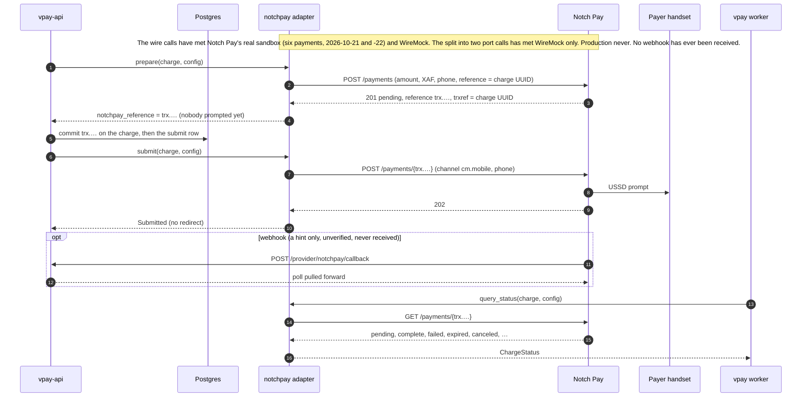

# Notch Pay

Notch Pay is an **aggregator**: one merchant account collects MTN MoMo and
Orange Money in Cameroon through its `cm.mobile` channel. In vpay it is the
`notchpay` rail, added in v0.9.0. It is a **push** rail, like MTN: the
payer is prompted on their own handset, the payment is addressed on Notch Pay
by **Notch Pay's own reference** (`trx.…`), and only the authenticated status
read moves money.

The adapter is `backends/crates/vpay-adapter-notchpay`, on a separate client
crate, `backends/crates/vpay-notchpay`. Its calls were transcribed from Notch
Pay's documentation and its `openapi.yaml` 2.1.0, then corrected on 2026-10-21
from what Notch Pay's sandbox answered.

::: danger Notch Pay's sandbox has been called through the adapter. Its production never has.
On 2026-10-21 Notch Pay's real sandbox answered RFC-0012's sandbox questions
through `vpay-notchpay`'s probe, **not through the adapter**
([verification](vpay:docs/status/verification/2026-10-21-notchpay-sandbox-run.md)).
It contradicted the adapter's addressing: process and read take Notch Pay's
`trx.…` reference, and vpay's own reference is a `404`. The adapter was fixed
the same day, in v0.9.1. **Six test-mode payments have since gone through vpay
itself** (server, worker and Postgres, `livemode=false`, test keys, the
maintainer's own machine), on Notch Pay's documented sandbox outcome numbers:

- **Step 5, 2026-10-21**
  ([verification](vpay:docs/status/verification/2026-10-21-notchpay-step5.md)):
  an MTN success, an MTN "other failure", and an "insufficient funds" number
  that read `complete` for less than its amount and was refused, never a
  success.
- **Runbook B3b, 2026-10-22**
  ([verification](vpay:docs/status/verification/2026-10-22-notchpay-b3b.md)):
  an MTN timeout (`payer_timeout`), an MTN cancel by the payer
  (`payer_declined`), and an **Orange** success.

No real payer was prompted and no real money moved. **Still not proven:**

- Notch Pay's production, or any live key.
- A webhook: none has ever been received, and vpay's own endpoint
  registration has never run against a real Notch Pay account.
- Any refund. `notchpay::refund` is `ProviderError::NotImplemented`, and the
  sandbox answered `403` to every `POST /refunds` the probe made.
- The two changes of 2026-10-23, the two-step submit and the immediate
  escalation of an answer only a person can act on. Both are proven against a
  WireMock Notch Pay and a real Postgres, and neither has run against Notch
  Pay.

The shared conformance suite's `notchpay` row still runs against a WireMock
stub, which proves the adapter against that stub and nothing about Notch Pay.
The rail is not wired into the compose, demo or e2e stacks:
`config/application.yml` carries its block **commented out**.
:::

Agents working on this adapter should load [vpay-notchpay](skill:vpay-notchpay).

## Admitted under ADR-0031

[ADR-0029](/guide/decisions#architecture)'s third hard rule refused an adapter
to any provider whose status read accepts a publishable key. Notch Pay's
`GET /payments/{reference}` is documented as authenticated by the key Notch Pay
itself calls **public**. So `notchpay` does not pass that rule as written.

[ADR-0031](vpay:docs/adr/0031-a-status-read-authenticated-by-a-server-side-key.md)
amended the rule on 2026-10-20, for every provider: such a read is admissible
when the deployment keeps the key server-side and meets six conditions.
`notchpay` is admitted under that amendment, and vpay's provider matrix says so
in its own words rather than "rule 3 passes".

| Condition                                          | How `notchpay` meets it                                                                                                                           |
| -------------------------------------------------- | ------------------------------------------------------------------------------------------------------------------------------------------------- |
| 1. Every secret is sent on every call              | The client sends `X-Grant: <private_key>` on every request                                                                                        |
| 2. Boot refuses a configuration without the secret | `REQUIRED_RAIL_KEYS` requires both `public_key` and `private_key`                                                                                 |
| 3. The exposure is written where an operator reads | The flow's "Production risks", and comments beside the keys in `config/application.yml`, `.env.example` and the Helm values                       |
| 4. The process says it too                         | `ProviderAdapter::accepted_exposure`, logged at `WARN` at every boot of `serve` and `worker`. In livemode, boot also needs an explicit acceptance |
| 5. Integrity is checked on the answer              | A success counts only for the charge's own amount and currency; anything else needs an operator (`NeedsReconciliation`)                           |
| 6. The written question stays open                 | The question to Notch Pay, whether the read can require the private key, is unanswered                                                            |

## The production risk

Whoever holds a merchant's Notch Pay **public key** can, on that merchant's
account and without vpay ever learning of it, read any payment, initialize a
payment, send a USSD prompt in the merchant's name to **any** phone number, and
cancel any pending payment, including one of vpay's. Since v0.9.1 a
`canceled` read is `payer_declined` (see [status mapping](#status-mapping)), so
such a cancel arrives as a payer's decline: the read is evidence of a decline,
not proof of whose.

vpay keeps the key server-side and never hands it to a browser or an app. That
is all it can do. Notch Pay's own documentation calls public keys safe to put
in front-end code. **A merchant who does so has given every operation above to
anyone who loads that page.**

Every boot of a deployment that configures `notchpay` logs this risk at `WARN`;
in livemode the line opens with `LIVEMODE, REAL MONEY`, and it never prints a
key. **In livemode, boot refuses the rail until its block says
`settings.accept_public_key_exposure: true`.** Setting it is the operator's
written acceptance of the risk. It does not silence the warning.

The flow lists what else an operator takes on: Notch Pay's webhooks are signed
but vpay cannot check the signature (the port gives `parse_callback` no
headers; RFC-0014, which would, is a draft), no Notch Pay page names a licence
or a regulator, the merchant agreement reserves the service to natural
persons, and Notch Pay's fraud system rejects some payments outright.

## The push payment

A charge is **two port calls with a commit between them**
([ADR-0032](vpay:docs/adr/0032-a-rail-issued-reference-is-committed-before-the-prompt.md),
since 2026-10-23). The adapter declares `SubmitSteps::PrepareThenSubmit`, the
only rail that does.



Every call carries `Authorization: <public_key>`, `X-Grant: <private_key>` and
the configured request deadline, and the client follows no redirect.
**`prepare`** is `POST /payments` with vpay's own reference: it creates the
payment, **prompts nobody**, and returns Notch Pay's `trx.…`. The core commits
that reference on the charge, then writes the `submit` row. **`submit`** is
`POST /payments/{notchpay_reference}`, by the reference the charge now holds,
and is the call that prompts the payer. A first answer with no Notch Pay
reference, or one whose `trxref` is not this charge's, is `Malformed`, and
nothing is sent to the payer.

The read is `GET /payments/{notchpay_reference}`, and its answer must name the
charge's own reference as `trxref`, or it is `Malformed`. A charge holding no
`notchpay_reference` needs an operator (`NeedsReconciliation`) before any
request: that is key material vpay lost, never `NotFound`.

Notch Pay's specification shows vpay's own reference in those paths. The
sandbox answered `404` "Payment Not Found" to every process and read by it and
accepted only its own `trx.…`. In every one of the six runs the charge held
its `trx.test_…` after submit, and every read made by it was answered.

**The crash window, closed on vpay's side.** Notch Pay's reference exists only
in the initialize answer, and the sandbox's `GET /payments?search=` does not
find a payment by vpay's reference. Before 2026-10-23 a crash between the
prompt and the reference being stored left a payment vpay could not read. Now
the reference is committed before anything prompts, so a crash leaves one of
three states:

| After the crash                              | What recovery does                                                                                                             |
| -------------------------------------------- | ------------------------------------------------------------------------------------------------------------------------------ |
| a `prepare` row, no `trx.…`, no `submit` row | the retried `prepare` meets `409`; nobody was prompted, so the charge fails `provider_unavailable` and the payer can try again |
| the `trx.…` held, no `submit` row            | the retry skips `prepare` and prompts by the held reference: one initialize, one process                                       |
| the `trx.…` held, an unanswered `submit` row | the poll reads by the held reference; nothing is sent again                                                                    |

A charge left in flight by the earlier one-call build, with an unanswered
`submit` row and no `trx.…`, may have prompted the payer, and still needs an
operator. A lost initialize leaves a payment on Notch Pay that nobody
processed; Notch Pay expires it. This is proven against WireMock and a real
Postgres, each guard mutation-checked
([verification](vpay:docs/status/verification/2026-10-23-two-step-submit.md)),
and has **not** been run against Notch Pay.

## Status mapping

| Notch Pay status                            | vpay `ChargeStatus`                                                                                          |
| ------------------------------------------- | ------------------------------------------------------------------------------------------------------------ |
| `pending`, `processing`, `incomplete`       | `Pending`. `incomplete` (paid less than asked) is never a success                                            |
| `complete`, `refunded`, `partialy-refunded` | `Succeeded`, **only if** `amount`, `amounts.total` and currency are the charge's; else `NeedsReconciliation` |
| `canceled`                                  | `Failed(payer_declined)`                                                                                     |
| `failed`, `rejected`                        | `Failed(provider_error)`                                                                                     |
| `expired`, `abandoned`                      | `Failed(payer_timeout)`                                                                                      |
| any other status, or none                   | `Malformed`                                                                                                  |
| `404` "Payment not found"                   | `NotFound`, which is never on its own a failure ([crash safety](/payments/crash-safety))                     |

The read names no failure reason. On 2026-10-21 the sandbox's outcome numbers
read `complete` (MTN and Orange success), `failed` (other failure), `expired`
(timeout) and `canceled` (canceled by user), with no reason field. So this rail
produces `payer_timeout`, `payer_declined`, `provider_error`,
`provider_account_blocked` and, since the two-step submit, `provider_unavailable`
(the `409` for a payment nobody was prompted for). It never produces
`insufficient_funds`. See [failures](/payments/failures).

Through vpay, every one of those numbers has now run. The MTN and Orange
success numbers became `succeeded`, each with one balanced ledger capture and
the event `payment_intent.succeeded`. The "other failure" number became
`provider_error`, the timeout number `payer_timeout` and the cancel number
`payer_declined`, each with the intent back at `requires_payment_method`. Each
settled on the worker's second read, 11 to 15 seconds after create, with no
webhook.

**The "insufficient funds" number reads `complete`, for less than was asked**
(`amount` 107, `amounts.total` 105, in step 1). Comparing `amount` alone would
have made it a success. A success needs `amounts.total` to be the charge's
too, and a read with no `amounts` is refused as well. In step 5 the charge
was refused on every read after the first and never succeeded; under the code
of that day it would have reached `unresolved` only after 24 hours.
**Since 2026-10-23** ([#313](https://github.com/vaam-apps/vpay/issues/313))
such an answer is `NeedsReconciliation`: the worker makes the charge
`unresolved` on the first read that says so, and an operator is alerted. That
is proven against WireMock and a real Postgres
([verification](vpay:docs/status/verification/2026-10-23-needs-reconciliation.md)),
not against Notch Pay.

A success with no `id` records Notch Pay's `trx.…` reference as the provider
transaction id, since the sandbox's answers carry no `id`.

## Configuration

```yaml
providers:
  - code: notchpay
    host:
      url: https://api.notchpay.co # one host for sandbox and production
      label: notchpay
    currency: XAF # the only one allowed
    settings:
      channel: cm.mobile # the only one allowed today
      description: Payment # optional; the one free-text field Notch Pay receives
      accept_public_key_exposure: true # livemode refuses to boot without it
    credentials:
      public_key: ${NOTCHPAY_PUBLIC_KEY}
      private_key: ${NOTCHPAY_PRIVATE_KEY}
    callbacks: # optional; absent means `register: ensure`
      register: ensure # or `check` (list, never create) or `off` (never ask)
```

Boot refuses a block that lacks either key, names a channel other than
`cm.mobile` or a currency other than `XAF`. Because Notch Pay serves sandbox and
production from one host, **the livemode rule is on the keys**: in livemode a
key containing `test.` or `test_` refuses to boot, and outside livemode a key
with neither does. The real test-mode keys carry `test.`, which vpay measured
and corrected for in v0.9.0. The error names the key and never prints it.

The keys are the merchant's own Notch Pay account's. Provider credentials are
configured once per rail, so every merchant on a deployment collects into that
one account. Since the maintainer's decision of 2026-10-22 the rule is one
deployment per **legal entity**, not per merchant: projects of one company may
share a deployment, and a merchant that is another company, a subsidiary
included, needs its own
([RFC-0009](vpay:docs/rfc/0009-provider-accounts-per-merchant.md), revised, a
draft). Its phase A, which would make vpay refuse a second company at boot, is
not built, so nothing in code checks this yet. Whether Notch Pay lets a company
hold an account at all is an open question (RFC-0012 § 10 item 10).

**vpay keeps its webhook endpoint registered itself**
([RFC-0013](vpay:docs/rfc/0013-vpay-registers-its-own-callbacks.md), since
2026-10-22). Notch Pay is not told a callback URL on each payment, so the
account must hold an endpoint at `{public_base_url}/provider/notchpay/callback`.
The worker's `ensure_callbacks` job keeps one there, at every worker start and
hourly; `vpay-server callbacks ensure` runs the same pass by hand. A pass
lists every endpoint, recognises vpay's by its description (Notch Pay's
sandbox answered `"url": null` for every endpoint), creates one only when none
exists and the setting is `ensure`, and never modifies or deletes anything.
`check` only lists and reports; `off` never asks. An endpoint registered by
hand before this, at vpay's URL, cannot be seen, so each callback would arrive
twice: delete the hand-made one in Notch Pay's dashboard, or set `register:
off`. The alert `VpayCallbackEndpointUnconfirmed` fires when no pass confirms
the endpoint ([runbooks](/operate/runbooks#callback-endpoints)). The sandbox
profile, `config/application-notchpay-sandbox.yml`, sets `register: check`, so
a worker started for the sandbox runbook never creates an endpoint on the real
account; registering is a step of its own, B4, which has not been run. **This
registration has been proven against a WireMock Notch Pay and a real Postgres,
and has never run against a real Notch Pay account.**

The endpoint is optional for correctness: in every sandbox run the worker's
authenticated read settled the payment, and no webhook was received. Notch
Pay's own reference asks a receiver for a `200` so that it does not retry, and
vpay answers `202`; whether Notch Pay counts that as delivered is an open
question.

## Refunds: `NotImplemented`

Notch Pay's refunds guide documents full and partial refunds back to the
origin, so the adapter declares `supports_refunds: true`,
`supports_partial_refunds: true` and `refund_destination: Origin`. But the
guide's `POST /refunds` is absent from the specification and carries nothing
that would make a replay safe, so a lost answer re-sent would pay twice.
`refund` therefore returns the declared token
`NotImplemented("notchpay::refund")` until Notch Pay confirms a replay-safe
refund in writing. Account-holder lookup is `Unsupported`.

On 2026-10-22 the probe asked the sandbox. `POST /refunds` answered `403`
"Forbidden", with no message, to all four requests against a `complete`
payment, and refunded nothing
([verification](vpay:docs/status/verification/2026-10-22-notchpay-refunds.md)).
Whether that is an IP allowlist or refunds not being enabled for the account is
not known, and replay safety is still unmeasured.

## Status in this release

| Part                                       | Status                   | Evidence                                                                                                                                                                                                                                                                                  |
| ------------------------------------------ | ------------------------ | ----------------------------------------------------------------------------------------------------------------------------------------------------------------------------------------------------------------------------------------------------------------------------------------- |
| Submit and status read                     | <Status s="partial" />   | Six payments through the adapter against Notch Pay's real sandbox on 2026-10-21 and -22 (MTN and Orange outcome numbers, `cm.mobile`, XAF): two succeeded, three failed with the mapped code, one short collection was refused. The conformance suite's `notchpay` row is a WireMock stub |
| Addressing by Notch Pay's `trx.…`          | <Status s="partial" />   | Met Notch Pay in all six runs: every charge held it after submit and every read by it was answered                                                                                                                                                                                        |
| The two-step submit (ADR-0032)             | <Status s="unproven" />  | Proven against WireMock and a real Postgres, each guard mutation-checked; the split into two port calls has not met Notch Pay                                                                                                                                                             |
| A short collection is never a success      | <Status s="partial" />   | Refused on eleven reads of a real sandbox answer. Since 2026-10-23 it escalates to `unresolved` on the first such read, proven against WireMock and a real Postgres, not observed with Notch Pay                                                                                          |
| Callback registration (RFC-0013)           | <Status s="unproven" />  | Proven against WireMock and a real Postgres; never run against a real Notch Pay account                                                                                                                                                                                                   |
| Callback parsing                           | <Status s="unproven" />  | Parsed in conformance; no webhook has ever been received from Notch Pay                                                                                                                                                                                                                   |
| Boot rules and the exposure warning        | <Status s="built" />     | Tested in process, by running the real binary on a Notch Pay fixture configuration, and logged at every sandbox run's boot by both the server and the worker                                                                                                                              |
| Webhook signature verification             | <Status s="not-built" /> | Designed in RFC-0014, a draft                                                                                                                                                                                                                                                             |
| `refund`                                   | <Status s="not-built" /> | `NotImplemented("notchpay::refund")`; the sandbox answered `403` to `POST /refunds`                                                                                                                                                                                                       |
| `cm.mtn` and `cm.orange` channels          | <Status s="not-built" /> | Wait for the payer's chosen method type to reach the adapter (ADR-0029 D6)                                                                                                                                                                                                                |
| Production and a live key                  | <Status s="unproven" />  | Never called; a live key's prefix is a written question to Notch Pay                                                                                                                                                                                                                      |
| Wired into the compose, demo or e2e stacks | <Status s="not-built" /> | The block in `config/application.yml` is commented out. The real runs used the `notchpay-sandbox` profile on the maintainer's machine                                                                                                                                                     |

The runs are described in
[the runbook section](/operate/runbooks#test-notch-pay-against-its-sandbox):
Part A (the probe) and Part B (vpay itself, steps 5 and B3b). None received a
webhook, so the webhook signature has not been measured.

## Go deeper

- [Adapter: Notch Pay](vpay:docs/flows/adapter-notchpay.md): the calls, the
  production risks, and the "to confirm" items that decide whether the adapter
  is right, each marked with what the sandbox answered
- vpay's dated verification pages:
  [step 5](vpay:docs/status/verification/2026-10-21-notchpay-step5.md),
  [B3b](vpay:docs/status/verification/2026-10-22-notchpay-b3b.md),
  [the step 1 probe run](vpay:docs/status/verification/2026-10-21-notchpay-sandbox-run.md),
  [the addressing fix](vpay:docs/status/verification/2026-10-21-notchpay-trx-reference.md),
  [the refunds probe](vpay:docs/status/verification/2026-10-22-notchpay-refunds.md),
  [the two-step submit](vpay:docs/status/verification/2026-10-23-two-step-submit.md)
  and [the immediate escalation](vpay:docs/status/verification/2026-10-23-needs-reconciliation.md)
- [The Notch Pay sandbox runbook](vpay:docs/runbooks/notchpay-sandbox-test.md):
  how both parts are run
- [ADR-0031](vpay:docs/adr/0031-a-status-read-authenticated-by-a-server-side-key.md):
  the amended admission rule and its six conditions;
  [ADR-0032](vpay:docs/adr/0032-a-rail-issued-reference-is-committed-before-the-prompt.md):
  the two-step submit
- [RFC-0013](vpay:docs/rfc/0013-vpay-registers-its-own-callbacks.md): vpay
  registering its own callback endpoints
- [Providers](vpay:docs/status/providers.md): vpay's matrix of every rail it
  ships or has designed, cell by cell
- [`vpay-notchpay`](vpay:docs/reference/vpay-notchpay.md): the client crate's
  reference
- [The provider port](/rails/provider-port) and
  [MTN MoMo](/rails/mtn-momo) on this site
- Skill: [vpay-notchpay](skill:vpay-notchpay)
