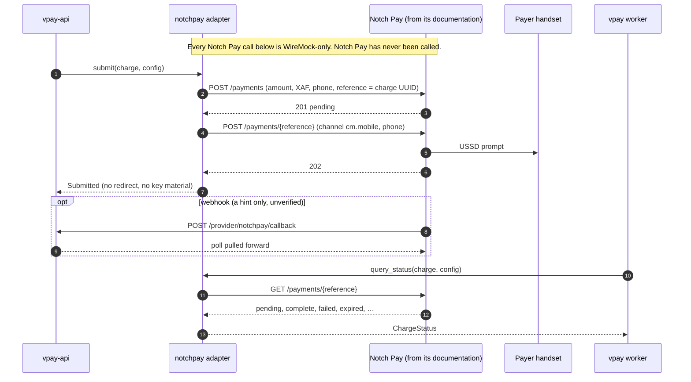

# Notch Pay

Notch Pay is an **aggregator**: one merchant account collects MTN MoMo and
Orange Money in Cameroon through its `cm.mobile` channel. In vpay it is the
`notchpay` rail, added in <Release />. It is a **push** rail, like MTN: the
payer is prompted on their own handset, the charge is addressed on Notch Pay by
a reference vpay generated, and only the authenticated status read moves money.

The adapter is `backends/crates/vpay-adapter-notchpay`, on a separate client
crate, `backends/crates/vpay-notchpay`. Every call, status and error it uses is
transcribed from Notch Pay's documentation and its `openapi.yaml` 2.1.0.

::: danger Nothing has called Notch Pay
Not the sandbox, and not production. The adapter is proven only against a
WireMock stub that vpay transcribed from the same pages as the adapter. A
sandbox runbook and a probe exist, and neither has been run against Notch Pay
yet. `notchpay::refund` is `ProviderError::NotImplemented`. The rail is not
wired into any running stack: `config/application.yml` carries its block
**commented out**.
:::

Agents working on this adapter should load [vpay-notchpay](skill:vpay-notchpay).

## Admitted under ADR-0031

[ADR-0029](/guide/decisions#architecture)'s third hard rule refused an adapter
to any provider whose status read accepts a publishable key. Notch Pay's
`GET /payments/{reference}` is documented as authenticated by the key Notch Pay
itself calls **public**. So `notchpay` does not pass that rule as written.

[ADR-0031](vpay:docs/adr/0031-a-status-read-authenticated-by-a-server-side-key.md)
amended the rule on 2026-10-20, for every provider: such a read is admissible
when the deployment keeps the key server-side and meets six conditions.
`notchpay` is admitted under that amendment, and vpay's provider matrix says so
in its own words rather than "rule 3 passes".

| Condition                                          | How `notchpay` meets it                                                                                                                           |
| -------------------------------------------------- | ------------------------------------------------------------------------------------------------------------------------------------------------- |
| 1. Every secret is sent on every call              | The client sends `X-Grant: <private_key>` on every request                                                                                        |
| 2. Boot refuses a configuration without the secret | `REQUIRED_RAIL_KEYS` requires both `public_key` and `private_key`                                                                                 |
| 3. The exposure is written where an operator reads | The flow's "Production risks", and comments beside the keys in `config/application.yml`, `.env.example` and the Helm values                       |
| 4. The process says it too                         | `ProviderAdapter::accepted_exposure`, logged at `WARN` at every boot of `serve` and `worker`. In livemode, boot also needs an explicit acceptance |
| 5. Integrity is checked on the answer              | A success counts only for the charge's own amount and currency; anything else is `Malformed`                                                      |
| 6. The written question stays open                 | The question to Notch Pay, whether the read can require the private key, is unanswered                                                            |

## The production risk

Whoever holds a merchant's Notch Pay **public key** can, on that merchant's
account and without vpay ever learning of it, read any payment, initialize a
payment, send a USSD prompt in the merchant's name to **any** phone number, and
cancel any pending payment, including one of vpay's. vpay records such a
cancelled charge as `provider_error`, never `payer_declined`, because the
cancel may not have been the payer's.

vpay keeps the key server-side and never hands it to a browser or an app. That
is all it can do. Notch Pay's own documentation calls public keys safe to put
in front-end code. **A merchant who does so has given every operation above to
anyone who loads that page.**

Every boot of a deployment that configures `notchpay` logs this risk at `WARN`;
in livemode the line opens with `LIVEMODE, REAL MONEY`, and it never prints a
key. **In livemode, boot refuses the rail until its block says
`settings.accept_public_key_exposure: true`.** Setting it is the operator's
written acceptance of the risk. It does not silence the warning.

The flow lists what else an operator takes on: Notch Pay's webhooks are signed
but vpay cannot check the signature (the port gives `parse_callback` no
headers), no Notch Pay page names a licence or a regulator, the merchant
agreement reserves the service to natural persons, and Notch Pay's fraud
system rejects some payments outright.

## The push payment



Every call carries `Authorization: <public_key>`, `X-Grant: <private_key>` and
the configured request deadline, and the client follows no redirect. The
submit is two calls: `POST /payments` creates the payment with vpay's own
reference, and `POST /payments/{reference}` is the one that prompts the payer.
A `409` on the first (the reference already exists) is the crash-retry case:
the adapter reads the payment and carries on from what it finds.

The read is addressed by **vpay's** reference, which is what the specification
shows. Whether the live API also wants Notch Pay's own `trx.…` reference is on
the "to confirm" list.

## Status mapping

| Notch Pay status                            | vpay `ChargeStatus`                                                                      |
| ------------------------------------------- | ---------------------------------------------------------------------------------------- |
| `pending`, `processing`, `incomplete`       | `Pending`. `incomplete` (paid less than asked) is never a success                        |
| `complete`, `refunded`, `partialy-refunded` | `Succeeded`, **only if** the amount and currency are the charge's; else `Malformed`      |
| `failed`, `canceled`, `rejected`            | `Failed(provider_error)`                                                                 |
| `expired`, `abandoned`                      | `Failed(payer_timeout)`                                                                  |
| any other status, or none                   | `Malformed`                                                                              |
| `404` "Payment not found"                   | `NotFound`, which is never on its own a failure ([crash safety](/payments/crash-safety)) |

The read names no failure reason in Notch Pay's specification, so this rail
produces only `payer_timeout`, `provider_error` and `provider_account_blocked`.
A payer with no funds and a payer who never answered both read `failed`. See
[failures](/payments/failures).

## Configuration

```yaml
providers:
  - code: notchpay
    host:
      url: https://api.notchpay.co # one host for sandbox and production
      label: notchpay
    currency: XAF # the only one allowed
    settings:
      channel: cm.mobile # the only one allowed today
      accept_public_key_exposure: true # livemode refuses to boot without it
    credentials:
      public_key: ${NOTCHPAY_PUBLIC_KEY}
      private_key: ${NOTCHPAY_PRIVATE_KEY}
```

Boot refuses a block that lacks either key, names a channel other than
`cm.mobile` or a currency other than `XAF`. Because Notch Pay serves sandbox and
production from one host, **the livemode rule is on the keys**: in livemode a
key containing `test.` or `test_` refuses to boot, and outside livemode a key
with neither does. The real test-mode keys carry `test.`, which vpay measured
and corrected for in <Release />. The error names the key and never prints it.

The keys are the merchant's own Notch Pay account's. Provider credentials are
configured once per rail, so until vpay can hold an account per merchant
([RFC-0009](vpay:docs/rfc/0009-provider-accounts-per-merchant.md)), a deployment
that offers this rail serves one merchant. Notch Pay's webhook endpoint,
`{public_base_url}/provider/notchpay/callback`, is registered by hand in Notch
Pay's dashboard; it is optional, because the poll ladder settles every charge
without callbacks.

## Refunds: `NotImplemented`

Notch Pay's refunds guide documents full and partial refunds back to the
origin, so the adapter declares `supports_refunds: true`,
`supports_partial_refunds: true` and `refund_destination: Origin`. But the
guide's `POST /refunds` is absent from the specification and carries nothing
that would make a replay safe, so a lost answer re-sent would pay twice.
`refund` therefore returns the declared token
`NotImplemented("notchpay::refund")` until Notch Pay confirms a replay-safe
refund in writing. Account-holder lookup is `Unsupported`.

## Status in this release

| Part                                       | Status                   | Evidence                                                                                   |
| ------------------------------------------ | ------------------------ | ------------------------------------------------------------------------------------------ |
| Submit and status read                     | <Status s="unproven" />  | The shared conformance suite's `notchpay` row passes against WireMock; never called        |
| Callback parsing                           | <Status s="unproven" />  | Parsed in conformance; never received from Notch Pay                                       |
| Boot rules and the exposure warning        | <Status s="built" />     | Tested in process, and by running the real binary on a Notch Pay fixture configuration     |
| Webhook signature verification             | <Status s="not-built" /> | Designed in RFC-0014, a draft                                                              |
| `refund`                                   | <Status s="not-built" /> | `NotImplemented("notchpay::refund")`                                                       |
| `cm.mtn` and `cm.orange` channels          | <Status s="not-built" /> | Wait for the payer's chosen method type to reach the adapter (ADR-0029 D6)                 |
| Sandbox session and first test-mode call   | <Status s="not-built" /> | [The runbook](/operate/runbooks#test-notch-pay-against-its-sandbox) is written and not run |
| Wired into the compose, demo or e2e stacks | <Status s="not-built" /> | The block in `config/application.yml` is commented out                                     |

## Go deeper

- [Adapter: Notch Pay](vpay:docs/flows/adapter-notchpay.md): the calls, the
  production risks, and the ten "to confirm" items that decide whether the
  adapter is right
- [ADR-0031](vpay:docs/adr/0031-a-status-read-authenticated-by-a-server-side-key.md):
  the amended admission rule and its six conditions
- [Providers](vpay:docs/status/providers.md): vpay's matrix of every rail it
  ships or has designed, cell by cell
- [`vpay-notchpay`](vpay:docs/reference/vpay-notchpay.md): the client crate's
  reference
- [The provider port](/rails/provider-port) and
  [MTN MoMo](/rails/mtn-momo) on this site
- Skill: [vpay-notchpay](skill:vpay-notchpay)
