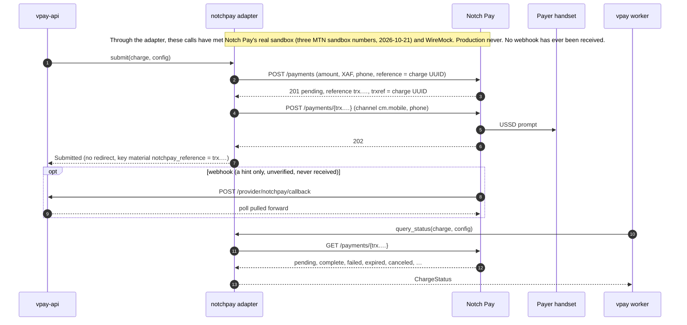

# Notch Pay

Notch Pay is an **aggregator**: one merchant account collects MTN MoMo and
Orange Money in Cameroon through its `cm.mobile` channel. In vpay it is the
`notchpay` rail, added in v0.9.0. It is a **push** rail, like MTN: the
payer is prompted on their own handset, the payment is addressed on Notch Pay
by **Notch Pay's own reference** (`trx.…`), and only the authenticated status
read moves money.

The adapter is `backends/crates/vpay-adapter-notchpay`, on a separate client
crate, `backends/crates/vpay-notchpay`. Its calls were transcribed from Notch
Pay's documentation and its `openapi.yaml` 2.1.0, then corrected on 2026-10-21
from what Notch Pay's sandbox answered.

::: danger Notch Pay's sandbox has been called through the adapter. Its production never has.
On 2026-10-21 Notch Pay's real sandbox answered RFC-0012's sandbox questions
(delivery step 1) through `vpay-notchpay`'s probe, **not through the adapter**
([verification](vpay:docs/status/verification/2026-10-21-notchpay-sandbox-run.md)).
It contradicted the adapter's addressing: process and read take Notch Pay's
`trx.…` reference, and vpay's own reference is a `404`. The adapter was fixed
the same day, in v0.9.1. Later that day, step 5 took **three test-mode payments
through vpay itself** (server, worker and Postgres, `livemode=false`, test keys,
the maintainer's own machine) to Notch Pay's real sandbox
([verification](vpay:docs/status/verification/2026-10-21-notchpay-step5.md)):
one succeeded, one failed, and one that read `complete` for less than its amount
was refused and stayed `pending`. The fix met Notch Pay there and worked.

The payer numbers were Notch Pay's documented sandbox outcome numbers, so no
real payer was prompted and no real money moved. **Still not proven:** Notch
Pay's production or any live key; an Orange number through vpay (only step 1's
probe ran one); a webhook, since none was received; any refund, because
`notchpay::refund` is `ProviderError::NotImplemented`; and the 24-hour
escalation of the short collection, which was read from code and not observed.
The shared conformance suite's `notchpay` row still runs against a WireMock
stub, which proves the adapter against that stub and nothing about Notch Pay.
The rail is not wired into the compose, demo or e2e stacks:
`config/application.yml` carries its block **commented out**.
:::

Agents working on this adapter should load [vpay-notchpay](skill:vpay-notchpay).

## Admitted under ADR-0031

[ADR-0029](/guide/decisions#architecture)'s third hard rule refused an adapter
to any provider whose status read accepts a publishable key. Notch Pay's
`GET /payments/{reference}` is documented as authenticated by the key Notch Pay
itself calls **public**. So `notchpay` does not pass that rule as written.

[ADR-0031](vpay:docs/adr/0031-a-status-read-authenticated-by-a-server-side-key.md)
amended the rule on 2026-10-20, for every provider: such a read is admissible
when the deployment keeps the key server-side and meets six conditions.
`notchpay` is admitted under that amendment, and vpay's provider matrix says so
in its own words rather than "rule 3 passes".

| Condition                                          | How `notchpay` meets it                                                                                                                           |
| -------------------------------------------------- | ------------------------------------------------------------------------------------------------------------------------------------------------- |
| 1. Every secret is sent on every call              | The client sends `X-Grant: <private_key>` on every request                                                                                        |
| 2. Boot refuses a configuration without the secret | `REQUIRED_RAIL_KEYS` requires both `public_key` and `private_key`                                                                                 |
| 3. The exposure is written where an operator reads | The flow's "Production risks", and comments beside the keys in `config/application.yml`, `.env.example` and the Helm values                       |
| 4. The process says it too                         | `ProviderAdapter::accepted_exposure`, logged at `WARN` at every boot of `serve` and `worker`. In livemode, boot also needs an explicit acceptance |
| 5. Integrity is checked on the answer              | A success counts only for the charge's own amount and currency; anything else is `Malformed`                                                      |
| 6. The written question stays open                 | The question to Notch Pay, whether the read can require the private key, is unanswered                                                            |

## The production risk

Whoever holds a merchant's Notch Pay **public key** can, on that merchant's
account and without vpay ever learning of it, read any payment, initialize a
payment, send a USSD prompt in the merchant's name to **any** phone number, and
cancel any pending payment, including one of vpay's. Since v0.9.1 a
`canceled` read is `payer_declined` (see [status mapping](#status-mapping)), so
such a cancel arrives as a payer's decline: the read is evidence of a decline,
not proof of whose.

vpay keeps the key server-side and never hands it to a browser or an app. That
is all it can do. Notch Pay's own documentation calls public keys safe to put
in front-end code. **A merchant who does so has given every operation above to
anyone who loads that page.**

Every boot of a deployment that configures `notchpay` logs this risk at `WARN`;
in livemode the line opens with `LIVEMODE, REAL MONEY`, and it never prints a
key. **In livemode, boot refuses the rail until its block says
`settings.accept_public_key_exposure: true`.** Setting it is the operator's
written acceptance of the risk. It does not silence the warning.

The flow lists what else an operator takes on: Notch Pay's webhooks are signed
but vpay cannot check the signature (the port gives `parse_callback` no
headers), no Notch Pay page names a licence or a regulator, the merchant
agreement reserves the service to natural persons, and Notch Pay's fraud
system rejects some payments outright.

## The push payment



Every call carries `Authorization: <public_key>`, `X-Grant: <private_key>` and
the configured request deadline, and the client follows no redirect. The
submit is two calls: `POST /payments` creates the payment with vpay's own
reference, and `POST /payments/{notchpay_reference}` is the one that prompts the
payer, where `notchpay_reference` is the `trx.…` the first call returned. The
adapter keeps it in the charge's `ref_extra` as key material. A first answer
with no Notch Pay reference, or one whose `trxref` is not this charge's, is
`Malformed`, and nothing is sent to the payer.

The read is `GET /payments/{notchpay_reference}`, and its answer must name the
charge's own reference as `trxref`, or it is `Malformed`. A charge holding no
`notchpay_reference` is `Config` before any request: that is key material vpay
lost, never `NotFound`.

Notch Pay's specification shows vpay's own reference in those paths. The
sandbox answered `404` "Payment Not Found" to every process and read by it and
accepted only its own `trx.…`. In step 5 every charge held its `trx.test_…` in
`ref_extra` after `submit`, and every read made by it was answered.

**The crash window this leaves.** Notch Pay's reference exists only in the
first call's answer, and is durable only once `submit` returns. The sandbox's
`GET /payments?search=` did not find a payment by vpay's reference, so a crash
between the first call and `submit` returning leaves a payment vpay cannot
read. A `409` on the retry (the reference already exists) is read by the
`notchpay_reference` the charge holds when it holds one; when it holds none, it
is `Malformed`: the charge's fate is left unknown for an operator, never
`Submitted` and never a decline. Before the prompt, the payment simply expires;
after it, only Notch Pay's dashboard shows whether the payer paid. Step 5 did
not exercise this window.

## Status mapping

| Notch Pay status                            | vpay `ChargeStatus`                                                                                |
| ------------------------------------------- | -------------------------------------------------------------------------------------------------- |
| `pending`, `processing`, `incomplete`       | `Pending`. `incomplete` (paid less than asked) is never a success                                  |
| `complete`, `refunded`, `partialy-refunded` | `Succeeded`, **only if** `amount`, `amounts.total` and currency are the charge's; else `Malformed` |
| `canceled`                                  | `Failed(payer_declined)`                                                                           |
| `failed`, `rejected`                        | `Failed(provider_error)`                                                                           |
| `expired`, `abandoned`                      | `Failed(payer_timeout)`                                                                            |
| any other status, or none                   | `Malformed`                                                                                        |
| `404` "Payment not found"                   | `NotFound`, which is never on its own a failure ([crash safety](/payments/crash-safety))           |

The read names no failure reason. On 2026-10-21 the sandbox's outcome numbers
read `complete` (MTN and Orange success), `failed` (other failure), `expired`
(timeout) and `canceled` (canceled by user), with no reason field. So this rail
produces `payer_timeout`, `payer_declined`, `provider_error` and
`provider_account_blocked`, never `insufficient_funds`. See
[failures](/payments/failures).

Through vpay, step 5 ran three of those numbers. The success number became
`succeeded`, with one balanced ledger capture of 210 XAF and the event
`payment_intent.succeeded`. The "other failure" number read `failed` and became
`provider_error`, with the intent back at `requires_payment_method`. Both
settled on the worker's second read, about 15 seconds after create, with no
webhook. The `expired` and `canceled` numbers were not run through vpay, so
`payer_timeout` and `payer_declined` here rest on the probe's reads and on
WireMock.

**The "insufficient funds" number read `complete`, for less than was asked**
(`amount` 107, `amounts.total` 105, in step 1). Comparing `amount` alone would
have made it a success. A success now needs `amounts.total` to be the charge's
too, and a read with no `amounts` is `Malformed`. Step 5 ran this number through
vpay (230 XAF). Its first read answered `pending`, and each of the next eleven
read `complete` with a short `amounts.total` and was refused as `Malformed`:
never a success. After 15 minutes the charge was still `pending` and the intent
`processing`, with no event and no ledger entry. That run did not capture the
`amounts.total` value.

**What happens next to a charge like that was read from code and not
observed.** The adapter's message says the charge needs an operator, but the
worker retries a `Malformed` read on the poll ladder as a warning. By the code
the charge reaches `unresolved` only at the 24-hour horizon, so for its first
day the only trace is a repeated `WARN` log line: no state, no event and no
alert. vpay records this as a design question for the maintainer and has not
changed it. The worker does record each such refused read in `provider_requests`
as answered (`status_code` 0, `error_kind` `provider_error`), since Notch Pay
did answer it.

A success with no `id` records Notch Pay's `trx.…` reference as the provider
transaction id, since the sandbox's answers carried no `id`. Step 5's success
did exactly that.

## Configuration

```yaml
providers:
  - code: notchpay
    host:
      url: https://api.notchpay.co # one host for sandbox and production
      label: notchpay
    currency: XAF # the only one allowed
    settings:
      channel: cm.mobile # the only one allowed today
      accept_public_key_exposure: true # livemode refuses to boot without it
    credentials:
      public_key: ${NOTCHPAY_PUBLIC_KEY}
      private_key: ${NOTCHPAY_PRIVATE_KEY}
```

Boot refuses a block that lacks either key, names a channel other than
`cm.mobile` or a currency other than `XAF`. Because Notch Pay serves sandbox and
production from one host, **the livemode rule is on the keys**: in livemode a
key containing `test.` or `test_` refuses to boot, and outside livemode a key
with neither does. The real test-mode keys carry `test.`, which vpay measured
and corrected for in v0.9.0. The error names the key and never prints it.

The keys are the merchant's own Notch Pay account's. Provider credentials are
configured once per rail, so until vpay can hold an account per merchant
([RFC-0009](vpay:docs/rfc/0009-provider-accounts-per-merchant.md)), a deployment
that offers this rail serves one merchant. Notch Pay's webhook endpoint,
`{public_base_url}/provider/notchpay/callback`, is registered by hand in Notch
Pay's dashboard. It is optional: in step 5 the worker's authenticated read
settled both payments that reached a terminal status, and no webhook endpoint
was created or received. Notch Pay's own reference asks a receiver for a `200`
so that it does not retry, and vpay answers `202`; whether Notch Pay counts that
as delivered is an open question
([RFC-0013](vpay:docs/rfc/0013-vpay-registers-its-own-callbacks.md) § 12, item
12).

## Refunds: `NotImplemented`

Notch Pay's refunds guide documents full and partial refunds back to the
origin, so the adapter declares `supports_refunds: true`,
`supports_partial_refunds: true` and `refund_destination: Origin`. But the
guide's `POST /refunds` is absent from the specification and carries nothing
that would make a replay safe, so a lost answer re-sent would pay twice.
`refund` therefore returns the declared token
`NotImplemented("notchpay::refund")` until Notch Pay confirms a replay-safe
refund in writing. Account-holder lookup is `Unsupported`.

## Status in this release

| Part                                       | Status                   | Evidence                                                                                                                                                                                                                                                |
| ------------------------------------------ | ------------------------ | ------------------------------------------------------------------------------------------------------------------------------------------------------------------------------------------------------------------------------------------------------- |
| Submit and status read                     | <Status s="partial" />   | Three payments through the adapter against Notch Pay's real sandbox on 2026-10-21 (MTN outcome numbers, `cm.mobile`, XAF): one succeeded, one failed, one short collection was refused. The conformance suite's `notchpay` row is still a WireMock stub |
| Addressing by Notch Pay's `trx.…`          | <Status s="partial" />   | Met Notch Pay in step 5: every charge held it after `submit` and every read by it was answered. A crash between initialize and `submit` returning still leaves a payment vpay cannot read; not exercised                                                |
| A short collection is never a success      | <Status s="partial" />   | Refused as `Malformed` on eleven reads of a real sandbox answer; `pending` 15 minutes later. The escalation to `unresolved` at 24 hours is read from code, not observed                                                                                 |
| Callback parsing                           | <Status s="unproven" />  | Parsed in conformance; no webhook has ever been received from Notch Pay                                                                                                                                                                                 |
| Boot rules and the exposure warning        | <Status s="built" />     | Tested in process, by running the real binary on a Notch Pay fixture configuration, and logged at the sandbox run's boot by both the server and the worker                                                                                              |
| Webhook signature verification             | <Status s="not-built" /> | Designed in RFC-0014, a draft                                                                                                                                                                                                                           |
| `refund`                                   | <Status s="not-built" /> | `NotImplemented("notchpay::refund")`                                                                                                                                                                                                                    |
| `cm.mtn` and `cm.orange` channels          | <Status s="not-built" /> | Wait for the payer's chosen method type to reach the adapter (ADR-0029 D6)                                                                                                                                                                              |
| An Orange number through vpay              | <Status s="unproven" />  | Step 1's probe ran one against the sandbox; step 5 did not                                                                                                                                                                                              |
| Production and a live key                  | <Status s="unproven" />  | Never called; a live key's prefix is a written question to Notch Pay                                                                                                                                                                                    |
| Wired into the compose, demo or e2e stacks | <Status s="not-built" /> | The block in `config/application.yml` is commented out. The one real run used the `notchpay-sandbox` profile on the maintainer's machine                                                                                                                |

Both real runs are described in
[the runbook section](/operate/runbooks#test-notch-pay-against-its-sandbox):
Part A (the probe, step 1) and Part B (vpay itself, step 5). Neither run
received a webhook: the runbook's step for that (A4) was not run, so the
webhook signature has not been measured.

## Go deeper

- [Adapter: Notch Pay](vpay:docs/flows/adapter-notchpay.md): the calls, the
  production risks, and the "to confirm" items that decide whether the adapter
  is right, each marked with what the sandbox answered
- [Step 5, three payments through vpay](vpay:docs/status/verification/2026-10-21-notchpay-step5.md),
  [the step 1 probe run](vpay:docs/status/verification/2026-10-21-notchpay-sandbox-run.md)
  and [the addressing fix](vpay:docs/status/verification/2026-10-21-notchpay-trx-reference.md):
  vpay's dated verification pages
- [The Notch Pay sandbox runbook](vpay:docs/runbooks/notchpay-sandbox-test.md):
  how both parts are run
- [ADR-0031](vpay:docs/adr/0031-a-status-read-authenticated-by-a-server-side-key.md):
  the amended admission rule and its six conditions
- [Providers](vpay:docs/status/providers.md): vpay's matrix of every rail it
  ships or has designed, cell by cell
- [`vpay-notchpay`](vpay:docs/reference/vpay-notchpay.md): the client crate's
  reference
- [The provider port](/rails/provider-port) and
  [MTN MoMo](/rails/mtn-momo) on this site
- Skill: [vpay-notchpay](skill:vpay-notchpay)
