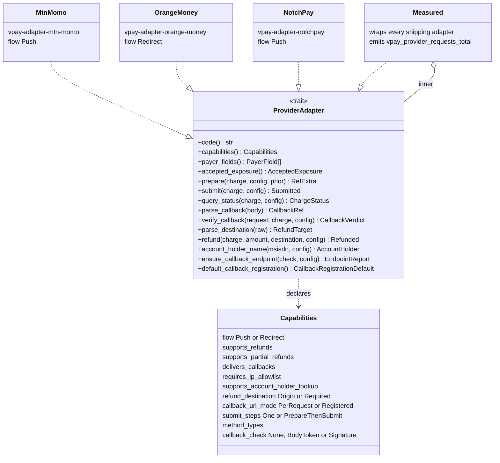
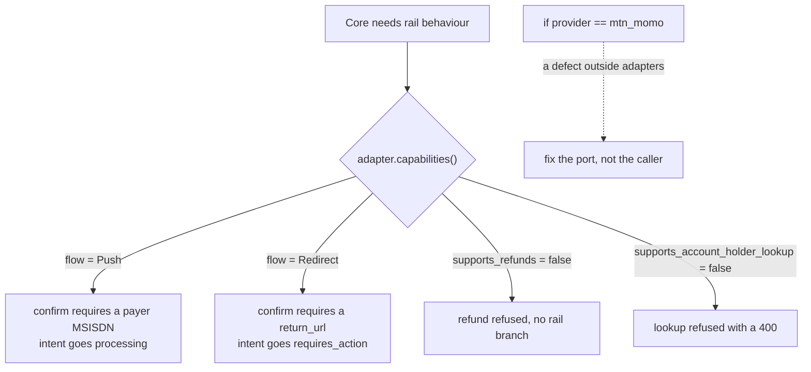
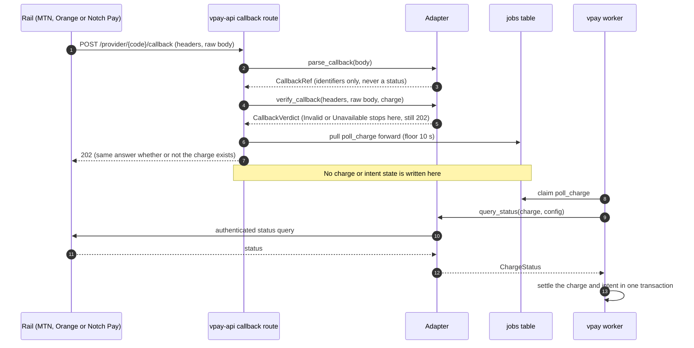

# The provider port

vpay's core decides what a payment _means_ — its lifecycle, its ledger, its
reconciliation, its failure vocabulary. An **adapter** decides how to say that
on one rail's wire. Between the two sits a single Rust trait, `ProviderAdapter`,
in `backends/crates/vpay-provider`. Everything rail-specific lives behind it, so
adding a rail is meant to be an adapter crate and some configuration, not a
change to the core. <Release /> ships three: `mtn_momo`, `orange_money` and,
new in v0.9.0, `notchpay`.

The rule that keeps it honest is mechanical and greppable: if
`if provider == "mtn_momo"` appears anywhere outside an adapter crate, the port
is wrong — fix the port, not the caller
([ADR-0002](vpay:docs/adr/0002-provider-port.md)).

Agents working on an adapter or on the port itself should load
[vpay-provider-adapters](skill:vpay-provider-adapters).

{.diagram}

## The shape of the port

The HTTP layer only ever holds adapters as `Box<dyn ProviderAdapter>` — trait
objects whose concrete type it cannot name. That is what makes a rail-name
branch structurally awkward outside an adapter crate. Every shipping adapter is
additionally wrapped in `vpay_provider::Measured`, a decorator that records
`vpay_provider_requests_total` per port call.

### The operations

| Method                          | What it promises                                                                                                                                                                                                                                                                                                                                                                                                                                                                                                                                               |
| ------------------------------- | -------------------------------------------------------------------------------------------------------------------------------------------------------------------------------------------------------------------------------------------------------------------------------------------------------------------------------------------------------------------------------------------------------------------------------------------------------------------------------------------------------------------------------------------------------------- |
| `prepare`                       | Optional, since v0.11.0. Called only on a rail declaring `submit_steps: PrepareThenSubmit`, before `submit`, and told whether any `submit` was ever made for the charge. It creates the payment on the rail **without prompting anyone** and returns the reference the rail will be addressed by, which the core commits on the charge before it writes the `submit` row ([ADR-0032](vpay:docs/adr/0032-a-rail-issued-reference-is-committed-before-the-prompt.md), accepted). Defaults to `ProviderError::Unsupported`; only `notchpay` overrides it.         |
| `submit`                        | Ask the rail to take a payment. **Idempotent on `reference_id`**: a duplicate submission must answer `Submitted`, never an error, which is what makes a same-reference retry after a crash safe. A redirect rail returns its `redirect_url` and its key material (`ref_extra`) in the same value, so a caller cannot hold one without the other.                                                                                                                                                                                                               |
| `query_status`                  | The authoritative read, and the only thing that moves money. Takes the whole charge, because some rails need the amount and their own token. Must keep working indefinitely.                                                                                                                                                                                                                                                                                                                                                                                   |
| `parse_callback`                | Turns a notification body into **identifiers only — never a status**. Deliberately synchronous, so it cannot make a network call and cannot smuggle a status out of an unauthenticated request.                                                                                                                                                                                                                                                                                                                                                                |
| `verify_callback`               | Optional, since v0.12.0. Handed the request's headers and **raw** body, the charge the identifiers matched and the rail's config, it answers whether the callback is the rail's: `Verified`, `VerifiedPrevious` (the previous signing secret matched), `Invalid`, `NotChecked`, `NoSecret` or `Unavailable` — a verdict, never an error. It decides **only** whether the charge's poll is pulled forward; even `Verified` moves no money. Defaults to `NotChecked`; only `notchpay` overrides it ([RFC-0014](vpay:docs/rfc/0014-verifying-rail-callbacks.md)). |
| `parse_destination`             | Optional. Reads the adapter's own `destination[<rail_code>][…]` sub-map from a refund request into a `RefundTarget`. The core strips the rail code and interprets nothing inside.                                                                                                                                                                                                                                                                                                                                                                              |
| `refund`                        | Optional, gated by `supports_refunds`. Answers `Refunded` — which carries `fee: Option<Money>` rather than a redirect URL. The default body is `ProviderError::Unsupported`.                                                                                                                                                                                                                                                                                                                                                                                   |
| `account_holder_name`           | Optional, gated by `supports_account_holder_lookup`. Defaults to `ProviderError::Unsupported`. See [account-holder lookup](/rails/account-holder-lookup).                                                                                                                                                                                                                                                                                                                                                                                                      |
| `ensure_callback_endpoint`      | Optional, since v0.11.0. Called only on a rail declaring `callback_url_mode: Registered` whose registration is switched on, by the worker's `ensure_callbacks` pass and by `vpay-server callbacks ensure`, under a database lock. Lists the account's webhook endpoints and creates vpay's at most once when asked to write. **It never modifies or deletes an endpoint.** Defaults to `ProviderError::Unsupported`; only `notchpay` overrides it ([RFC-0013](vpay:docs/rfc/0013-vpay-registers-its-own-callbacks.md)).                                        |
| `default_callback_registration` | Optional, since v0.12.0. What the registration pass does on this rail when the deployment leaves `providers[].callbacks.register` unset: `Ensure` (the default) or `Off`. An explicit setting always wins. `notchpay` answers `Off`, so vpay asks a Notch Pay account nothing unless the deployment says `register: ensure` or `check` ([RFC-0013](vpay:docs/rfc/0013-vpay-registers-its-own-callbacks.md)).                                                                                                                                                   |
| `payer_fields`                  | Optional. What a payer must fill in before this rail can be confirmed. The one declaration drives both the rail spec the checkout page renders and the confirm-time validation of `payment_method_data[<code>][…]`, so the two cannot drift. Defaults to none, which is right for a redirect rail; `mtn_momo` declares its MSISDN.                                                                                                                                                                                                                             |
| `code`                          | The stable rail code, equal to its `payment_method_types` value.                                                                                                                                                                                                                                                                                                                                                                                                                                                                                               |
| `capabilities`                  | A static declaration the core reads instead of special-casing a rail.                                                                                                                                                                                                                                                                                                                                                                                                                                                                                          |
| `accepted_exposure`             | Optional, `None` by default. What the key a rail's status read accepts lets someone other than vpay do, on a rail admitted under [ADR-0031](vpay:docs/adr/0031-a-status-read-authenticated-by-a-server-side-key.md). Boot logs it at `WARN`, naming the credential and never its value. Only `notchpay` declares one.                                                                                                                                                                                                                                          |

The six network methods (`prepare`, `submit`, `query_status`, `refund`,
`account_holder_name` and `ensure_callback_endpoint`) are `async` via
`#[async_trait]` (a native `async fn`
would not be dyn-safe), and so is `verify_callback`, which reaches no rail
today: it is `async` for a future check that must fetch something, such as
PayPal's certificate. That makes fourteen methods in all. `ProviderConfig` carries `base_url`, `callback_url`,
`currency`, `settings`, `credentials` and two deadlines, `connect_timeout` and
`request_timeout` — on the config rather than the HTTP client, because one
`reqwest::Client` is shared by every rail.

### What every rail call inherits

All outbound rail traffic goes through `vpay_provider::http`, so every adapter
shares the same refusals: redirects are returned rather than followed, proxy
environment variables are ignored, and response bodies are capped at 256 KiB.
None of these is rail-specific, which is why they live in the port crate.

The same crate owns `http::path_segment`, the one helper an adapter calls before
it puts a value it did not write, such as a payer's number or a reference, into
a rail's URL path. It percent-encodes the value, and since v0.9.0 it also
**refuses an empty or all-dots value** before anything is sent. Escaping alone
could not stop `.` and `..`, which would move a request to another endpoint
under vpay's own credentials. No `/v1` route reaches the refusal with a
caller's value: `/v1` admits only digits for MTN's number, and since v0.9.1
`notchpay` addresses a payment by the `trx.…` reference Notch Pay's own
initialize answer returned, which the `vpay-notchpay` client puts in the path
through the same helper. The merchant SDKs refuse the same values for the ids
they put in `/v1` paths, since v0.9.1 (see [Node.js](/sdks/nodejs#errors) and
[Rust](/sdks/rust#errors)).

## Branch on capabilities, never on provider codes

The core asks an adapter what it can do and acts on the answer. The two
capabilities [ADR-0002](vpay:docs/adr/0002-provider-port.md) names are `flow`
and `supports_refunds`; the port now declares eleven.

| Capability                       | `mtn_momo`   | `orange_money`  | `notchpay`          | What the core does with it                                                                                                                                                                                                                                                                                       |
| -------------------------------- | ------------ | --------------- | ------------------- | ---------------------------------------------------------------------------------------------------------------------------------------------------------------------------------------------------------------------------------------------------------------------------------------------------------------- |
| `flow`                           | `Push`       | `Redirect`      | `Push`              | whether a confirm needs a payer number or a return URL, and whether `submit` may answer a `redirect_url`                                                                                                                                                                                                         |
| `supports_refunds`               | `true`       | `true`          | `true`              | refuses a refund on a rail with no refund API, with no rail-specific branch                                                                                                                                                                                                                                      |
| `supports_partial_refunds`       | `true`       | `false`         | `true`              | refuses a part-refund on a rail that declares `false`                                                                                                                                                                                                                                                            |
| `delivers_callbacks`             | `true`       | `true`          | `true`              | whether to expect a notification at all — which is a hint either way                                                                                                                                                                                                                                             |
| `requires_ip_allowlist`          | `true`       | `false`         | `false`             | an operational fact for a deployment, not a code path                                                                                                                                                                                                                                                            |
| `supports_account_holder_lookup` | `true`       | `false`         | `false`             | refuses `GET /v1/account_holders` with a `400` on a rail with no such API                                                                                                                                                                                                                                        |
| `refund_destination`             | `Required`   | `Required`      | `Origin`            | whether a refund needs an explicit payee; read by the refund route                                                                                                                                                                                                                                               |
| `callback_url_mode`              | `PerRequest` | `PerRequest`    | `Registered`        | whether the rail is told its callback URL on every submit, or holds it registered with the account, where the worker keeps it only when the rail's registration is on (since v0.11.0; `off` by default on `notchpay` since v0.12.0)                                                                              |
| `submit_steps`                   | `One`        | `One`           | `PrepareThenSubmit` | whether a charge is one call that prompts, or `prepare` then `submit` with the rail's reference committed between them (since v0.11.0)                                                                                                                                                                           |
| `method_types`                   | `mtn_wallet` | `orange_wallet` | both                | which payment-method types the rail serves; the router's eligibility filter reads this and nothing else. Boot refuses an enabled rail that serves none (since v0.12.0)                                                                                                                                           |
| `callback_check`                 | `None`       | `None`          | `Signature`         | what vpay's adapter checks on a callback: `None`, `Signature`, or `BodyToken` (a per-payment token in the body, which no adapter declares yet). Boot reads it to decide whether a missing signing secret refuses a livemode deployment, and refuses a signing setting on a rail that checks none (since v0.12.0) |

`notchpay` is the first shipping rail that declares `Origin`, so it is the first
on which the core **refuses** a refund `destination` rather than demanding one.
On an `Origin` rail the core hands the adapter the charge's `provider_txn_id`,
so the refund can name the payment it unwinds. Its `refund` is still a declared
token, so that arm moves no money yet.

`notchpay` is also the first rail to declare `Registered`,
`PrepareThenSubmit` and `Signature`, and the only one serving two method
types. A `providers[].callbacks` block on a `PerRequest` rail
refuses to boot, and so does `Registered` on a rail that does not declare
`delivers_callbacks`. `submit_steps` exists because Notch Pay names a payment
by **its own** reference, issued only in the answer to its first call; the
core puts a commit between that call and the prompt
([crash safety](/payments/crash-safety#two-step-push-rails-notch-pay-commit-the-rail-s-reference-before-the-prompt)).

Since v0.12.0 the port also tells an adapter which **payment-method type** the
payer chose. `ChargeRef::method_type` is `mtn_wallet` or `orange_wallet`, or
none when the charge was confirmed by the code of a rail serving several types
(`notchpay`), and on every charge written before the change. An adapter serving one type may ignore it. `notchpay` reads it to
pick Notch Pay's channel: `cm.mtn` for `mtn_wallet`, `cm.orange` for
`orange_wallet`, and its configured `cm.mobile` when there is none. Which rail
serves a method-type confirm is the router's choice in `vpay-core`, made from
`method_types` and the operator's configured weights; it names no rail. See
[RFC-0008](vpay:docs/rfc/0008-payment-method-routing.md)'s 2026-10-23 revision.

### `Unsupported` is a claim about the rail; `NotImplemented` is an admission about vpay

Two different errors mean "this will not work", and the difference is the point:

- **`ProviderError::Unsupported`** — the rail has no such API. It is a permanent
  capability answer. Orange's account-holder lookup is this:
  `supports_account_holder_lookup: false` and the port's default.
- **`ProviderError::NotImplemented("…")`** — the rail _does_ have the API and
  vpay has not written the call. Such a rail declares the capability `true`
  anyway and overrides the method with a named token, which
  `cargo xtask verify-status` requires to be listed in vpay's status page.
  `orange_money::refund` and `notchpay::refund` are the two such tokens in
  <Release />.

A rail leaving that list says nothing about whether its written call has ever
been made. `mtn_momo::refund` left it on 2026-09-15 when the Disbursements call
was written — and that call has **never been made against MTN** (see
[MTN MoMo](/rails/mtn-momo#refunds-via-disbursements)).

## Callbacks are hints

MTN and Orange do not sign their notifications or send a shared secret, so
anyone who can reach their callback URLs can post anything to them. Notch Pay
signs its webhooks, and since v0.12.0 vpay checks that signature
(`verify_callback`, [RFC-0014](vpay:docs/rfc/0014-verifying-rail-callbacks.md)).
Either way, vpay's answer is that a callback is only ever a _hint to look
sooner_:

1. `parse_callback` extracts identifiers and nothing else — the body's `status`
   field is not read.
2. The route finds the charge those identifiers name, then asks the adapter's
   `verify_callback` whether the callback is the rail's. An `Invalid` or
   `Unavailable` verdict stops here: the same `202`, nothing enqueued.
3. Otherwise `POST /provider/{code}/callback` uses the identifiers only to
   bring the charge's `poll_charge` job forward, enqueueing it first if none is
   queued. It never writes charge or intent state, and it discards any key
   material the adapter extracted.
4. The worker then runs the **authenticated** `query_status` — and that is what
   settles the charge.

A verified signature changes nothing about step 4. What the check buys is that
an anonymous POST stops pulling a signing rail's polls forward. On Notch Pay
the signature is a hex HMAC-SHA256 of the raw body under the account's Hash
Key, in `x-notch-signature`, compared in constant time; the key is the rail's
`credentials.callback_signing_secret`, with an optional `_previous` for a
rotation. With no secret configured the verdict is `NoSecret` and the poll is
pulled forward as before, and a livemode deployment refuses to boot that way
unless it says `callbacks: { verify: off }`. A rail that declares a check but
keeps the default `NotChecked` is answered `Unavailable` by the route, so a
missing check fails closed. Every verdict is counted on
`vpay_provider_callbacks_total{provider,verdict}`. The check is stub-proven,
against WireMock and a real Postgres, on a scheme transcribed from Notch Pay's
guide: **no real Notch Pay webhook has ever been checked**, because none has
ever reached vpay.

The route answers the same `202` for a reference it does not recognise as for
one it does, so it is not an oracle for "does this charge exist". That is the
whole reason, and it does not lean on any rail retrying: MTN's own documentation
says it sends a callback once, has no retry mechanism and recommends polling; no
official Orange source says either way; and Notch Pay's reference asks for a
`200` so that it does not retry, so whether vpay's `202` counts as delivered
there is an open question
([RFC-0013](vpay:docs/rfc/0013-vpay-registers-its-own-callbacks.md) § 12, item
12). A callback a rail sends and vpay misses costs latency, because the poll
ladder reads the charge anyway. A body the adapter cannot parse is a `400`; an
unknown rail code is a `404`. The route mounts `POST` only, and whether MTN
sends its callbacks as `POST` or `PUT` is open (see
[MTN MoMo](/rails/mtn-momo)).

::: warning The callback route has no rate limit
A job already due within ten seconds (the poll ladder's first rung) is left
alone, but a charge parked further out is brought forward by every callback. A
caller who knows a live charge's reference can therefore hold it at roughly one
authenticated status query per worker claim. vpay's own docs state there is **no
rate limit**, per charge or per source. Since v0.12.0 that caller needs a valid
signature on Notch Pay when the deployment holds its signing secret; on MTN and
Orange, which sign nothing, it needs only the reference.
:::

## Stub rails are configuration, not code

[ADR-0006](vpay:docs/adr/0006-no-mocks-in-main-processes.md) forbids any mock,
fake, stub or dummy reachable from a shipping binary. The ADR names
`vpay-server` and `vpay-worker-bin`; the two have been one binary,
`vpay-server`, with `serve` and `worker` modes, since 2026-09-07. A stub
rail is instead a **`wiremock/wiremock` host named in configuration** — the same
`providers[].host` mechanism a deployment uses to reach a real rail. Sandbox,
production and stub are three configuration profiles, not three code paths.
`cargo xtask verify-no-mocks` enforces this in CI. Code that is not written
returns `ProviderError::NotImplemented`; it never fabricates a success.

The cost is that local development needs Docker. The gain is that CI exercises
the binary that ships.

### The shared conformance suite

One suite, `backends/tests/conformance/tests/adapter_conformance.rs`, is
parameterised over every adapter. It starts a real `wiremock/wiremock` container
per rail and drives it over HTTP, using the mappings under
`backends/tests/conformance/wiremock/<rail>/mappings/` — the same directory the
compose stack mounts. **Adding a rail means making this suite pass, not writing
a new one.** Its cases cover, among others, that a duplicate submit reports
`Submitted`, that "not found" is never on its own a failure, that an unreachable
rail is a transport error and never a decline, that bad credentials are never
reported as a payer problem, and that a callback round-trips to identifiers
only.

::: danger What the suite cannot prove
Every conformance case talks to WireMock. A mapping faithful to vpay's own
reading of a rail — but not to the rail — passes. The 401-after-a-good-token
re-mint path has no mapping and is unproven on both rails.
:::

## Adding a rail

1. Answer the preconditions for the flow shape **during commercial
   negotiation**. A push rail must let you supply your own idempotent reference
   _and_ query final status by it indefinitely, because the payer's phone buzzes
   before you learn whether your request succeeded. A push rail that issues its
   own reference instead qualifies only if the call that issues it prompts
   nobody, so the reference can be committed before the call that does
   (`PrepareThenSubmit`); one that issues it only in the answer to the prompt
   does not qualify. A redirect rail must let you persist the submit response
   before the payer can act, and query status by what you hold afterwards.
2. Add a `providers[]` entry to the deployment's YAML — the `providers` table is
   reconciled from configuration at boot. No schema migration.
3. Write `backends/crates/vpay-adapter-<rail>/` implementing the trait, with a
   mapping into the [failure taxonomy](/payments/failures).
4. Add WireMock mappings and make the shared conformance suite pass unchanged.
5. Document the rail's quirks in a flow doc.

**Nothing in the core changes.** If a step reads "and also patch the
reconciler", the port leaked.

## What can go wrong

- **A rising rail-call failure rate.** `vpay_provider_requests_total` is
  labelled by `error_kind`, and which kind dominates decides what is wrong:
  `provider_unavailable` is transport, `charge_declined` is ordinary rail
  decisions, `provider_error` is a rail string the adapter's table does not know
  (mapping drift) or an answer the adapter refused to act on, `misconfigured` is
  our YAML or credentials, and `charge_needs_reconciliation` (since v0.11.0) is
  one charge that only a person can settle, not a rail's error rate. The alert and its threshold are provisional and have
  never been evaluated against real series — see the
  [provider error-rate runbook](vpay:docs/runbooks/provider-error-rate.md) and
  [Runbooks](/operate/runbooks). In the `provider_requests` rows the worker
  writes, a status read the adapter refused is recorded as answered
  (`status_code` 0, `error_kind` `provider_error`), because the rail did answer
  it; a refused `submit` is deliberately left unanswered (`status_code` null),
  because the charge's fate is then unknown.
- **An answer only a person can settle** is its own error since v0.11.0,
  `ProviderError::NeedsReconciliation`, the port's seventh variant
  ([ADR-0011](vpay:docs/adr/0011-error-modelling.md)'s 2026-10-23 amendment). It
  is a `Rail` error with the code `charge_needs_reconciliation` and severity
  `error`, and the worker escalates the charge to `unresolved` on the first one
  ([reconciler](/payments/reconciler)). `notchpay` raises it for a `complete`
  whose sum is not the charge's, for a duplicate whose payer may have been
  prompted and for a charge with no `trx.…`; `orange_money` for a charge with no
  `pay_token`. `Malformed` keeps the other meaning, an answer the adapter could
  not read, and stays on the poll ladder.
- **Widening a mapping to swallow an unknown string** is worse than an honest
  `provider_error`, because it tells a merchant something false about whether to
  retry.

## Status in this release

| Part                                               | Status                   | Evidence                                                                                                                                                                                                                                                         |
| -------------------------------------------------- | ------------------------ | ---------------------------------------------------------------------------------------------------------------------------------------------------------------------------------------------------------------------------------------------------------------- |
| The trait, capabilities and `Measured` decorator   | <Status s="built" />     | Implemented in `vpay-provider`; unit-tested                                                                                                                                                                                                                      |
| Shared conformance suite over all three rails      | <Status s="built" />     | Runs against real `wiremock/wiremock` containers                                                                                                                                                                                                                 |
| Callback route as a hint                           | <Status s="partial" />   | Built and tested; never called by a real rail; no rate limit. MTN's HTTP method and whether Orange's body carries `order_id` are open                                                                                                                            |
| `verify_callback` and `callback_check`             | <Status s="unproven" />  | Stub-proven: Notch Pay's signature check (a scheme transcribed from its "Verify webhooks" guide), the boot refusals and the verdict counter, against WireMock and a real Postgres. No real Notch Pay webhook has ever been received or checked                   |
| Orange `notif_token` comparison on callbacks       | <Status s="not-built" /> | Route discards the received token; the comparison is unbuilt                                                                                                                                                                                                     |
| MTN charge path over the port                      | <Status s="partial" />   | Over seven sandbox payments succeeded on 2026-09-15                                                                                                                                                                                                              |
| Orange over the port                               | <Status s="unproven" />  | WireMock only; Orange has never been called                                                                                                                                                                                                                      |
| Notch Pay over the port                            | <Status s="partial" />   | Six payments through the adapter against Notch Pay's real sandbox on 2026-10-21 and -22, on the one-call build; WireMock otherwise; production never called. See [Notch Pay](/rails/notchpay)                                                                    |
| `prepare` and `submit_steps`                       | <Status s="unproven" />  | Conformance census plus every submit case driven through `prepare` on `notchpay`, and against WireMock and a real Postgres. Notch Pay's sandbox answered the two calls as designed when a probe made them; vpay itself has never run the split against Notch Pay |
| `ensure_callback_endpoint` and `callback_url_mode` | <Status s="unproven" />  | Two conformance rules over all three rails; integration cases against a WireMock Notch Pay; never against a real Notch Pay account by vpay. Off by default on `notchpay` since v0.12.0                                                                           |
| `method_types` and `ChargeRef::method_type`        | <Status s="unproven" />  | Conformance pins each rail's set; routing and Notch Pay's `cm.mtn` and `cm.orange` channels proven against WireMock and a real Postgres; the per-network channels never sent by vpay to Notch Pay                                                                |
| `NeedsReconciliation`                              | <Status s="partial" />   | Raised and escalated against WireMock and a real Postgres; no real Notch Pay charge has reached `unresolved` through it                                                                                                                                          |
| `accepted_exposure` and its boot warning           | <Status s="built" />     | Declared by `notchpay` only; forwarded by `Measured`; logged at every boot                                                                                                                                                                                       |
| `refund` through the port                          | <Status s="unproven" />  | MTN written and never called; Orange and Notch Pay are `NotImplemented`; nothing settles a `pending` refund — the port has no refund status read                                                                                                                 |
| 401 → re-mint → retry                              | <Status s="unproven" />  | No mapping exercises it on either rail                                                                                                                                                                                                                           |

The full, dated record is in vpay's
[provider-port flow § Status](vpay:docs/flows/provider-port.md#status).

## Go deeper

- [The provider port flow](vpay:docs/flows/provider-port.md) — the full
  interface table and every capability decision
- [ADR-0002: rails live behind a port](vpay:docs/adr/0002-provider-port.md)
- [ADR-0006: no test doubles in shipping processes](vpay:docs/adr/0006-no-mocks-in-main-processes.md)
- [Rails reference](vpay:docs/reference/rails.md) — per-adapter implementation
  notes, the callback URL contract
- [Payment lifecycle](/payments/lifecycle),
  [the reconciler](/payments/reconciler) and [Notch Pay](/rails/notchpay) on
  this site
- Skill: [vpay-provider-adapters](skill:vpay-provider-adapters)
