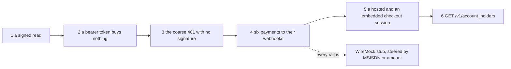

# Rust SDK

`vpay-sdk` (in `sdks/rust`) is the Rust merchant SDK for vpay's `/v1` API. It
implements the same wire contract as the [Node.js SDK](/sdks/nodejs) and is held
to putting **byte-identical** request bodies on the wire. Since <Release /> its
sealing code is also the Node SDK's: `sdks/rust/wasm` compiles it to
WebAssembly, so the two SDKs sign through one implementation. It is also the SDK
`just demo` runs: `examples/merchant-demo` uses it to walk six payments through
both rails to their signed webhooks.

Agents working on this SDK should load [vpay-sdks](skill:vpay-sdks); for the
`/v1` contract, [vpay-merchant-api](skill:vpay-merchant-api).

## Install

The crate is a workspace member and is **`publish = false`** — it is not on
crates.io. Depend on it by path from inside the vpay workspace:

```toml
[dependencies]
vpay-sdk = { path = "sdks/rust" }
```

```bash
cargo nextest run -p vpay-sdk    # or: just test-sdk-rust
```

Every request method is `async` and needs a `tokio` runtime. TLS is rustls with
Mozilla's **vendored** root bundle, never OpenSSL; the crate builds its own
rustls config and installs no process-wide crypto provider. One consequence: a
merchant behind a TLS-intercepting proxy with a private CA is not trusted, and
there is no setting for that.

## What the SDK does for you

It seals every request and opens every answer
([Signed requests](/api/signed-requests)). There are no access tokens:

1. **Seal.** cratestack's `ClientEnvelope` builds a COSE_Sign1 message whose
   payload is the form body and whose signature binds the audience, the method,
   the route template and its parameters, the canonical query, the operation's
   digest from the vendored contract table (`src/contracts.rs`), the payload
   type and the `Idempotency-Key`, with a fresh `cti`. Every `POST` and `DELETE`
   carries an `Idempotency-Key`, yours or a generated UUIDv4. No
   `Authorization` header is sent.
2. **Open.** The answer is verified under the pinned server keys
   `{current, next}` and against this request and status before any JSON is
   decoded. An answer that is not sealed is `Error::Unsigned`; one that does not
   verify is `Error::Unverified`.
3. **Never retry.** vpay spends a message's `cti` when it opens it, and the
   coarse `401` is the same for an unknown key, a bad signature, a wrong clock, a
   wrong audience and a replay, so a retry would only spend another. The SDK
   follows no redirect and reads at most 8 MiB of an answer.

The key is an Ed25519 seed, or an external signer for a key held in a KMS.
`build()` fails without credentials or without server keys; there is no trust
on first use. A deployment that also permits bearer tokens accepts them from
other callers ([Authentication](/api/authentication)); this SDK has no token
mode (planned as VPA-6, not built).

## Usage

From the crate README, trimmed to one create and confirm:

```rust
use std::collections::BTreeMap;
use std::time::Duration;

use vpay_sdk::payment_intents::{
    ConfirmPaymentIntentParams, CreatePaymentIntentParams, PaymentMethodType,
};
use vpay_sdk::{Client, Credentials, IntentStatus, NextAction, RequestOptions, ServerKeys};

// 32 bytes, unpadded base64url, as `cargo xtask gen-envelope-key` writes it.
let seed = std::fs::read_to_string("./merchant_a.seed")?;
// The two response keys vpay's operator publishes (vpay-server logs them at boot).
let server_keys = ServerKeys::from_base64url(CURRENT_PUB, NEXT_PUB)?;
let client = Client::builder("https://api.vpay.example")
    .credentials(Credentials::ed25519_seed_base64url("merchant_a", &seed)?)
    .server_keys(server_keys)
    .timeout(Duration::from_secs(30))
    .build()?;

let mut metadata = BTreeMap::new();
metadata.insert("order_id".to_string(), "1234".to_string());

let intent = client
    .payment_intents()
    .create(
        CreatePaymentIntentParams {
            amount: 5000,
            currency: "xaf".to_string(),
            payment_method_types: vec![PaymentMethodType::MtnMomo],
            metadata,
            description: Some("Order 1234".to_string()),
            customer: None,
        },
        RequestOptions::new().with_idempotency_key("order_1234_attempt_1"),
    )
    .await?;

let confirmed = client
    .payment_intents()
    .confirm(
        &intent.id,
        ConfirmPaymentIntentParams::mtn_momo("237670000000"),
        RequestOptions::new(),
    )
    .await?;

match confirmed.status {
    IntentStatus::Processing => {}
    IntentStatus::RequiresAction => {
        // Redirect rail (Orange Money): send the payer to the URL.
        if let Some(NextAction::RedirectToUrl { redirect_to_url }) = &confirmed.next_action {
            println!("redirect to {}", redirect_to_url.url);
        }
    }
    IntentStatus::RequiresPaymentMethod => {
        if let Some(err) = &confirmed.last_payment_error {
            println!("refused: {} — {}", err.code, err.message);
        }
    }
    IntentStatus::Succeeded | IntentStatus::Canceled => {}
}
```

Two things the types do for you. `ConfirmPaymentIntentParams` has one variant
per rail — `mtn_momo(msisdn)` and, since v0.9.0, `notchpay(msisdn)` for the
push rails, `orange_money(return_url)` for the redirect rail — so they cannot be
mixed up. And there is no `failed`
status: a rail refusal returns the intent to `RequiresPaymentMethod` with
`last_payment_error` set ([Payment lifecycle](/payments/lifecycle)).
`last_payment_error.code` is an open `String` on purpose, so a failure code
newer than your SDK still decodes.

`PaymentMethodType`, which a create's `payment_method_types` takes, gained two
**payment-method types** in v0.12.0: `MtnWallet` and `OrangeWallet`
(`mtn_wallet`, `orange_wallet` on the wire). A type names the payer's wallet
network and leaves the server's router to pick the rail at confirm
([Payment lifecycle](/payments/lifecycle#which-rail-a-confirm-reaches)); the
three rail codes still mean that rail, pinned, and one list may mix both. A
type needs a server with migration `0053`, and an older one refuses it as an
unknown rail. The enum is `#[non_exhaustive]`, so the new variants break no
caller. `ConfirmPaymentIntentParams` still has rail variants only, so this SDK
cannot confirm by type or pin a rail with
`payment_method_options[<type>][rail]`: a dated ⛔ in the matrix.

Since v0.14.0 `PaymentIntent::payment_method_details` is an
`Option<PaymentMethodDetails>`: `None` until the intent has a charge, then
`PaymentMethodDetails { method_type: Option<String>, rail: String }` (`type` on
the wire, `None` where the charge records none). It is `#[serde(default)]`, so
an older vpay that omits the key still decodes.

The client exposes `payment_intents()`, `checkout().sessions()`, `customers()`,
`invoices()`, `invoice_items()`, `refunds()`, `events()`, `balance()` and
`account_holders()`. As in Node, there is no `events().retrieve()`, and
`balance().retrieve()` is refused by the client itself: `GET /v1/balance` is
mounted nowhere, so there is no operation to sign for it.

### Two source-breaking changes since vpay 0.6.0

Both bite only code that builds a params struct with a literal naming every
field and no `..Default::default()`. `Default::default()`, field assignment and
the constructors are unaffected, and the bytes on the wire did not change for an
existing call.

- **`ListPaymentIntentsParams`, `ListCheckoutSessionsParams` and
  `ListRefundsParams` gained `customer: Option<String>`**, the
  [customer filter](/api/#filtering-a-list-by-customer). Add `customer: None`.
  A server older than 0.6.0 ignores the filter and returns the unfiltered list.
- **`PayInvoiceParams` gained `out_of_band: Option<OutOfBandParams>`**, to
  record a payment made outside vpay
  ([paid out of band](/api/invoices#paid-out-of-band)). The invoice model
  gained `paid_out_of_band` and `out_of_band_payment`.

## Errors

Two types, deliberately. `ConfigError` comes from building a client or reading a
key — nothing has reached the wire. `Error` is everything that happens on, or
instead of, the wire:

| Variant                     | When                                                                                                      |
| --------------------------- | --------------------------------------------------------------------------------------------------------- |
| `Error::Api`                | A non-2xx `/v1` envelope — `status`, `kind`, `code`, `message`, `param`                                   |
| `Error::Unsigned`           | The answer was not sealed: vpay's coarse `401` (one answer for every cause), a `426`, or a proxy's `502`  |
| `Error::Unverified`         | A sealed answer that did not verify under the pinned server keys                                          |
| `Error::Seal`               | The request could not be sealed (a KMS callback failed); nothing was sent                                 |
| `Error::UnexpectedResponse` | Not the envelope — a proxy's HTML 502, an undecodable success                                             |
| `Error::Transport`          | DNS, TLS, timeout, refused connection                                                                     |
| `Error::InvalidParams`      | An amount negative or past 2^53-1, or (since v0.9.1) a path `id` that is empty or only dots; nothing sent |
| `Error::Config`             | A `ConfigError` surfaced through a request path                                                           |
| `Error::Webhook`            | `webhooks::verify` rejected a delivery                                                                    |

The id refusal is a behaviour change in v0.9.1 with no signature change: every
method that puts an `id` in the path (`retrieve`, `update`, `del`, `confirm`,
`cancel`, `expire`, `finalize`, `void`, `mark_uncollectible`, `pay`) returns
`Error::InvalidParams { param: "id", .. }` for `""`, `.`, `..` or a longer run of
dots, without sending anything, with one fixed message that never quotes the id.
Those ids used to be sent, and the URL parser resolved them before the request
left, so `customers().del("..")` was a `DELETE /v1/`. A caller matching on
`Error::Api { status: 404, .. }` for those inputs now gets `InvalidParams`.

`Error::InvalidParams` carries `param` and `message`, and displays as
`invalid request parameter {param}: {message}`. Its twin in the
[Node.js SDK](/sdks/nodejs#errors) is `VpayInvalidParamsError`, which carries
the same `param` and writes the same prefix. The id refusal reads byte for byte
the same in both; the amount refusal keeps each SDK's own wording. The Node
refusals are `VpayError`s since v0.10.0, and were bare `TypeError`s before.

Branch on `code`, not on `kind`: `idempotency_key_in_flight` means wait and
resend the same call; `idempotency_key_in_use` means the key was reused with a
different body. See [Errors](/payments/errors).

## Webhook verification

```rust
use vpay_sdk::webhooks::{self, DEFAULT_TOLERANCE};

// The RAW request body must be used. A parsed-and-reserialised body breaks
// the HMAC — do not run a JSON body parser before this.
let event = webhooks::verify(raw_body, signature_header, secret, DEFAULT_TOLERANCE)?;

match event.kind.as_str() {
    "payment_intent.succeeded" => {
        let intent = event.payment_intent()?;
        println!("{} succeeded", intent.id);
    }
    _ => {}
}
```

It compares in constant time, accepts a second `v1=` during rotation, and holds
its header grammar byte for byte to the Node verifier's. It does not dedupe —
keep a unique index on processed event ids. See [Webhooks](/api/webhooks).

## The demo that drives it: `examples/merchant-demo`

`just demo` boots the compose stack and runs this program, which signs every
request with the SDK and exits `0` only if all six steps behave as expected.



Steps 2 and 3 hold because the demo stack permits no merchant token:
`just gen-demo-keys` writes `auth.methods: [keypair, hmac_webhooks, human_login]`
into its overlay (`human_login` is the staff sign-in, not a way into `/v1`). Against a deployment that leaves `auth.methods` out, and so also
accepts tokens, those two steps fail and say so.

| #   | Rail           | Outcome                           | Settles to                | `failure_code`       |
| --- | -------------- | --------------------------------- | ------------------------- | -------------------- |
| 1   | `mtn_momo`     | payer approves                    | `succeeded`               | —                    |
| 2   | `mtn_momo`     | no balance                        | `requires_payment_method` | `insufficient_funds` |
| 3   | `mtn_momo`     | prompt expires                    | `requires_payment_method` | `payer_timeout`      |
| 4   | `orange_money` | payer completes the page          | `succeeded`               | —                    |
| 5   | `orange_money` | page expires                      | `requires_payment_method` | `payer_timeout`      |
| 6   | `orange_money` | rail refuses, undocumented reason | `requires_payment_method` | `provider_error`     |

Nothing in the program tells vpay what should happen: each outcome is selected
at the WireMock stub by a field a merchant genuinely controls (the MSISDN on
MTN, the amount on Orange). It is a real run of real code against stub rails —
no money moves. [Demo runbook](/operate/runbooks#demo).

## What its tests talk to

- **Most of the crate's tests run against `wiremock`** — a real local HTTP
  server, so the SDK's transport and encoding run unchanged, but a stub answers.
- **The signature is checked against the real layer.** `tests/signing.rs`
  drives the SDK against cratestack's real `EnvelopeLayer` (11 cases): an
  unknown key, a replay, a wrong pinned key and a wrong audience are each
  refused, and a refused call is never retried. A workspace test fails if the
  vendored operation table drifts from `vpay-wire`'s.
- **Against a real router and Postgres:** `signed_transport.rs`,
  `payment_intents.rs`, `webhooks.rs` and `refunds.rs` in
  `backends/tests/integration`. Against the compose stack:
  `tests/live_invoices.rs` and `tests/live_refunds.rs`, behind the `live-stack`
  feature and run by `just sdk-live`, which fail rather than skip without a
  stack; they were not run where the sealing change was written, and CI's `e2e`
  job is their evidence. Rails are WireMock throughout.
- **Not proven: TLS.** Nothing in the repository serves TLS, so certificate
  verification against the vendored roots is exercised by no test.

## Status in this release

| Part                                          | Status                   | Evidence                                                                                          |
| --------------------------------------------- | ------------------------ | ------------------------------------------------------------------------------------------------- |
| Sealing and opening                           | <Status s="built" />     | `tests/signing.rs` against the real layer (13 cases); the "Signing" rows of the matrix            |
| A bearer-token mode                           | <Status s="not-built" /> | Deleted with the signed transport; VPA-6                                                          |
| `/v1` resource methods                        | <Status s="built" />     | Every method's wire shape pinned; byte-identical to Node                                          |
| Empty or all-dots path `id` refused           | <Status s="built" />     | Since v0.9.1, on all twenty-one id-taking methods, before any request; four ✅ rows in the matrix |
| `MtnWallet` and `OrangeWallet` on a create    | <Status s="built" />     | Since v0.12.0; a ✅ row, the same body byte for byte as Node's                                    |
| `payment_method_details` on a `PaymentIntent` | <Status s="built" />     | Since v0.14.0; a ✅ row: both shapes, and a server that omits the key                             |
| Confirm by payment-method type, or pinned     | <Status s="not-built" /> | A dated ⛔ row: `ConfirmPaymentIntentParams` has rail variants only                               |
| Refunds and invoices against a running vpay   | <Status s="partial" />   | Live suites against WireMock rails; no refund ever settles                                        |
| A timeout test, a retry policy                | <Status s="not-built" /> | Dated ⛔ rows                                                                                     |
| An `async-stripe` sealing transport           | <Status s="not-built" /> | Dated ⛔: the thing that signs must own the transport, and `async-stripe` has no seam for it      |
| TLS verification                              | <Status s="unproven" />  | No test serves TLS                                                                                |
| Published crate                               | <Status s="not-built" /> | `publish = false`                                                                                 |

The full record is the Rust column of
[docs/sdks/parity.md](vpay:docs/sdks/parity.md) and the crate's own
[README](vpay:sdks/rust/README.md).

## Go deeper

- [sdks/rust/README.md](vpay:sdks/rust/README.md) — the whole API, the parity
  table between languages, the mutation list
- [examples/merchant-demo/README.md](vpay:examples/merchant-demo/README.md) —
  the six steps and the outcome table
- [sdks/rust/examples/create_and_confirm.rs](vpay:sdks/rust/examples/create_and_confirm.rs)
- [SDK overview](/sdks/) and [Node.js SDK](/sdks/nodejs)
- Skills: [vpay-sdks](skill:vpay-sdks),
  [vpay-merchant-api](skill:vpay-merchant-api)
